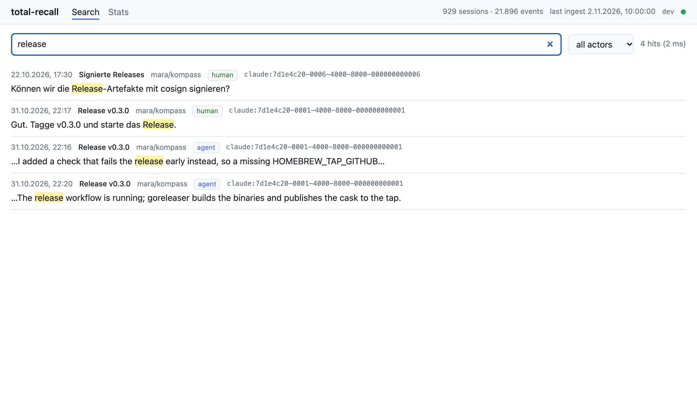
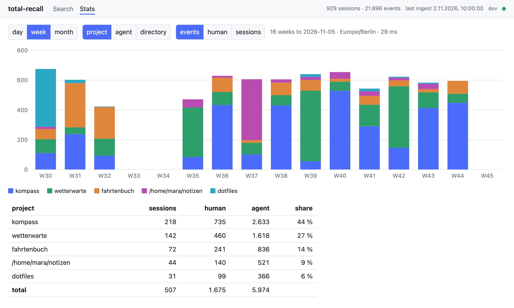
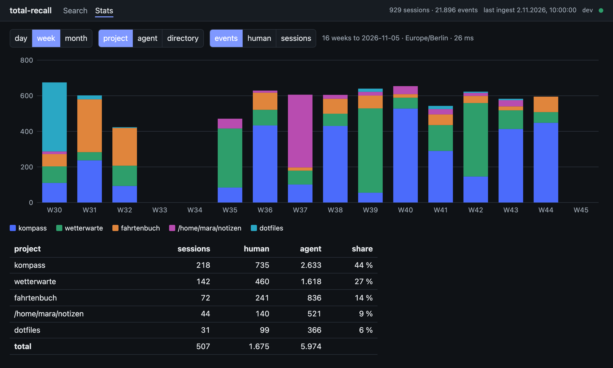

# Spike: Web-UI mit Svelte

Spike zum Epic [#170](https://github.com/seletz/total-recall/issues/170) (Sub-Issue [#171](https://github.com/seletz/total-recall/issues/171)): Lässt sich zusätzlich zur TUI eine Web-Oberfläche mit Svelte bauen, die im statischen Go-Binary mitkommt und nur lokal läuft? Stand der Untersuchung: 5. November 2026. Die Entscheidung, ob es weitergeht, ist offen; der Prototyp ist deshalb ein eigenes Unterkommando `total-recall serve`, das sich wieder entfernen lässt ([Entfernungsanleitung](#entfernungsanleitung)).

Kurzfassung: **Es geht, und es ist klein.** Die eingebettete UI kostet 66 KiB im Binary, der Go-HTTP-Stack 3,9 MiB. Node wird nur beim Bauen gebraucht, `go build` ohne gebaute UI funktioniert weiter (Platzhalterseite), Build, CI und goreleaser laufen mit vier zusätzlichen Zeilen. Die offenen Punkte sind nicht technisch, sondern Umfang und Pflege: eine zweite Oberfläche neben der TUI, eine zweite Toolchain mit 87 npm-Paketen und die Frage, was die Web-UI besser kann als die TUI. Empfehlung: [weiterverfolgen, abgespeckt](#empfehlung).

## Fragen

Aus dem Issue, mit Verweis auf die Antwort:

1. **Einbettung:** Svelte oder SvelteKit, `go:embed`, SPA-Routing, Größe im Binary → [Architektur](#architektur), [Optionen](#optionen-svelte-oder-sveltekit), [Messwerte](#messwerte).
2. **Build:** Node nur beim Bauen, `mise`, CI, goreleaser, `go build` ohne UI → [Build, CI und Release](#build-ci-und-release).
3. **API:** JSON über die Store-Funktionen und den Ausgabevertrag der CLI, Live-Aktualisierung (SSE, `store.Poll`) → [API](#api), [Live-Aktualisierung](#live-aktualisierung).
4. **Sicherheit:** nur `127.0.0.1`, Host-/Origin-Prüfung, Token, keine externen Assets → [Sicherheit](#sicherheit).
5. **Lieferkette:** npm-Abhängigkeiten pinnen, SBOM, Prüfung in der CI → [Lieferkette](#lieferkette-und-sbom).
6. **Tests und Screenshots** gegen das Demo-Archiv → [Tests](#tests), [Screenshots](#screenshots).
7. **Aufwand und Nutzen**, Empfehlung → [Aufwand](#aufwandsschaetzung), [Empfehlung](#empfehlung).

Dazugekommen nach der ersten Durchsicht: **Gestaltung.** Wie die Web-UI hübsch und stylbar wird und wie Vorschläge dafür entstehen → [Gestaltung](#gestaltung).

## Festgelegt

Vorgaben aus dem Epic, hier nicht neu verhandelt:

- Ein statisches Binary (`CGO_ENABLED=0`), die UI per `go:embed`, zur Laufzeit kein Node.
- Nur lokal: Bindung an `127.0.0.1`, Schutz gegen fremde Webseiten (Origin-/Host-Prüfung, Token).
- Lesen über dieselben Store-Funktionen wie CLI und TUI. Der Prototyp schreibt nicht.
- Build, Release und SBOM bleiben reproduzierbar; die JavaScript-Abhängigkeiten sind gepinnt.
- Die TUI bleibt.

## Vorbild

Vor dem Prototyp wurde ein bestehendes Projekt mit eingebetteter Svelte-UI angesehen (Go-Service, SvelteKit-SPA, ein Binary, Apache-2.0). Übernommen wurde die Technik, kein Code:

- **Zwei Verzeichnisse, ein Binary.** Die UI liegt in einem eigenen Verzeichnis mit eigenem `package.json`; der Build schreibt in ein `dist/`-Verzeichnis unterhalb des Go-Pakets, das es mit `//go:embed all:dist` einbettet. `dist/` ist im Git ignoriert bis auf eine `.gitkeep`, damit `go build` ohne UI-Build nicht an einem fehlenden Verzeichnis scheitert.
- **SPA-Routing serverseitig.** Der Go-Handler liefert existierende Dateien, alles andere mit `index.html`; Pfade unter `/api/` fallen nie auf die Seite zurück. Gehashte Assets bekommen `Cache-Control: immutable`, die Seite selbst `no-cache`.
- **Origin-Prüfung** für schreibende API-Aufrufe gegen `r.Host`, Requests ohne `Origin` (Nicht-Browser) passieren.
- **Dev-Modus:** der Vite-Dev-Server proxyt `/api` zum laufenden Go-Server, mit `changeOrigin: false`, damit die Host-Prüfung den Browser-Host sieht.
- **Release:** die SPA wird einmal gebaut, dann cross-kompiliert Go je Plattform; das Dockerfile baut mehrstufig (Bun, dann Go, dann distroless).
- **CI:** die Gates eines `mise run check` werden als Matrix je Task ausgeführt; End-to-End-Tests laufen mit Playwright gegen das fertige Binary; die Screenshots der Doku entstehen mit Playwright gegen einen Demo-Modus und werden eingecheckt.
- **Lockfile und Pins:** Bun mit `--frozen-lockfile`, Versionen der Werkzeuge in `mise.toml`, Updates per Renovate gebündelt.
- **Nicht vorhanden:** eine SBOM der npm-Abhängigkeiten und ein SSE-Kanal. Beides musste hier eigens gelöst werden.

## Architektur

```
web/                          Svelte 5 + Vite + TypeScript, npm, package-lock.json
web/src/App.svelte            Shell: Navigation, Status, Live-Indikator, Token
web/src/views/Search.svelte   Suche: Eingabe, Debounce, Trefferliste mit Hervorhebung
web/src/views/Stats.svelte    Statistik: Periode × Dimension, gestapelte Balken (SVG), Tabelle
web/src/lib/api.ts            fetch-Wrapper, Token aus dem URL-Fragment, Typen der JSON-Antworten
web/src/lib/sse.ts            Live-Kanal: fetch-Stream statt EventSource (Bearer-Header), Reconnect
web/src/lib/snippet.ts        Treffer-Hervorhebung ohne HTML (Private-Use-Zeichen → <mark>)
web/src/lib/chart.ts          Layout der Balken als reine Funktion (getestet)
internal/web/web.go           go:embed all:dist, Dist(), Built()
internal/web/server.go        Guards (Host, Origin, Sec-Fetch-Site, Token, CSP), API-Routen, SSE, SPA-Handler, Platzhalter
internal/cli/serve.go         Unterkommando serve: Store read-only, Token, Listener 127.0.0.1, Handler-Closures
```

Berührt wird bestehender Code an vier Stellen: `internal/cli/root.go` hängt den Befehl ein und bekommt ein `App.Context` für den Testlauf, `internal/cli/read.go` zieht die Umwandlung der Suchtreffer in `hitsJSON` heraus (die Web-API nutzt sie mit), `mise.toml`, `.goreleaser.yml` und die Workflows bekommen den UI-Build. `go.mod` ändert sich nicht: der Server ist `net/http` aus der Standardbibliothek.

Datenfluss:

```
Browser ──GET /────────────► internal/web  index.html (eingebettet)
Browser ──GET /api/search──► Guards ──► Closure in internal/cli ──► store.Search ──► hitsJSON ──► JSON
Browser ──GET /api/events──► Guards ──► SSE-Stream ◄── Poller (store.Poll alle 2 s) ──► "change"
```

Das Paket `internal/web` kennt den Store nicht. Die CLI reicht ihm drei Funktionen (`Search`, `Activity`, `Status`), die mit **denselben JSON-Structs** antworten wie `search --json`, `stats --period --by --json` und `status`. Damit liest die UI den Vertrag, den die CLI ohnehin veröffentlicht, und `internal/web` bleibt ohne Abhängigkeit nach `internal/cli` (die Abhängigkeit läuft andersherum). Der Preis: die Handler-Signaturen geben `any` zurück. Sauberer wäre, die JSON-Typen aus `internal/cli` in ein eigenes Paket zu heben; das ist ein [Folge-Issue](#vorschlag-sub-issues-des-epics), kein Hindernis.

### Aufruf

```sh
total-recall serve                      # http://127.0.0.1:8787/#token=<zufällig>
total-recall serve --port 0 --open      # freier Port, Browser öffnen
total-recall serve --token dev          # festes Token (Entwicklung mit dem Vite-Dev-Server)
total-recall serve --poll 5s            # Archiv seltener auf Änderungen prüfen
```

Die Seite liest das Token aus dem Fragment der Start-URL, legt es im `sessionStorage` des Tabs ab, entfernt es aus der Adresse und schickt es bei jedem API-Aufruf als `Authorization: Bearer`. Routing nach Pfad (`/`, `/stats`), der Server beantwortet jeden unbekannten Pfad mit `index.html`.

### API

| Route | Antwort | Entspricht |
|---|---|---|
| `GET /api/status` | Version, Sessions, Events, Quellen, letzter Ingest je Harness, Schema, Zeitzone | `status` (Auszug) |
| `GET /api/search?q=&actor=&raw=1&limit=&since=&until=` | `[HitJSON]` | `search --json` |
| `GET /api/activity?period=&by=&top=&since=&until=` | `ActivitySeriesJSON` | `stats --period --by --top --json` |
| `GET /api/events` | `text/event-stream`, ein Event `change` je Änderung | `tui --reload` |

Fehler kommen als `{"error":{"kind","message"}}` wie `ErrorJSON` der CLI; Parameterfehler mit 400, Host/Origin mit 403, Token mit 401. Datumsangaben ohne Uhrzeit werden in der konfigurierten Zeitzone gelesen wie `--since` der CLI. Ohne `since`/`until` nimmt die Statistik 28 Tage, 16 Wochen oder 12 Monate bis heute.

Snippets tragen die Treffer zwischen zwei Private-Use-Zeichen (U+E000, U+E001) statt `[`/`]`: die UI teilt den Text daran und rendert Textknoten und `<mark>`-Elemente, nie HTML. Der Inhalt der Sessions kommt so nie als Markup in die Seite.

### Live-Aktualisierung

Ein Poller im Server ruft `store.Poll` im Intervall `--poll` (Default 2 s); `Modified` wird als Event an alle offenen Streams verteilt, `Replaced` (Wartung hat die Datei ersetzt) löst `store.Reopen` aus und meldet dann. Die UI zählt bei jedem Event eine Generation hoch, Suche und Statistik laden ihre Ansicht neu, der Punkt in der Kopfzeile zeigt den Verbindungszustand; bricht der Stream ab, verbindet sie mit wachsender Pause neu. Geprüft mit einem echten Commit auf das Demo-Archiv (`sqlite3`, Insert und Delete in einer Transaktion): das Event kommt innerhalb eines Poll-Intervalls.

`EventSource` kann keinen `Authorization`-Header schicken; das Token in der URL wollte ich nicht (steht in Logs und Verlauf). Der Stream wird deshalb mit `fetch` gelesen und die Frames von Hand getrennt (`parseEvents`, getestet). `Poll` ist für einen Aufrufer gedacht, deshalb gibt es genau einen Poller, nicht einen je Stream.

## Sicherheit

Das Archiv enthält private Inhalte; die Guards sitzen vor jeder Route (`internal/web/server.go`, `guard`):

| Maßnahme | Wie | Schützt vor |
|---|---|---|
| Bindung an `127.0.0.1` | `net.Listen("tcp", "127.0.0.1:port")`, nicht konfigurierbar | Zugriff aus dem Netz |
| Host-Prüfung | `Host` muss `localhost`, `127.0.0.1` oder `::1` sein (Port egal), sonst 403 | DNS-Rebinding: eine fremde Seite lässt `evil.example.com` auf 127.0.0.1 zeigen |
| Origin-Prüfung | ein vorhandener `Origin` muss ein Loopback-Host sein, sonst 403; `null` und fehlend passieren | Aufrufe aus fremden Seiten (CSRF) |
| Fetch-Metadata | `Sec-Fetch-Site`, falls gesendet, muss `same-origin` oder `none` sein | Cross-Site-Requests moderner Browser, auch ohne Origin |
| Token | 128 Bit Zufall je Lauf, `Authorization: Bearer`, konstantzeitiger Vergleich, Pflicht unter `/api/`, sonst 401 | andere lokale Prozesse und Seiten, die die Guards oben passieren |
| CSP | `default-src 'none'; script-src 'self'; style-src 'self'; connect-src 'self'; img-src 'self' data:; …; frame-ancestors 'none'` | externe Assets, Inline-Skripte, Einbettung in fremde Seiten |
| Weitere Header | `X-Content-Type-Options: nosniff`, `Referrer-Policy: no-referrer`, `X-Frame-Options: DENY`, `Cache-Control: no-store` unter `/api/` | MIME-Sniffing, Referrer-Leck, Caching der Daten |
| Keine Daten an Dritte | kein Font, kein CDN, kein Telemetrie-Skript; die CSP würde es blocken | |

Alles in Tabellen getestet (`TestGuard`, `TestLoopback`). Nicht umgesetzt: das Token steht beim Start einmal auf stdout und im URL-Fragment, also im Terminal-Scrollback und bis zum ersten Laden in der Adresszeile; nach dem Laden entfernt es die Seite aus der Adresse. Ein neues Token je Lauf begrenzt das. Mit `--token` kann man es fest setzen; das ist bewusst für die Entwicklung und steht so in der Hilfe.

Die statischen Dateien (Seite, JS, CSS) sind ohne Token abrufbar: sie sind Programmcode, keine Daten. Wer das anders will, kann die Guards auf alles ausdehnen; dann muss das Token aber vor dem ersten Laden bekannt sein (Cookie beim Erstaufruf), was ein Folgeschritt wäre.

## Build, CI und Release

| Frage | Antwort |
|---|---|
| Node zur Laufzeit? | Nein. `npm run build` schreibt `internal/web/dist/`, Go bettet es ein. |
| `go build` ohne gebaute UI? | Funktioniert: `dist/.gitkeep` ist eingecheckt, `go:embed all:dist` findet das Verzeichnis. `serve` liefert dann eine Platzhalterseite (503) mit dem Hinweis auf `mise run web:build`; die API funktioniert trotzdem. Kein Build-Tag nötig, also keine zweite Build-Variante, die Tests und CI abdecken müssten. |
| `mise` | `web:install` (`npm ci`), `web:build`, `web:check` (svelte-check, vitest), `web:dev` (Vite mit Proxy auf `serve`), `serve:demo` (UI gegen das Demo-Archiv, Token `demo`). `build` bleibt wie es ist; `mise run web:build && mise run build` ergibt das Binary mit UI. |
| CI | Job `test`: `actions/setup-node` (Node 26, npm-Cache über `web/package-lock.json`), dann `npm ci`, `check`, `test`, `build`, danach wie bisher `go test` mit eingebetteter UI. Job `release-snapshot` und `release.yml`: `setup-node`, weil die goreleaser-Hooks die UI bauen. |
| goreleaser | Zwei `before.hooks`: `npm ci --prefix web`, `npm run build --prefix web`. Die UI wird einmal gebaut, alle vier Binaries betten dieselben Dateien ein. `mise run sbom:check` (Snapshot-Release aller vier Plattformen samt SBOM-Prüfung) läuft durch, 28 s. |
| `CGO_ENABLED=0` | Unverändert: `net/http`, `embed`, `crypto/rand` sind reines Go. |
| Dev-Modus | `total-recall serve --token dev` plus `mise run web:dev`, dann `http://127.0.0.1:5173/#token=dev`. Vite proxyt `/api` mit `changeOrigin: false`; die Host-Prüfung sieht `127.0.0.1:5173`, die Origin-Prüfung `http://127.0.0.1:5173`, beides Loopback. |

Node ist in `mise.toml` als `node = "26"` gepinnt (Major), die Pakete exakt in `web/package.json` (`save-exact=true` in `.npmrc`) und vollständig in `web/package-lock.json`; `npm ci` installiert nichts anderes.

## Lieferkette und SBOM

- **Pins:** 7 direkte devDependencies (Svelte 5.57.3, Vite 8.3.6, vite-plugin-svelte 7.3.1, svelte-check 4.7.8, TypeScript 6.0.3, vitest 5.1.0, @tsconfig/svelte 5.0.8), keine Laufzeit-Abhängigkeit außer der Svelte-Runtime, die der Build einbettet. Das Lockfile zählt 87 Pakete, `node_modules` 73 MiB.
- **`npm audit`:** zwei Low-Findings in `deepmerge` (über vite-plugin-svelte), ohne Fix; betrifft nur den Build, nichts davon landet im Binary.
- **SBOM:** `cyclonedx-gomod bin` sieht die npm-Pakete nicht, sie sind keine Go-Module. Probe mit `@cyclonedx/cyclonedx-npm` (6.0.1, `--package-lock-only`): CycloneDX 1.6, 85 Komponenten (58 required, 27 optional), 116 KiB. Die Leitplanke des Epics („die JavaScript-Abhängigkeiten tauchen in der SBOM auf“) ist damit **machbar, aber im Prototyp nicht verdrahtet**. Zwei Wege: eine zweite SBOM je Release (`total-recall-<tag>-web.cdx.json`, plattformunabhängig, einmal) oder Einmischen in die Go-SBOMs als Komponenten mit `purl pkg:npm/…`. Die zweite SBOM ist einfacher und ehrlicher: sie beschreibt die Build-Kette, nicht das Binary (im Binary steckt nur der Svelte-Runtime-Anteil des Bundles). `tools/sbom check` müsste sie kennen. Eigenes Sub-Issue.
- **Prüfung in der CI:** `npm ci` scheitert, wenn Lockfile und `package.json` auseinanderlaufen. Ein `npm audit --audit-level=high` als Gate ist eine Zeile, fehlt aber noch, weil die beiden Low-Findings ohne Fix sonst jeden Lauf rot färben würden, wenn der Level zu tief gesetzt wird.

## Tests

| Ebene | Technik | Was |
|---|---|---|
| `internal/web` | `httptest` gegen Fake-Handler und `fstest.MapFS`, Tabellen | Loopback-Erkennung, jede Guard-Regel, Parameter der Routen, 400/401/403/404/405, SPA-Fallback und Cache-Header, Platzhalter ohne Build, SSE-Frames bei `Modified`/`Replaced` mit `Reopen`, Start und Stop über den Kontext |
| `internal/cli` | `serve` in-process mit `App.Context`, gegen die kleine Fixture | `--help`, ungültige Flags, fehlendes Archiv, die drei Routen mit Token, 401 ohne, Stop über den Kontext; Fensterberechnung der Statistik |
| `web/` | vitest, reine Module | SSE-Parser, Snippet-Teilung (auch `<script>` bleibt Text), Chart-Layout (Stapel, leere Perioden, Ticks, Metriken) |
| `web/` | svelte-check | Typen in `.svelte` und `.ts`, a11y-Warnungen |

Nicht vorhanden: ein Browser-Test (Playwright) gegen das Binary. Für zwei Ansichten reicht die Kombination aus Go-Tests der API und Unit-Tests der reinen Module; wächst die UI, ist ein Playwright-Lauf gegen `serve:demo` der nächste Schritt (das Vorbild macht es so).

## Screenshots

Die Bilder zeigen den Prototyp gegen das Demo-Archiv (`mise run demo:db`, erfundene Entwicklerin, erfundene Projekte), aufgenommen mit Playwright/Chromium bei 1200×720 Punkten, Zeitzone Europe/Berlin. Sie sind von Hand aufgenommen und nicht Teil von `docs:screenshots:check`; diese Prüfung vergleicht `docs/assets/screenshots/` als Ganzes, deshalb liegen die Web-Bilder in `docs/assets/webui/`. Reproduzierbar machen ließe sich das wie beim Vorbild mit einem Playwright-Skript gegen `mise run serve:demo`; dann wäre aber Chromium ein Build-Werkzeug der Doku.



*Suche nach „release“ im Demo-Archiv: Treffer mit Zeit, Session-Name, Repo, Actor und Snippet; die Suche läuft 150 ms nach dem letzten Tastendruck.*



*Statistik: 16 Wochen × Projekt, Kennzahl Events; Legende, Tabelle mit Anteil. Dieselben Zahlen wie `stats --period week --by project --top 6`.*



*Dasselbe mit `prefers-color-scheme: dark`; die Farben kommen aus CSS-Variablen, Chart und Legende teilen eine Palette.*

## Messwerte

Alle Messungen auf darwin/arm64, Go 1.27.3, `CGO_ENABLED=0`, `-s -w`, gegen das Demo-Archiv (929 Sessions, 21.896 Events, 10 MiB). Nur Zahlen, keine Inhalte.

**Binärgröße**

| Build | Größe | Differenz |
|---|---|---|
| `develop` ohne `serve` | 17,78 MiB | |
| mit `serve`, UI nicht gebaut (Platzhalter) | 21,71 MiB | +3,93 MiB: `net/http` samt TLS, HTTP/2, MIME |
| mit `serve` und eingebetteter UI | 21,77 MiB | +66 KiB für die UI |

Die Oberfläche selbst ist der kleinste Posten. Den Preis macht der HTTP-Stack der Standardbibliothek; er fällt einmal an und wächst mit weiteren Ansichten nicht.

**UI-Build** (Vite, Production): `index.html` 0,5 KiB, JS 53,5 KiB (20,8 KiB gzip), CSS 3,5 KiB, Favicon 0,3 KiB. 116 Module transformiert, Build 150 bis 250 ms. Keine Laufzeit-Abhängigkeit außer Svelte.

**Server**

| Messung | Wert |
|---|---|
| Prozessstart bis `/api/status` antwortet | 42 ms |
| `/api/search?q=test&limit=100` (100 Treffer, Demo) | 17 ms |
| `/api/search?q=release` (4 Treffer) | 2 bis 4 ms |
| `/api/activity?period=day&by=project&top=6` (28 Tage) | 9 ms |
| `/api/activity?period=week&by=project&top=6` (16 Wochen) | 26 bis 41 ms |
| Änderung im Archiv bis Event im Stream | ≤ Poll-Intervall (2 s), gemessen ~1 s |

Gegen ein echtes Archiv (180.000 Events) gelten die Zahlen des [TUI-Spikes](spike-tui.md#messwerte): Suche 100 bis 350 ms, `ActivitySeries` 0,3 bis 0,45 s. Die Web-UI ruft dieselben Funktionen; der HTTP-Overhead ist lokal unter einer Millisekunde.

**Toolchain:** 87 npm-Pakete im Lockfile, 73 MiB `node_modules`, `npm ci` etwa 5 s, `svelte-check` 179 Dateien in 2 s, vitest 13 Tests in 0,2 s. Snapshot-Release mit UI-Build und vier SBOMs: 28 s.

## Optionen: Svelte oder SvelteKit

| | Svelte 5 + Vite (Prototyp) | SvelteKit 3 + `adapter-static` (Vorbild) |
|---|---|---|
| Routing | von Hand (`history.pushState`, ein `switch`), serverseitig `index.html`-Fallback | Dateirouten `src/routes/**/+page.svelte`, `fallback: 'index.html'`, `ssr = false` |
| Daten laden | `fetch` in der Komponente | `+page.ts`-`load` ohne SSR, dasselbe `fetch`, aber mit Konventionen für Fehler und Redirects |
| Generiertes | nichts | `.svelte-kit/` (Typen, Manifest), `svelte-kit sync` vor `check` |
| Abhängigkeiten | 7 direkt, 87 im Lockfile | zusätzlich `@sveltejs/kit` (17 eigene Abhängigkeiten) und `adapter-static`; grob +30 bis 60 Pakete (nicht gemessen) |
| Bundle | 54 KiB JS | größer durch Router und Client-Runtime von Kit; beim Vorbild einige hundert KiB mit vielen Seiten |
| Wann richtig | 2 bis 5 Ansichten, eine Seite, keine Unterseiten mit Parametern | ab etwa 5 Ansichten mit Parametern (`/session/[id]`), Layouts, Fehlerseiten, Preloading |

Für den Spike war Svelte ohne Kit die richtige Wahl: weniger Teile, nichts Generiertes, der Router ist zehn Zeilen. Kommt die Web-UI mit Sessions-Detail (`/session/<id>`), Aktivität und Config, lohnt Kit; der Umstieg ist mechanisch (Komponenten bleiben, Routing und `fetch` wandern in Routen und `load`), solange die Komponenten keine eigene Router-Logik ansammeln. Entscheidung: **Svelte ohne Kit, solange es unter fünf Ansichten sind; Umstieg als eigenes Issue, sobald die Session-Detailseite kommt.**

Paketmanager: npm statt Bun, weil `package-lock.json` von jedem SBOM-Werkzeug und von `actions/setup-node` direkt gelesen wird und Node ohnehin da ist; Bun wäre schneller (Vorbild), bringt aber ein zweites Binary in die Toolchain.

## Risiken

| Risiko | Folge | Umgang |
|---|---|---|
| Zweite Oberfläche neben der TUI | jede Funktion zweimal, Doku zweimal, Screenshots zweimal | Umfang klein halten (siehe Empfehlung); Daten und Vertrag teilen (JSON-Typen der CLI), nur die Darstellung ist doppelt |
| Zweite Toolchain (Node, npm, 87 Pakete) | Updates, Audits, Breaking Changes von Vite/Svelte-Majors | Pins, Renovate-Gruppe „JavaScript“, `npm audit` als CI-Gate mit Level `high` |
| Token im Terminal und in der Start-URL | lesbar im Scrollback und Verlauf bis zum ersten Laden | neues Token je Lauf; die Seite entfernt es aus der Adresse; `--open` statt Kopieren |
| Alle lokalen Prozesse erreichen `127.0.0.1` | ein lokaler Angreifer könnte den Port scannen | ohne Token keine Daten; Konstantzeit-Vergleich; kein Rate-Limit (lokal verzichtbar) |
| Browser-Verhalten ändert sich (Fetch-Metadata, CSP) | Guards zu streng oder zu lax | Prüfungen sind additiv und einzeln getestet; `Sec-Fetch-Site` nur geprüft, wenn gesendet |
| `net/http` + 3,9 MiB | größeres Release für alle, auch wer `serve` nie nutzt | akzeptieren oder Build-Tag `noweb`; Tag nur, wenn die Größe stört |
| Screenshots von Hand | veralten unbemerkt | Playwright-Skript gegen `serve:demo` (Sub-Issue), oder in der Doku als „Stand vom …“ markieren |
| `Poll` für einen Aufrufer | TUI und `serve` dürfen nicht denselben Store teilen | sie tun es nicht (eigener Prozess); im Server gibt es genau einen Poller |

## Sackgassen

Was ausprobiert wurde und nicht trägt:

- **`EventSource` für SSE.** Kein `Authorization`-Header möglich; das Token müsste in die URL. Verworfen zugunsten eines `fetch`-Streams mit eigenem Frame-Parser (30 Zeilen, getestet).
- **Snippets mit `[`/`]` wie die CLI.** Die Zeichen kommen in Texten vor (Markdown-Links, Arrays); die UI könnte Treffer nicht sicher von Text unterscheiden. Private-Use-Zeichen als Marker, die Hervorhebung wird aus Textknoten gebaut, nie aus HTML.
- **`emptyOutDir` von Vite** löscht die eingecheckte `dist/.gitkeep`; `go build` scheitert dann nach einem UI-Build im frischen Checkout nicht, wohl aber nach `git clean`. Der Build-Task legt sie nach dem Build wieder an (wie das Vorbild).
- **`vite.config.ts` mit `process.env`** fällt bei `svelte-check` durch (keine Node-Typen). `loadEnv` von Vite liest die Umgebung ohne `@types/node`.
- **Web-Screenshots unter `docs/assets/screenshots/`** machen `docs:screenshots:check` rot (`diff -r` über das Verzeichnis). Eigenes Verzeichnis `docs/assets/webui/`.
- **JSON-Typen der CLI direkt im Web-Paket.** `internal/web` dürfte `internal/cli` nicht importieren (Zyklus). Statt die Typen zu verschieben, reicht die CLI Closures hinein; das Verschieben bleibt ein Folgeschritt.

## Gestaltung

Der Prototyp ist bewusst schlicht: Systemschrift, ein Akzent, eine Palette. Soll die Web-UI bleiben, dann soll sie **hübsch** sein und **stylbar**, also mit einem Aussehen, das sich ohne Codeänderung umstellen lässt. Das Vorbild zeigt, woran das hängt; nicht an einer Bibliothek, sondern an drei Gewohnheiten:

1. **Tokens mit Rollen, an einer Stelle.** Jede Farbe, jeder Radius, jeder Schatten, jede Schrift ist eine benannte CSS-Variable in einer Datei; Komponenten verwenden nur die Namen, nie Hex-Werte. Ein Dokument sagt, wofür jedes Token *ist* (Seitengrund, Fläche, erhöhte Fläche, Rand, Text, gedämpfter Text, Primär, Akzent, Fehler, Erfolg) und welche Fallen dahinterstecken. Dunkles Design definiert dieselben Namen neu. `web/src/app.css` hat davon eine kleine Fassung; der Schritt ist, die Rollen sauber zu benennen und die Regeln aufzuschreiben, damit jede spätere Ansicht das Aussehen erbt, statt sich eines auszudenken.
2. **Eine typografische Stimme.** Das Vorbild paart eine Display-Serife mit einer ruhigen Sans, beide selbst gehostet über fontsource-Pakete; nichts kommt aus dem Netz. Das geht auch unter unserer CSP (`font-src 'self'`): die Schriften werden Dateien im Binary. Für ein Archiv von Coding-Sessions passt eher das Gegenteil einer Rezepte-App: eine ruhige Sans für die Oberfläche, eine gute Monospace für Session-IDs, Snippets und Code, Tabellenziffern in jeder Tabelle. Zwei variable Schriften kosten etwa 300 KiB im Binary, neben dem HTTP-Stack unerheblich.
3. **Regeln, die aus Fehlern kamen.** Die Liste des Vorbilds ist konkret: eine Aktion ist nie nackter Text, ein Knopf bricht nie um, ein Titel bricht um und wird nie abgeschnitten, Trennlinien stehen zwischen Zeilen und nie nach der letzten, Hover tönt mit der eigenen Farbe des Elements, `prefers-reduced-motion` schaltet jede Bewegung ab, 44 px Ziele auf dem Telefon. Das meiste kostet nichts, wenn man es von Anfang an macht, und ist das, was eine Oberfläche fertig wirken lässt.

### Was für total-recall gilt

- **Identität:** ruhig und datendicht. Neutrale Grautöne, ein Akzent für Fokus und Links, und als einzige weitere Farben die Projektfarben aus `project.Palette` der Konfiguration, damit Chart, Legende, Aktivitätsbalken und ein Projekt-Chip in der Trefferliste dasselbe sagen wie TUI und `total-recall chart`.
- **Suche:** Treffer als Karten mit klarer Hierarchie: Session-Name zuerst, Zeit und Repo gedämpft, Actor als kleiner farbiger Chip, Snippet in der Monospace mit weicher Markierungsfarbe; Pfeiltasten und ++enter++ wie in der TUI.
- **Statistik:** Hover-Tooltips an den Balken, Haarlinien-Raster, Periodenlabels, die sich auf schmalen Bildschirmen ausdünnen, Tabelle mit Tabellenziffern und fixiertem Kopf.
- **Aktivität:** eine Zeile je Tag, Kernzeit als blasses Band, Wochenende und Feiertage schattiert, Projekt-Slots als runde Balken, heute markiert.
- **Zustände:** Leerzustand mit einem Satz, Skelett erst nach 300 ms, Fehlerbanner, das die Ursache nennt, Live-Punkt mit Erklärung beim Hover.

### Stylbar

Zwei Ebenen, beide ohne Build:

- **Themes als Token-Sätze.** Ein Theme ist eine CSS-Datei, die nur Variablen setzt (`:root[data-theme="…"]`). Die UI bringt zwei bis drei mit (hell, dunkel, vielleicht ein kontrastarmes „paper“); `data-theme` am `<html>` wählt, „system“ ist die Abwesenheit des Attributs wie beim Vorbild. Weil Komponenten nur Namen kennen, ist ein neues Theme eine Datei mit etwa 30 Zeilen.
- **Eigenes CSS aus dem Config-Verzeichnis.** `serve` liefert eine optionale Datei `~/.config/total-recall/webui.css` unter `/user.css` aus (gleicher Origin, also erlaubt unter `style-src 'self'`), die Seite bindet sie nach den eigenen Styles ein. Wer eine Farbe oder Schrift ändern will, überschreibt Variablen; wer mehr will, hat die Klassen. Ein Schlüssel `theme` in `[serve]` wählt das Start-Theme. Keine Node-Toolchain nötig, kein Rebuild.

### Vorgehen: Vorschläge sehen, visuell entscheiden

Die Entscheidung über das Aussehen soll **am Bild** fallen, nicht am Code: Agenten machen Vorschläge, Stefan wählt und sagt, was ihm gefällt und was nicht; daraus entsteht das Design-Dokument. Konkret:

1. **Varianten als Theme-Dateien.** Ein Vorschlag ist ein Token-Satz plus Schriftpaar, kein Umbau der Komponenten. Zwei bis drei Varianten je Runde (z. B. „Terminal“: Monospace-lastig, dunkel; „Papier“: warme Grautöne, Serife für Titel; „Werkbank“: kühle Grautöne, Sans, kräftiger Akzent), jede eine Datei unter `web/src/themes/`.
2. **Screenshots je Variante, automatisch.** Das Playwright-Skript aus dem Spike (gegen `mise run serve:demo`, feste Uhr, Demo-Archiv) rendert jede Ansicht in jeder Variante bei 1200 px und 360 px, hell und dunkel, nach `docs/assets/webui/<variante>/`. Eine Runde ist ein Branch mit Bildern, kein laufender Server.
3. **Auswahl und Rückmeldung in Worten.** Die Rückmeldung („die Serife ja, aber der Akzent zu laut; Tabellen wie in Variante 2“) geht in eine kurze Seite `docs/explanation/webui-design.md`: gewählte Tokens, gewählte Schriften, die Regeln, die Begründung, und was verworfen wurde. Die Seite ist das Design-System; `app.css` hält nur die Werte, wie beim Vorbild.
4. **Nächste Runde aus der Rückmeldung.** Agenten leiten aus dem Text neue Varianten ab, wieder als Theme-Dateien, bis eine steht. Komponentenregeln (Chips, Karten, Tabellen, Zustände) kommen in einer zweiten Runde auf dieselbe Art.

Das hält jede Runde billig (ein Token-Satz, ein Screenshot-Lauf), macht Vorschläge vergleichbar (dieselben Ansichten, dieselben Daten) und hinterlässt eine schriftliche Begründung, an der spätere Ansichten sich ausrichten. Werkzeuge erst, wenn sie gebraucht werden: Tailwind v4 für Utilities und Bits UI für kopflose Primitive (Select, Dialog, Segmented Control) nimmt das Vorbild; für drei lesende Ansichten reicht CSS mit Tokens, Bits UI lohnt sich mit der ersten Dialog- oder Menü-Komponente, also frühestens mit der Session-Detailansicht.

## Aufwandsschätzung { #aufwandsschaetzung }

Grob, in Arbeitstagen, aufbauend auf dem Prototyp:

| Schritt | Aufwand |
|---|---|
| Prototyp aufräumen und übernehmen: JSON-Typen in ein Paket heben, `serve` in Doku und Design, Changelog | 1 |
| npm-SBOM im Release (zweite Datei, `tools/sbom check` erweitern), `npm audit`-Gate | 1 |
| Session-Detailansicht (Events einer Session, Sprung aus dem Treffer, Tools ein-/ausblenden) | 1 bis 2 |
| Aktivität je Tag (Arbeitszeit, Kernzeit, Soll, Feiertage) als Kalender | 2 |
| Config-Ansicht lesend (Status, Herkunft je Wert); schreibend mit denselben Locks wie die TUI | 1 lesend, 2 bis 3 schreibend |
| Playwright-Screenshots gegen `serve:demo`, in `docs:screenshots` eingehängt | 1 |
| Umstieg auf SvelteKit, falls die Ansichten das brauchen | 1 |
| Gestaltung: Token-Rollen, Schriftpaar, Themes, `user.css`, Screenshot-Skript je Variante, Design-Seite; zwei bis drei Runden Vorschläge | 2 bis 3 |
| Tastaturbedienung, Kopieren von IDs/Snippets | 1 |

Bis zur Parität mit der TUI (Suche, Session, Statistik, Aktivität, Config) also etwa 10 bis 14 Tage; der abgespeckte Umfang unten mit Gestaltung etwa 6 bis 8.

## Empfehlung

**Weiterverfolgen, abgespeckt.** Die Technik hat keine offene Frage mehr: Einbettung, Sicherheit, Build, Release und Live-Aktualisierung funktionieren und sind getestet; die Kosten sind 66 KiB UI, 3,9 MiB HTTP-Stack und eine Node-Toolchain, die nur beim Bauen läuft. Was die Web-UI der TUI voraushat, ist konkret: echte Charts mit Hover und Farben in jedem Terminal, Markieren und Kopieren mit der Maus, Tabs für mehrere Suchen, Links auf Sessions, die man weitergeben kann (lokal), Lesbarkeit langer Antworten mit Umbruch und Schrift nach Wahl. Was sie nicht hat: die Nähe zum Terminal, in dem die Sessions laufen.

Abgespeckt heißt: **nicht die TUI nachbauen.** Drei Ansichten, in denen der Browser besser ist: Suche mit Session-Detail (lange Texte lesen, kopieren, verlinken), Statistik mit Charts (Perioden, Projekte, Heatmap), Aktivität als Kalender. Keine Config-Pflege, keine Wartungsaktionen, nichts Schreibendes: dafür bleibt die TUI, und `serve` bleibt read-only, was die Sicherheitsfragen einfach hält. Kein SvelteKit, bis die Session-Detailseite kommt.

Lassen wäre richtig, wenn die TUI in der Praxis alles abdeckt und die Charts dort reichen. Das lässt sich in einem Monat Gebrauch des Prototyps gegen das echte Archiv entscheiden (`total-recall serve` gegen die Live-DB ist lesend und gefahrlos). Die [Entfernungsanleitung](#entfernungsanleitung) bleibt gültig.

Für `docs/explanation/design.md` fehlt bei Übernahme ein Absatz unter „Technik“ (Web-UI, `web/`, `internal/web`, Node beim Bauen) und eine Zeile in der Architektur-Liste; die Tasks-Zeile bekommt `web:install|build|check|dev` und `serve:demo`. Das Design ist sonst nicht betroffen: kein Schema, keine Config, kein neuer Schreibpfad.

## Vorschlag: Sub-Issues des Epics

Nicht angelegt, nur gelistet; Reihenfolge ist Abhängigkeit:

1. **Prototyp übernehmen:** `serve` als Befehl dokumentieren (Referenz, Design), JSON-Typen von `internal/cli` nach `internal/output` (oder `internal/apijson`) heben, damit `internal/web` typisierte Handler bekommt; Changelog.
2. **npm-SBOM im Release:** `@cyclonedx/cyclonedx-npm` als gepinntes Werkzeug, zweite SBOM `total-recall-<tag>-web.cdx.json` in `checksums-<tag>.txt`, `tools/sbom check` kennt sie; `npm audit --audit-level=high` als CI-Gate; Renovate-Gruppe für `web/`.
3. **Session-Detail:** Route `/session/<id>`, `GET /api/sessions/<id>/events` über `store.Events` wie `show --json`, Sprung aus dem Treffer mit Hervorhebung, Tool-Events ein-/ausblenden, ID kopieren.
4. **Statistik ausbauen:** Zeitfenster verschieben und zoomen (`since`/`until` in der UI), Heatmap Wochentag × Stunde aus `store.Stats`, Kennzahl Tokens prüfen.
5. **Aktivität je Tag:** Kalenderansicht aus `store.Workday`/`ProjectDays` (wie `stats --workday`), Feiertage und Soll aus `[work]`.
6. **Screenshots reproduzierbar:** Playwright-Skript gegen `mise run serve:demo` mit fester Uhr, Ausgabe nach `docs/assets/webui/`, Prüfung in `docs:screenshots:check` (oder eigener Task `docs:webui:check`), Chromium nur für diesen Task.
7. **Config `[serve]`:** Port, Poll-Intervall, `open`; Flags gehen vor. Erst wenn jemand sie braucht.
8. **Gestaltung:** Token-Rollen und Schriftpaar festlegen, Themes als Dateien, `user.css` aus dem Config-Verzeichnis und `[serve] theme`, Screenshot-Skript je Variante, `docs/explanation/webui-design.md` als Design-System; Ablauf wie unter [Gestaltung](#gestaltung): Agenten liefern Varianten als Bilder, die Wahl fällt visuell, die Begründung steht in der Seite. Kann parallel zu Punkt 3 laufen, sobald Punkt 1 durch ist.
9. **Build-Tag `noweb`** nur, wenn die 3,9 MiB stören; dann CI für beide Varianten.
10. **SvelteKit-Umstieg** als Entscheidung nach Punkt 3, nicht vorher.

## Entfernungsanleitung

Falls der Spike wieder herausgenommen wird:

1. `web/`, `internal/web/`, `internal/cli/serve.go`, `internal/cli/serve_test.go` und `docs/assets/webui/` löschen.
2. In `internal/cli/root.go` die Zeile `e.serveCmd(),` entfernen; `App.Context` und `ExecuteContext` können bleiben (harmlos) oder zurück auf `Execute`. In `internal/cli/cli_test.go` `runCtx` zurückfalten. `hitsJSON` in `read.go` bleibt.
3. `mise.toml`: `node` unter `[tools]` und die Tasks `web:*` und `serve:demo` entfernen. `.goreleaser.yml`: die beiden `npm`-Hooks. `.github/workflows/ci.yml` und `release.yml`: die Schritte `Set up Node` und `Check and build the web UI`. `.gitignore`: die Zeilen zu `internal/web/dist` und `web/node_modules`.
4. Diese Seite bleibt als Protokoll; der Abschnitt `serve` in `docs/reference/10-befehle.md` wird entfernt.
5. `go test ./...`, `go vet ./...`, `mise run lint`, `mise run docs:build`. `go.mod` ist unverändert, `go mod tidy` ändert nichts.
