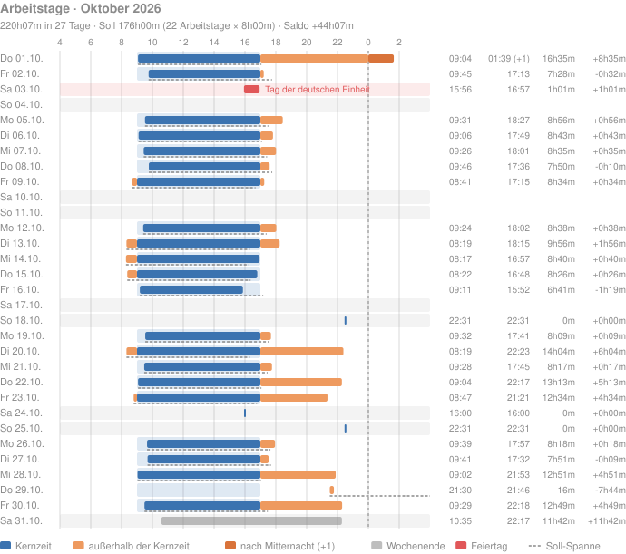

# Arbeitszeit nachvollziehen

Wann hast du an einem Tag angefangen und aufgehört? `total-recall` beantwortet das aus deinen eigenen Nachrichten: die erste und letzte Aktivität je Tag, die Spanne dazwischen und die Differenz zum Tagessoll. Ein Notnagel, wenn das Ein- oder Ausstempeln vergessen wurde; keine Zeiterfassung. Welche Projekte die Zeit bekommen haben, schätzt [Stundenzettel füllen](45-stundenzettel.md).

## Soll und Kernzeit einstellen

Die Defaults passen für eine Vollzeitstelle in Baden-Württemberg: Kernzeit 09:00–17:00, Tagessoll 8 h, Tagesgrenze 04:00. Abweichungen kommen in den Abschnitt `[work]` der Konfiguration:

```toml
[work]
hours = "08:00-16:00"
target = "7h"
bundesland = "Bayern"
```

`total-recall config init` schreibt eine Vorlage mit allen Schlüsseln; was sie bedeuten, steht unter [`[work]`](../reference/20-konfiguration.md#work). Ein Fehler in `[work]` bricht `stats --workday` und `tui` ab, stoppt aber nie die Hooks.

## Auf der Kommandozeile

Die laufende Woche:

```sh
total-recall stats --workday
```

Die letzte Woche, der letzte Monat oder ein beliebiger Zeitraum:

```sh
total-recall stats --workday --range last-week
total-recall stats --workday --range last-month
total-recall stats --workday --since 2026-10-01 --until 2026-10-15
```

```text
2026-10-26 04:00 – 2026-11-02 03:59 (Europe/Berlin, day starts 04:00, human events only)
core hours 09:00-17:00, target 8h00m per workday, holidays Baden-Württemberg

DATE        DAY  FIRST  LAST        SPAN    DIFF    HOLIDAY
2026-10-26  Mon  08:12  18:40       10h28m  +2h28m  -
2026-10-27  Tue  09:03  01:30 (+1)  16h27m  +8h27m  -
2026-10-28  Wed  -      -           -       -       -
2026-10-29  Thu  07:55  17:10       9h15m   +1h15m  -
…
2026-11-01  Sun  21:00  21:05       5m      +0h05m  Allerheiligen

total: 5 days with activity, 41h40m · target 40h00m (5 workdays × 8h00m) · balance +1h40m · 1 holiday
```

Die Summenzeile rechnet das Soll als Tagessoll × Arbeitstage des Zeitraums: Montag bis Freitag ohne Feiertage, bis heute. Ein Arbeitstag ohne Aktivität drückt den Saldo also um ein Tagessoll; Urlaub und ein vergessener Tag sind nicht zu unterscheiden.

Für Skripte liefert `--json` dieselben Werte mit Zeiten in UTC und Dauern in Sekunden. Alle Optionen und das JSON: [`stats --workday`](../reference/10-befehle.md#stats-workday).

## Als Grafik

```sh
total-recall chart workday --month 2026-10 --lang de > arbeitstage.svg
```

`chart workday` zeichnet dieselben Tage wie `stats --workday` und die TUI als SVG oder PNG, mit denselben Grenzen aus [`[work]`](../reference/20-konfiguration.md#work): Kernzeit als Band, Soll als gestrichelte Linie, Aktivität nach Mitternacht dunkler und mit `(+1)`, Wochenenden grau, Feiertage rot mit Namen. Das Bild stammt aus dem Demo-Archiv, mehr dazu im [Monatsbericht](47-monatsbericht.md).



## In der TUI

```sh
total-recall tui activity
```

- Die Zeilen füllen den Bildschirm: so viele Tage, wie passen, der neueste unten. `d`, `w` und `m` wählen die Periode, die Kopfzeile und Kennzahlen zusammenfassen (ein Tag, eine Woche, ein Monat); ihre Tage sind links mit `▎` markiert, die Tage davor gedämpft. ++left++ und ++right++ blättern um eine Periode, `c` springt in die aktuelle, `l` in die vorige.
- Die Kernzeit liegt als Band auf der Zeitachse jedes Werktags. Der Balken ist innerhalb der Kernzeit blau, davor und danach orange, nach Mitternacht rot.
- Die Kopfzeile von Woche und Monat nennt Arbeitszeit, Soll, Saldo und Feiertage; `s` blendet Median, Mittelwert, Minimum und Maximum ein und aus.
- `h` zählt für diesen Lauf auch Agent-Events mit, wie `--all-events`.
- `p` färbt die Balken nach Projekt statt nach Kernzeit, mit einer Legende der Projekte der Woche; die Farben sind die aus [`[[project]]`](67-projekte-definieren.md).
- ++up++ und ++down++ (`k`/`j`, auch das Mausrad) blättern tageweise durch die Zeit; Woche und Monat werden so zu einem gleitenden Fenster, `c` richtet wieder am Kalender aus. `o` stellt den neuesten Tag nach oben (`activity_newest` in der Konfiguration).

Alle Tasten, Farben und Kennzahlen: [Aktivität](../reference/30-tui.md#aktivitat).

## Was zählt

Standard sind nur deine eigenen Nachrichten (`count = "human"`): Agent-Events laufen nachts weiter und würden die Spanne dehnen. `--all-events`, die Taste `h` oder `count = "all"` in `[work]` zählen alles.

Aufträge, die ein koordinierender Agent in eine Session tippt oder einfügt, sehen aus wie eigene Nachrichten und würden die Spanne ebenfalls dehnen. Mit `peer_prefixes` und `peer_paste_headers` in der Konfiguration gelten sie als `peer` und zählen nicht; für bereits eingelesene Tage hilft `reindex --actors`. Wie das eingerichtet wird: [Stundenzettel füllen](45-stundenzettel.md#mehrere-agenten).

Ein Tag beginnt um `day_start` aus der Konfiguration, Standard 04:00 Ortszeit. Aktivität davor zählt zum Vortag und steht als `01:30 (+1)` in der Spalte.

Feiertage gibt es nur für Deutschland, je Bundesland. Urlaub und Krankheit kennt die Auswertung nicht; solche Tage zählen als Arbeitstage ohne Aktivität.
