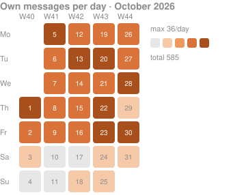
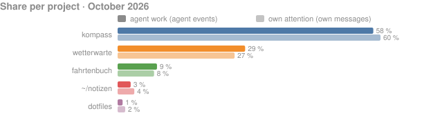
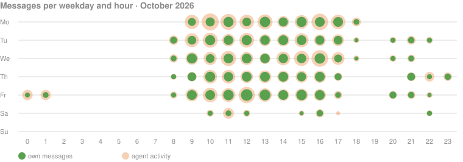
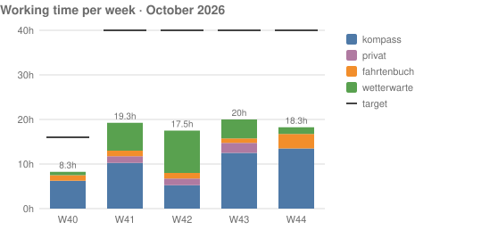
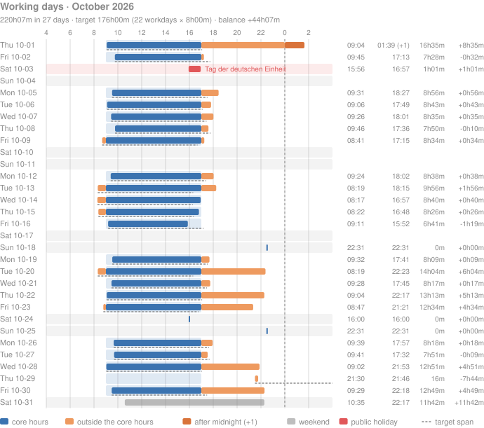
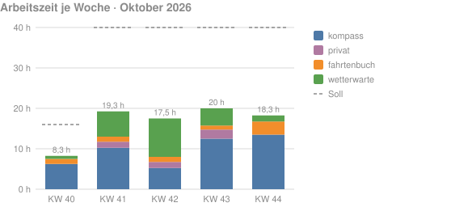
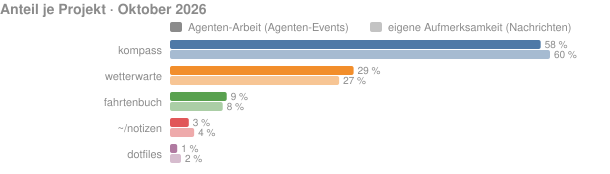

# Grafiken für einen Monatsbericht

Wie sah der Monat aus? `total-recall chart` zeichnet fünf Grafiken aus dem Archiv, als SVG oder PNG, für den Monatsbericht, das Wochen-Review oder die eigene Notiz: einen Kalender der eigenen Nachrichten je Tag, den Anteil je Projekt, die Uhrzeiten als Punchcard, die Arbeitszeit je Woche und Kategorie und die Arbeitstage mit erster und letzter Aktivität. Gezählt wird wie bei [`stats`](../reference/10-befehle.md#stats): eigene Nachrichten sind Events mit `actor = human`; Aufträge anderer Agenten (`peer`) und Automatisches zählen nicht. Die Bilder auf dieser Seite stammen aus dem synthetischen Demo-Archiv.

## Alle fünf Grafiken für einen Monat

```sh
total-recall chart all --month 2026-10 --out berichte/2026-10
```

schreibt fünf Dateien mit vorhersagbaren Namen und gibt ihre Pfade aus:

```text
berichte/2026-10/2026-10-calendar.svg
berichte/2026-10/2026-10-projects.svg
berichte/2026-10/2026-10-punchcard.svg
berichte/2026-10/2026-10-worktime.svg
berichte/2026-10/2026-10-workday.svg
```

Ohne `--month` ist es der laufende Monat; `--range last-month` nimmt den vorigen, `--since`/`--until` einen beliebigen Zeitraum (die Dateien heißen dann `2026-10-05_2026-10-11-calendar.svg`). Eine einzelne Grafik geht ohne `--out` nach stdout:

```sh
total-recall chart calendar --month 2026-10 > kalender.svg
```

## Die Grafiken

**Kalender.** Ein Monatsraster mit den ISO-Wochen als Spalten und Mo–So als Zeilen; die Farbe einer Zelle ist die Zahl der eigenen Nachrichten an dem Tag, in vier Stufen relativ zum stärksten Tag. Die Legende nennt Maximum und Summe.



**Anteil je Projekt.** Je Projekt zwei Balken: der Anteil an der Agenten-Arbeit (alle `agent`-Events) und der Anteil an der eigenen Aufmerksamkeit (eigene Nachrichten), beide in Prozent des Monats. Die zwölf größten Projekte, der Rest als `other` (`--top`). Ein Projekt mit einer Farbe in [`[[project]]`](../reference/20-konfiguration.md#project) behält sie, die anderen bekommen die Reihenfarben.



**Uhrzeiten.** Wochentag × Stunde: der große helle Kreis ist die Agenten-Aktivität in der Stunde, der kleine dunkle die eigenen Nachrichten, beide relativ zur jeweils stärksten Stunde. Zeigt, wann gearbeitet wurde und wann Agenten allein weiterliefen.



**Arbeitszeit je Woche.** Gestapelte Balken je ISO-Woche aus [`stats --worktime`](../reference/10-befehle.md#stats-worktime): je Kategorie die gerundete Arbeitszeit, als Strich das Wochensoll, also das Tagessoll aus [`[work]`](../reference/20-konfiguration.md#work) mal Arbeitstage der Woche im Zeitraum (Mo–Fr ohne Feiertage, bis heute). Die erste und die letzte Woche eines Monats sind angeschnitten und haben entsprechend weniger Soll.



**Arbeitstage.** Die Arbeitstage-Ansicht der TUI als Grafik (`chart workday`): eine Zeile je Tag, der Balken läuft von der ersten bis zur letzten Aktivität auf einer Zeitachse ab `day_start`. Blau ist Aktivität in der Kernzeit, Orange davor und danach, dunkleres Orange nach Mitternacht (im Text mit `(+1)`). Die Kernzeit ist ein Band, das Tagessoll eine gestrichelte Linie ab der ersten Aktivität; Wochenenden sind grau, Feiertage rot mit Namen. Rechts stehen erste und letzte Aktivität, Spanne und Abweichung vom Soll, oben Summe, Soll und Saldo des Zeitraums. Gezählt wird wie bei [`stats --workday`](../reference/10-befehle.md#stats).



## Helle und dunkle Notizen

Der Hintergrund ist transparent und der Text ein mittleres Grau (`#8b8b8b`), die Grafiken lesen sich auf hellem wie auf dunklem Grund. Jede Zelle, jeder Balken und jeder Kreis trägt seine Zahlen als Tooltip. Wer eine feste Fläche will: `--background "#ffffff"` oder `[chart] background`.

## Farben einstellen

Kategorien bekommen in [`[[worktime.category]]`](../reference/20-konfiguration.md#worktime) eine Farbe, Projekte in `[[project]]`; ohne Farbe nimmt die Grafik die nächste freie Reihenfarbe. Die Farbfolgen stehen in [`[chart]`](../reference/20-konfiguration.md#chart): `scale_orange` (Kalender, Arbeitstage außerhalb der Kernzeit), `scale_blue` (Arbeitstage in der Kernzeit), `palette` (Projekte und Kategorien ohne eigene Farbe), dazu `text` und `background`:

```toml
[[worktime.category]]
name = "kompass"
match = ["https://git.invalid/mara/kompass"]
color = "blue"

[[worktime.category]]
name = "privat"
match = ["~/dotfiles", "~/notizen"]
color = "purple"

[chart]
scale_orange = ["#f6c9a8", "#ee9a5f", "#d9733a", "#a84f1c"]
scale_blue = ["#b3cde3", "#6a9fcf", "#3b73b0", "#1f4e85"]
text = "#8b8b8b"
```

Erlaubt sind die Namen der Palette (`blue`, `orange`, `green`, `red`, `purple`, `teal`) und `#rrggbb`. So sieht ein Projekt in der TUI, in den Grafiken und in der Kategorie gleich aus.

## PNG, Größe, Hintergrund

```sh
total-recall chart all --month 2026-10 --format png --scale 2 --out berichte/2026-10
total-recall chart punchcard --month 2026-10 --width 1200 > punchcard.svg
total-recall chart calendar --month 2026-10 --no-title --no-legend --background "#1e1e1e" > kalender.svg
```

SVG ist der Default und skaliert ohne Verlust; PNG rastert das Bild in reinem Go, `--scale 2` für scharfe Bilder auf hochauflösenden Displays. `--width` oder `--height` setzen die Größe in Pixeln, beide zusammen einen Rahmen, in dem die Grafik zentriert sitzt. `--no-title` und `--no-legend` lassen Überschrift und Legende weg, wenn der Bericht sie selbst setzt, `--background #rrggbb` eine Hintergrundfarbe. Die Defaults von Format, Faktor, Titel, Legende und Hintergrund stehen in [`[chart]`](../reference/20-konfiguration.md#chart).

## Deutsche Beschriftung, eigener Titel

Die Beschriftungen sind Englisch wie die übrige Ausgabe. Für einen deutschen Bericht schaltet `--lang de` Titel, Legende, Achsen, Wochentage und Monatsnamen auf Deutsch um, dazu das Datums- und Zahlenformat (`KW 41`, `05.10.2026`, `7,5 h`); die Dateinamen bleiben gleich.

```sh
total-recall chart all --month 2026-10 --lang de --out berichte/2026-10
```





Wer immer deutsche Grafiken will, setzt den Default in der Konfiguration; `--lang en` holt für einen Lauf die englische zurück:

```toml
[chart]
lang = "de"
```

`--title TEXT` ersetzt die Überschrift samt Zeitraum durch einen eigenen Text, etwa den Namen des Kunden oder des Projekts:

```sh
total-recall chart worktime --month 2026-10 --lang de --title "Kompass, Oktober 2026" > arbeitszeit.svg
```

## In einer Notiz einbetten

Ein Markdown-Bericht bindet die Dateien wie jedes Bild ein:

```markdown
## Oktober 2026


```

Die Zahlen dazu liefert [`stats --month 2026-10 --json`](../reference/10-befehle.md#stats) bzw. [`stats --worktime --month 2026-10`](../reference/10-befehle.md#stats-worktime); wie die Arbeitszeit zustande kommt, erklärt [Stundenzettel füllen](45-stundenzettel.md).
