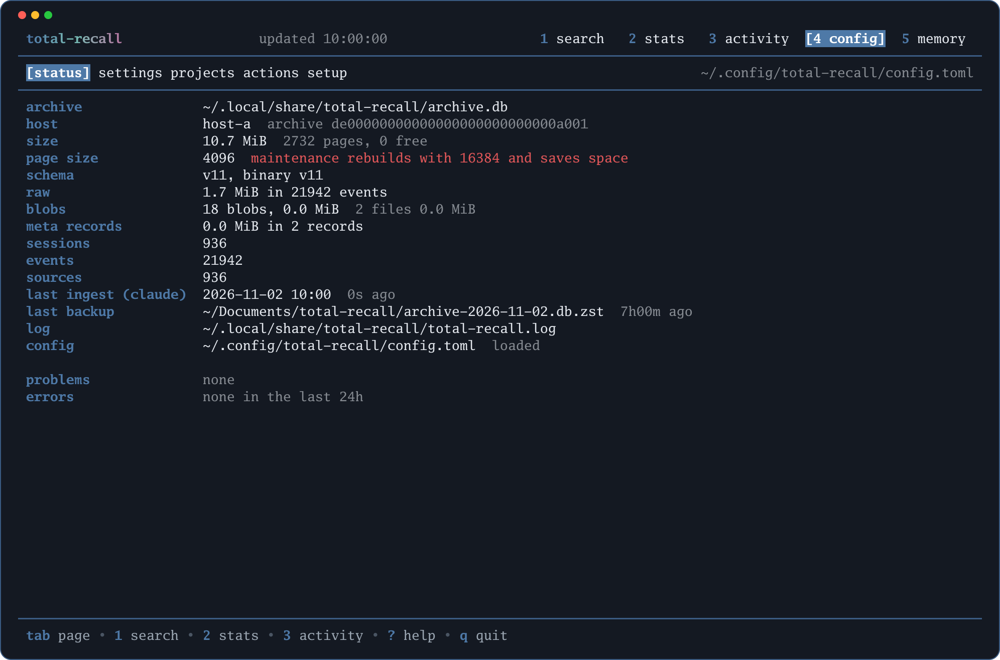
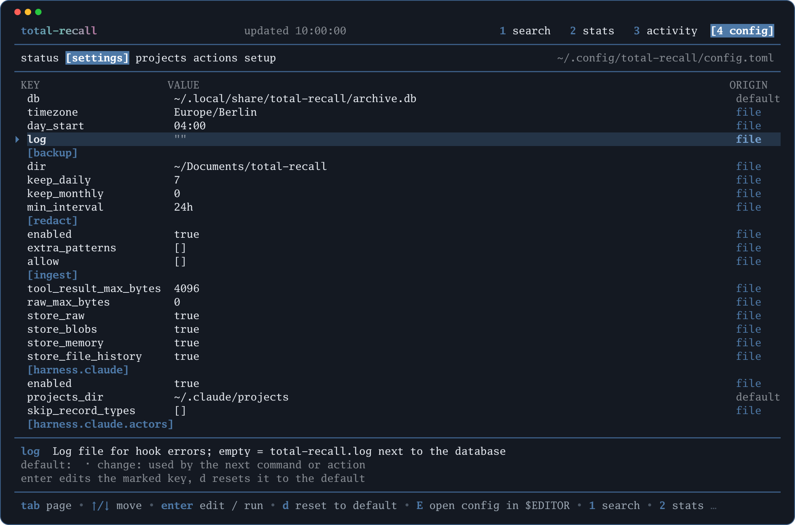
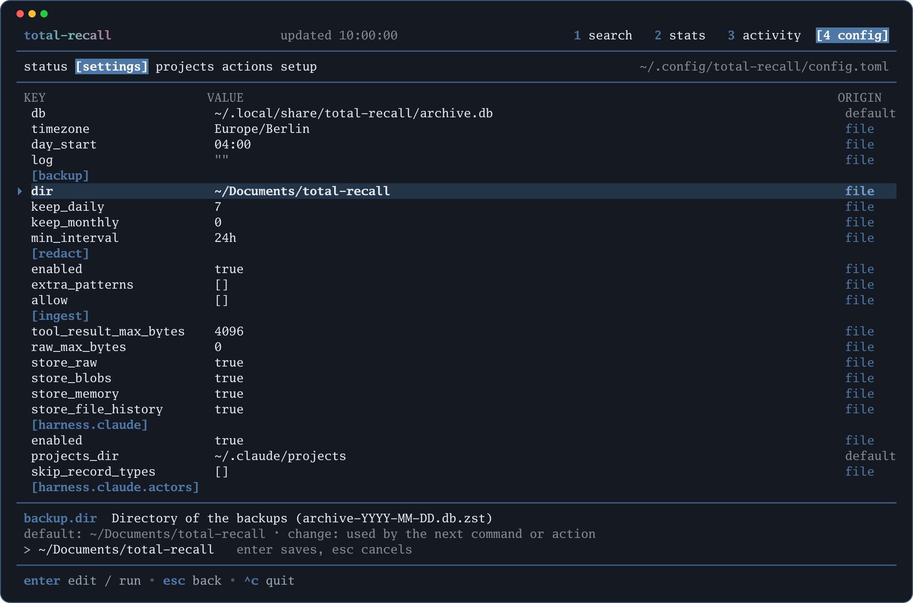
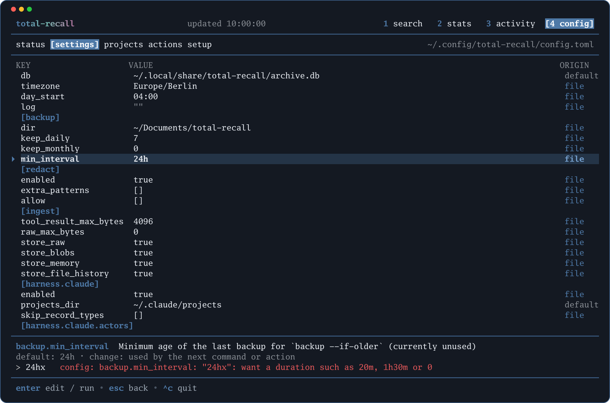
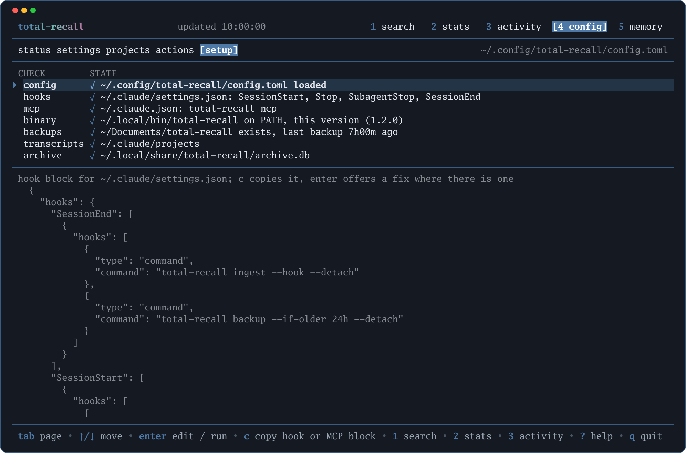

# Einstellungen in der TUI ändern

Die Ansicht [Config](../reference/30-tui.md#config) der TUI zeigt den Zustand des Archivs, ändert einzelne Werte der Konfiguration in der Datei, startet die Wartungsbefehle und prüft die Installation. Alles, was sie schreibt, fragt vorher nach; die Datei behält ihre Kommentare, und vor jedem Schreiben entsteht `config.toml.bak`.

```sh
total-recall tui config
```

Oder in einer laufenden TUI `4` drücken (oder mit der Maus auf `4 config` in der Kopfzeile klicken). Die Seiten wechseln mit ++tab++ und ++shift+tab++ oder per Klick auf den Seitennamen.



*Config, Seite Status: Archiv, Schema, Zähler, letztes Backup, Fehler des Logs*


## Einen Wert ändern



*Seite Settings: die Liste der Schlüssel; unter der Linie Hilfetext und Default des markierten*

1. Seite **settings** (++tab++ einmal). Mit ++down++ / `j` zum Schlüssel, etwa `reload` unter `[tui]`. Unter der Linie stehen Hilfetext, erlaubte Werte und Default des markierten Schlüssels.
2. ++enter++. Ein Wahrheitswert wie `mouse` kippt sofort, eine Aufzählung wie `view` nimmt den nächsten Wert; bei allem anderen öffnet sich die Eingabezeile mit dem aktuellen Wert.
3. Wert tippen, wie er in der Datei stünde: `10s`, `1h30m`, `04:00`, `~/Backups/total-recall`, eine Liste als `["a", "b"]` oder `a, b`. ++enter++ schreibt, ++esc++ verwirft.
4. Die Meldung sagt, was passiert ist: `tui.reload written to ~/.config/total-recall/config.toml · applied at once`, `· takes effect at the next start` oder `· used by the next command or action`; dasselbe steht schon vorher in der Zeile `default` des markierten Schlüssels. Ein abgelehnter Wert (`want a duration like "20m"`) ändert nichts; die Eingabezeile bleibt offen zum Korrigieren.



*Die Eingabezeile mit dem aktuellen Wert; ++enter++ schreibt, ++esc++ verwirft*



*Ein abgelehnter Wert ändert nichts; die Eingabezeile bleibt offen zum Korrigieren*

Sofort gelten `reload`, `mouse`, die Tastenbelegung `[keys]`, `day_start`, die Tabelle `[work]`, `activity_projects` und `activity_newest`: Aktivität und Statistik zeichnen neu, Fenster, Markierung, Scrollposition und Eingabe bleiben. Wer etwa `work.target` auf `4h` setzt, sieht die Differenz je Tag und die Bilanz der Woche beim Wechsel mit `3` schon mit dem neuen Ziel; eine neue Taste in `keys.global_stats` steht sofort in der Fußzeile. `db`, `timezone` und die Startzustände der Ansichten (`view`, `graphics`, `stats_period`, `stats_dimension`, `activity_window`) gelten beim nächsten Start; alles Übrige liest der nächste Befehl, der nächste Hook oder die nächste Aktion. Die Liste steht in der [Referenz](../reference/30-tui.md#settings).

`d` setzt den markierten Schlüssel auf den Default zurück: Die Zeile wird in der Datei auskommentiert, nicht gelöscht. Ein Wert mit Herkunft `env` oder `flag` lässt sich hier nicht ändern, weil die Datei dagegen wirkungslos wäre; die Meldung nennt die Quelle.

Für `[accounts]` und `[[worktime.category]]` öffnet `E` die Datei in `$EDITOR`; nach dem Schließen liest die TUI die Konfiguration neu. Fehlt die Datei noch, legt die TUI sie beim ersten Schreiben aus der Vorlage an.

## Dasselbe auf der Kommandozeile

Was die Seite **settings** und **projects** schreibt, geht auch ohne TUI, mit denselben Funktionen und derselben Prüfung (Kommentare bleiben, vorher entsteht `config.toml.bak`, das Archiv bleibt unberührt):

```sh
total-recall config set tui.view stats    # Wert schreiben; ein abgelehnter Wert ändert nichts (Fehlerart validation)
total-recall config unset tui.view        # zurück auf den Default: die Zeile wird auskommentiert
total-recall config show --json           # Werte, Herkunft und der Katalog aller Schlüssel (Art, erlaubte Werte, Default, Hilfetext)
total-recall doctor --setup               # die Prüfungen der Seite setup, nur lesend (auch --json)
```

Für Skripte und andere Oberflächen: [`config set` / `unset`](../reference/10-befehle.md#config), [`doctor --setup`](../reference/10-befehle.md#doctor-setup) und für die Projekte [`config project`](../reference/10-befehle.md#config-project) und [`config projects`](../reference/10-befehle.md#config-projects).

## Die Projekte pflegen

![Seite Projects: Definitionen aus `[[project]]`, darunter die Pfade des Archivs ohne Definition](../assets/screenshots/config-projects.png)

*Seite Projects: Definitionen aus `[[project]]`, darunter die Pfade des Archivs ohne Definition*

Seite **projects** (++tab++ zweimal): die Definitionen aus [`[[project]]`](../reference/20-konfiguration.md#project) mit Farbfeld, Name, Beschreibung, Sessions und Mustern, darunter die Pfade des Archivs ohne Definition. ++enter++ öffnet das Formular, `a` legt ein Projekt aus dem markierten Pfad an, `m` macht ihn zum Muster einer Definition, `x` löscht nach Rückfrage, `K`/`J` sortieren; geschrieben wird mit `y`, und Statistik und Aktivität zeigen die Änderung sofort. Rezept mit Beispielen: [Projekte definieren](67-projekte-definieren.md).

## Eine Aktion ausführen


*Seite Actions: `backup` wartet auf die Bestätigung*

Seite **actions**: ++down++ zur Aktion, ++enter++. Was liest (`maintenance (dry run)`, `reindex actors (dry run)`, `doctor`), läuft sofort. Was schreibt (`backup`, `maintenance`, `reindex actors`, `ingest all`), zeigt zuerst, was es tun wird, und wartet auf `y`; ++esc++ bricht ab. Die Fortschrittszeilen stehen unter der Liste, ++esc++ bricht eine laufende Aktion ab, am Ende steht die Zusammenfassung mit Dauer. Solange eine Aktion läuft, lädt die TUI nichts nach; danach lädt sie den Status neu und öffnet ein von `maintenance` ausgetauschtes Archiv von selbst.

## Die Datenbank migrieren

Zeigt der Status nach einem Update `migration pending`, liegt die Datenbank hinter dem Schema der Binary; die Hooks schreiben bis zur Migration nichts, und auf der Seite **actions** stehen `maintenance`, `reindex actors` und `ingest all` mit `migrate first`. Dann, in dieser Reihenfolge:

1. `backup`, ++enter++, `y`: die Sicherung vor allem anderen. Sie geht auch mit altem Schema.
2. `migrate`, ++enter++: Unter der Liste steht der Plan, wie ihn [`total-recall migrate`](../reference/10-befehle.md#migrate) ausgibt: die Versionen, jede ausstehende Migration mit einer Zeile Beschreibung, der Pfad der Kopie `archive.db.pre-v<N>.bak` und wie viel Platz neben der Datenbank frei sein muss. `y` startet; eine lange Migration meldet ihren Fortschritt (`migration v5: 120000/233000 (51 %)`), ++esc++ bricht sie ab, die Datenbank bleibt dann unverändert. Am Ende: `migrated v4 -> v5; the copy archive.db.pre-v4.bak can be removed once everything works`, der Status lädt neu, und der nächste Hook liest nach, was in der Zwischenzeit anfiel.
3. `maintenance`, ++enter++, `y`: Direkt nach der Migration ist die Datei größer als vorher; der Neuaufbau macht sie klein. Hintergrund und Messwerte: [Aktualisieren](10-installieren.md#aktualisieren).

Die Kopie neben der Datenbank ist die Rückfalloption. Läuft alles, kann sie weg.

## Die Installation prüfen



*Seite Setup: die Prüfungen der Installation und der Hook-Block*


*Die Zeile `mcp` markiert: darunter der Eintrag für den MCP-Server von Claude Code*

Seite **setup** (++shift+tab++ vom Status aus): sechs Prüfungen, `√`, `!` oder `×` mit Text. Bei zwei bietet ++enter++ eine Korrektur an, nach `y`: die Vorlage der Config-Datei schreiben, das Backup-Verzeichnis anlegen. Fehlen Hooks in `~/.claude/settings.json`, nennt die Zeile die Ereignisse; `c` kopiert den Hook-Block in die Zwischenablage, eingetragen wird er von Hand, siehe [Hooks einrichten](20-hooks-einrichten.md). Die TUI ändert die Einstellungen von Claude Code nie.
