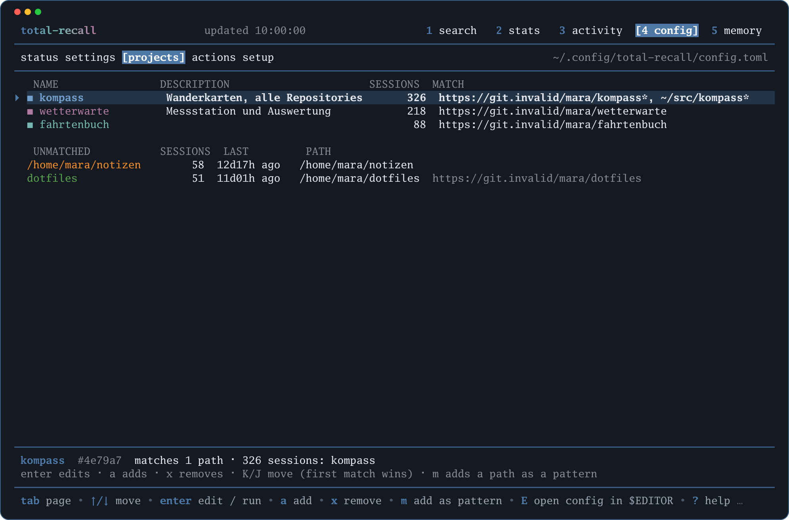
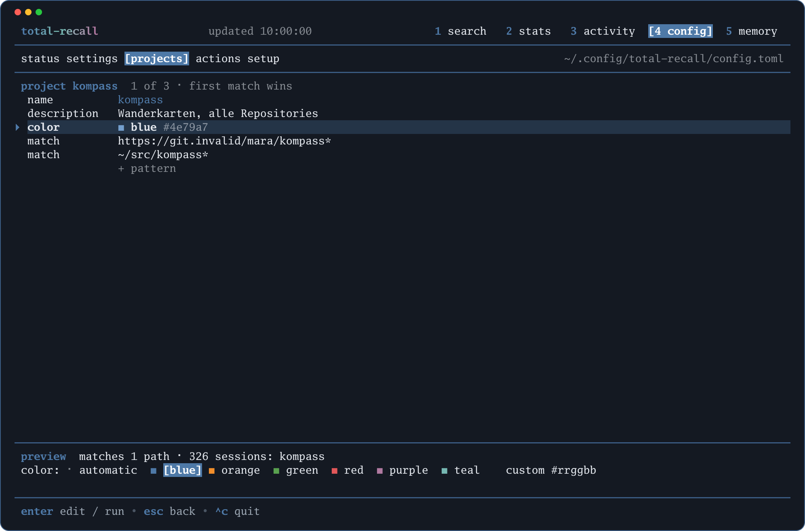
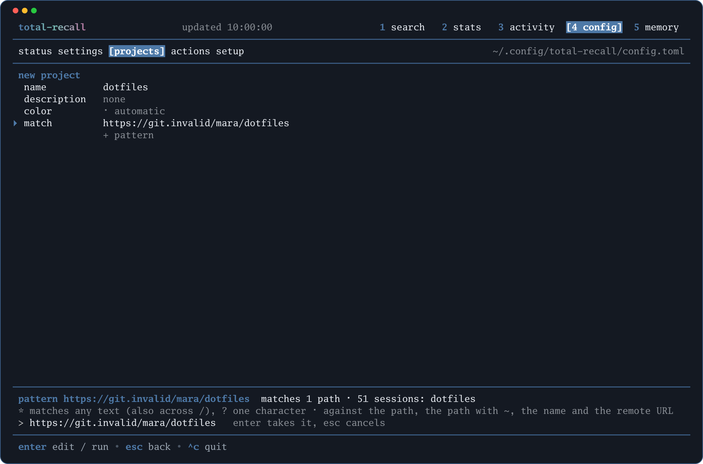

# Projekte definieren

Ohne Konfiguration heißt ein Projekt wie der Basisname seines Git-Roots, ein Verzeichnis ohne Repository wie sein Pfad. Das reicht, bis zwei Repositories zusammengehören (ein Kunde, ein Produkt mit API und Web-App), ein Repo unter mehreren Pfaden ausgecheckt ist (Worktrees, ein zweiter Rechner) oder ein Projekt eine feste Farbe im Chart haben soll. Dafür gibt es die Definitionen [`[[project]]`](../reference/20-konfiguration.md#project): Name, Beschreibung, Farbe und Muster, die Sessions dem Projekt zuordnen. Die Zuordnung wird bei jeder Abfrage berechnet, nicht gespeichert: Eine geänderte Definition wirkt sofort und rückwirkend auf das ganze Archiv, in `stats`, `chart` und der TUI.

Drei Wege: die Datei im Editor, die Kommandozeile ([`config project`](../reference/10-befehle.md#config-project)) oder die Seite **projects** der Ansicht [Config](../reference/30-tui.md#projects) der TUI, die dieselbe Datei schreibt und dabei zeigt, was ein Muster im Archiv trifft.

## In der Datei

```toml
[[project]]
name = "kompass"
description = "Wanderkarten, alle Repositories"
color = "blue"
match = ["https://git.invalid/mara/kompass*", "~/src/kompass*"]

[[project]]
name = "wetterwarte"
color = "purple"
match = "https://git.invalid/mara/wetterwarte"

[[project]]
name = "notizbox"
description = "Markdown-Notizen ohne Repository"
match = "~/notizen"
```

- `name` ist Pflicht und eindeutig; so heißt das Projekt in `stats --by project`, in der Statistik und in den Kategorie-Regeln der Arbeitszeit.
- `match` ist ein Muster oder eine Liste. Ein Muster wird als Ganzes gegen vier Dinge geprüft: den Git-Root bzw. das Arbeitsverzeichnis der Session als Pfad, denselben Pfad mit `~` für das Home-Verzeichnis, die Remote-URL des Repositories und den Namen, den die Session ohne Definition bekäme. `*` steht für beliebigen Text, auch über `/` hinweg, `?` für ein Zeichen.
- `color` ist optional: ein Name der Palette (`blue`, `orange`, `green`, `red`, `purple`, `teal`) oder `#rrggbb`. Ohne Angabe bekommt das Projekt die nächste freie Reihenfarbe.

Danach `total-recall config show`: Die Zeile `project` zeigt die wirksamen Definitionen, unter der Tabelle stehen Fehler (doppelter Name, Muster fehlt, unbekannte Farbe). `total-recall stats --by project` zeigt die neuen Namen sofort.

## Worktrees und zweite Checkouts

Worktrees liegen unter einem anderen Pfad, haben aber denselben Git-Root und dieselbe Remote-URL. Ein Muster auf die Remote-URL trifft deshalb jeden Checkout des Repositories, auch auf einem zweiten Rechner mit anderem Home-Verzeichnis; das ist das Muster, das die TUI vorschlägt. Wer lieber nach Pfad geht, nimmt ein Muster mit `*` auf das Verzeichnis, etwa `~/src/kompass*` für `~/src/kompass` und `~/src/kompass__worktrees/gpx`. Sessions von Subagenten zählen immer zur Eltern-Session und brauchen kein eigenes Muster.

## Überschneidungen

Die erste passende Definition in Dateireihenfolge gewinnt. Das ist gewollt: Eine spezielle Definition steht oben, eine allgemeine unten.

```toml
[[project]]
name = "kompass-api"
match = "https://git.invalid/mara/kompass-api"

[[project]]
name = "kompass"
match = "https://git.invalid/mara/kompass*"
```

Umgekehrt angeordnet fiele `kompass-api` in `kompass`, weil `kompass*` zuerst passt. Die Seite **projects** der TUI zeigt zu jeder Definition, was sie trifft und was eine frühere Definition ihr wegnimmt (`kompass-api goes to kompass (earlier)`); `K` und `J` ändern die Reihenfolge in der Datei.

## Auf der Kommandozeile

`config project` schreibt dieselben `[[project]]`-Tabellen wie die TUI, je Name, mit derselben Prüfung; Kommentare und Reihenfolge der Datei bleiben, vorher entsteht `config.toml.bak`, das Archiv bleibt unberührt.

```sh
total-recall config project add kompass --match '~/src/kompass*' --match 'https://git.invalid/mara/kompass' --description Wanderkarten --color blue
total-recall config project set kompass --description "Karten und Routen"   # nur die genannten Felder ändern sich
total-recall config project move kompass --to 1                              # an den Anfang: die erste passende Definition gewinnt
total-recall config project rm kompass
```

`add` braucht mindestens ein `--match`; bei `set` ersetzt `--match` alle Muster, ein leeres `--description ""` oder `--color ""` entfernt den Wert, `--name` benennt um. Ein Entwurf ohne Muster, mit unbekannter Farbe oder doppeltem Namen wird abgelehnt (Fehlerart `validation`), die Datei bleibt dann wie sie war. Mit `--json` steht im Ergebnis die Definition nach der Änderung samt ihrer Stelle in der Datei und die ganze Liste.

Was ein Muster trifft, zeigt `config projects`, ohne etwas zu ändern:

```sh
total-recall config projects              # Definitionen, Pfade des Archivs, Zuordnung
total-recall config projects --preview --name notizen --match '~/notizen'   # Entwurf prüfen, nichts wird gespeichert
```

```text
PROJECT  SESSIONS  PATHS  MATCH
kompass  326       1      ~/src/kompass*, https://git.invalid/mara/kompass

PATH                        SESSIONS  PROJECT
/home/mara/src/kompass      326       kompass
/home/mara/src/wetterwarte  218       -
/home/mara/src/fahrtenbuch  88        -
/home/mara/notizen          58        -
/home/mara/dotfiles         51        -

741 sessions in 5 paths; 415 sessions in 4 paths without a project
```

Die Sessions der Definitionen und die ohne Projekt ergeben zusammen alle Sessions (741 im Demo-Archiv). Mit `--json` kommen dazu `problem` und die Vorschau mit dem, was eine frühere Definition dem Entwurf wegnimmt. Wie viel je Projekt gearbeitet wurde, zeigt [`stats --workday --projects`](../reference/10-befehle.md#stats-workday): je Tag die gezählten Events je Projekt.

## In der TUI



*Seite Projects: oben die Definitionen mit Farbe, Beschreibung, Sessions und Mustern, unter `UNMATCHED` die Pfade des Archivs, die noch keine Definition trifft*

`total-recall tui config`, dann ++tab++ zweimal. Oben stehen die Definitionen in Dateireihenfolge mit Farbfeld, Name, Beschreibung, der Zahl der Sessions, die sie treffen, und den Mustern; unter `UNMATCHED` die Git-Roots und Verzeichnisse des Archivs, die keine Definition trifft, mit Sessionzahl, letzter Aktivität, Pfad und Remote-URL. Unter der Linie steht zur markierten Zeile, was sie trifft.

**Ein Projekt aus der Liste anlegen.** Mit ++down++ (`j`) zu einem Pfad unter `UNMATCHED`, dann `a` oder ++enter++: Das Formular öffnet sich mit dem abgeleiteten Namen und der Remote-URL als Muster (ohne Repository der Pfad mit `~`). Beschreibung und Farbe nach Wunsch, `y` schreibt die Definition in die Datei. Die Zeile wandert nach oben, Statistik und Aktivität zeigen das Projekt sofort unter dem neuen Namen.

**Einen Pfad einem Projekt zuschlagen.** Auf einem Pfad unter `UNMATCHED` `m` drücken, dann mit ++up++/++down++ die Definition wählen, die das Muster bekommt, ++enter++ bestätigt. So landet ein zweites Repository beim selben Projekt.



*Das Formular einer Definition: Felder, darunter die Vorschau und die Farbwahl*

**Eine Definition bearbeiten.** ++enter++ auf der Zeile öffnet das Formular: `name`, `description`, `color`, je Muster eine Zeile `match` und `+ pattern`. ++enter++ auf einem Textfeld öffnet die Eingabezeile (++enter++ übernimmt, ++esc++ verwirft), auf `color` die Farbwahl: ++left++/++right++ (auch ++tab++) wählen zwischen `automatic`, den sechs Palettenfarben mit Farbfeld und `custom #rrggbb`, das eine Eingabe öffnet; `d` setzt die Farbe auf automatisch zurück. `a` fügt ein Muster an, `x` entfernt das markierte. Geschrieben wird erst mit `y`, als Ganzes; ++esc++ verlässt das Formular, bei ungesicherten Änderungen erst nach einer Rückfrage.



*Ein Muster wird bearbeitet: Die Vorschau zeigt beim Tippen, welche Pfade und wie viele Sessions es trifft*


*`m` auf einem Pfad ohne Definition: Die Rückfrage nennt das Muster und das Projekt, das es bekommt*


*`x` auf einer Definition: Die Rückfrage nennt die Datei, `y` löscht, ++esc++ bricht ab*

**Vorschau.** Während ein Muster markiert oder in der Eingabezeile ist, sagt die Zeile `pattern …` unter der Linie, welche Pfade des Archivs es trifft und wie viele Sessions das sind; sonst gilt die Zeile `preview` für alle Muster der Definition. Nimmt eine frühere Definition einen Pfad weg, steht es dabei (`alpha goes to alles (earlier)`). Ein doppelter Name erscheint schon in der Vorschau.

**Löschen und sortieren.** `x` auf einer Definition fragt nach (`y` bestätigt, ++esc++ bricht ab) und entfernt die Tabelle aus der Datei. `K` und `J` verschieben die markierte Definition um eine Stelle; die erste passende gewinnt.

**Was geschrieben wird.** Jede Änderung geht in die Config-Datei wie auf der Seite Settings: Kommentare und alle anderen Zeilen bleiben, vorher entsteht `config.toml.bak`, geschrieben wird atomar und nur, was die Prüfung besteht. Ein abgelehnter Entwurf (Name fehlt, kein Muster, Farbe unbekannt, Name doppelt) lässt die Datei unverändert, die Meldung steht unten im Formular. Nach dem Schreiben tauscht die TUI die Definitionen aus und lädt Statistik und Aktivität neu; ein Neustart ist nicht nötig. Wer die Datei lieber im Editor ändert: `E` öffnet sie, nach dem Schließen liest die TUI sie neu.
