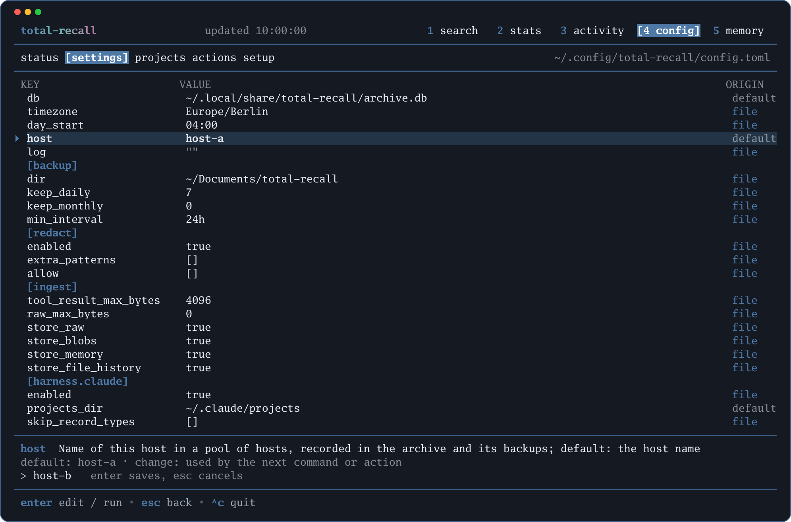
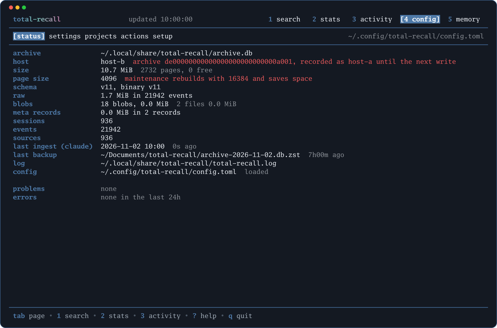

# Rechner im Pool benennen

Das [Analyse-Tool](../reference/15-analyse.md) wertet die Archive mehrerer Rechner zusammen aus. Damit es sie auseinanderhält, trägt jedes Archiv einen Host-Namen und eine eigene ID ([`archive_meta`](../reference/40-schema.md#archive_meta)). Den Namen bestimmt der Schlüssel [`host`](../reference/20-konfiguration.md#host). Ohne Eintrag gilt der Hostname bis zum ersten Punkt, kleingeschrieben. Einen eigenen Namen braucht es nur, wenn der Hostname nichtssagend ist oder zwei Rechner gleich heißen.

Erlaubt sind 1 bis 63 Buchstaben, Ziffern, `.`, `_` und `-`, am Anfang ein Buchstabe oder eine Ziffer.

## Vorher: auf Schema v11 migrieren

Ein Archiv aus einer Version vor v1.11.0 kennt noch keinen Host. Die Migration legt die Kennung an und speichert den Host gleich mit. Wie jede Migration läuft sie nur auf ausdrücklichen Befehl und nach einem Backup:

```sh
total-recall backup
total-recall migrate
```

Bis dahin zeigt `status` in der Zeile `host` den Hinweis `the archive records it after migrate`. Das ganze Vorgehen beim Aktualisieren steht unter [Installieren](10-installieren.md).

## In der CLI

```sh
total-recall config set host host-b
total-recall status
```

Ausgabe gegen das Demo-Archiv, dessen Host `host-a` ist:

```text
$ total-recall config set host host-b
host = host-b (file)

$ total-recall status   # Zeile host
host                  host-b  archive de00000000000000000000000000a001, recorded as host-a until the next write
```

Das Archiv übernimmt den neuen Namen beim nächsten Schreiben, also beim nächsten Hook-Lauf oder bei `ingest`. Die ID bleibt:

```text
$ total-recall ingest --all
scanned 0 files: 0 changed, 0 unchanged, 0 locked; 0 new events, 0 meta records, 0 sessions touched (0s)

$ total-recall status   # Zeile host
host                  host-b  archive de00000000000000000000000000a001
```

Ein ungültiger Name ändert die Datei nicht:

```text
$ total-recall config set host "host b"
total-recall: config: host "host b": 1 to 63 letters, digits, '.', '_' or '-', starting with a letter or digit
```

Für Skripte stehen dieselben Angaben in `status --json`: `host` (konfiguriert), `archive_host` (im Archiv) und `archive_id`.

## In der TUI

```sh
total-recall tui config
```

1. Seite **settings**: ++tab++ einmal, oder ein Klick auf `settings` in der Umschaltzeile.
2. Mit ++down++ / `j` oder einem Klick zur Zeile `host`. Unter der Linie stehen Hilfetext und Default, der aus dem Hostnamen kommt.
3. ++enter++ oder ein zweiter Klick auf die markierte Zeile öffnet die Eingabezeile mit dem aktuellen Namen. Namen tippen, ++enter++ schreibt in die Config-Datei, ++esc++ verwirft.



*Seite Settings: der Schlüssel host wird in der Eingabezeile auf host-b geändert*

4. Seite **status**: ++shift+tab++ oder ein Klick auf `status`. Die Zeile `host` zeigt den neuen Namen und in Rot, dass das Archiv bis zum nächsten Schreiben noch den alten nennt. Danach steht dort nur noch `archive` mit der ID.



*Seite Status nach der Änderung: das Archiv nennt bis zum nächsten Schreiben noch host-a*

## Backups

Ein Backup ist eine Kopie des Archivs und trägt Host und ID in sich; der Dateiname bleibt `archive-YYYY-MM-DD.db.zst`. Wie die Backups mehrerer Rechner zentral abgelegt werden, regelt das Pool-Verzeichnis ([#359](https://github.com/seletz/total-recall/issues/359)).
