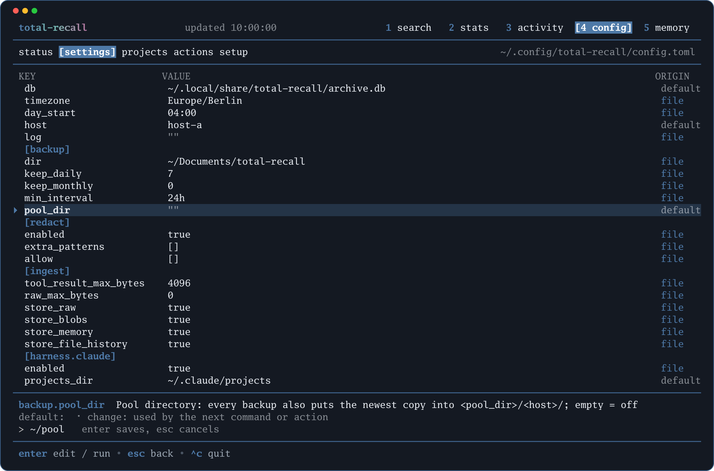
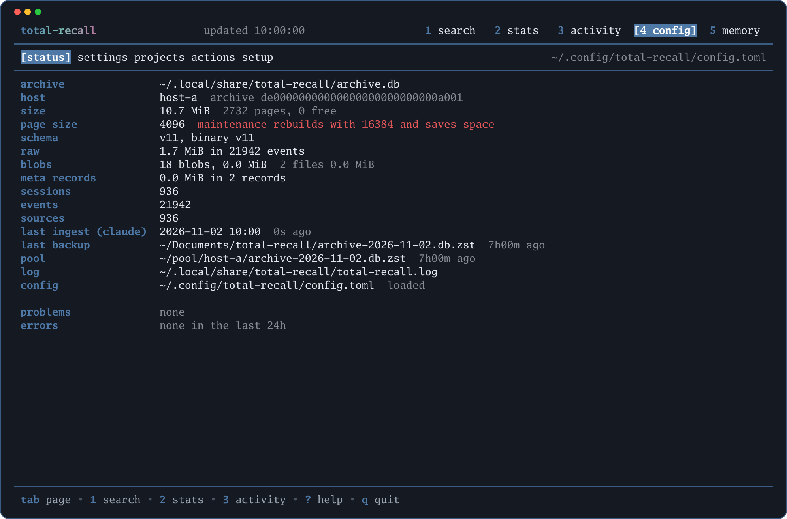
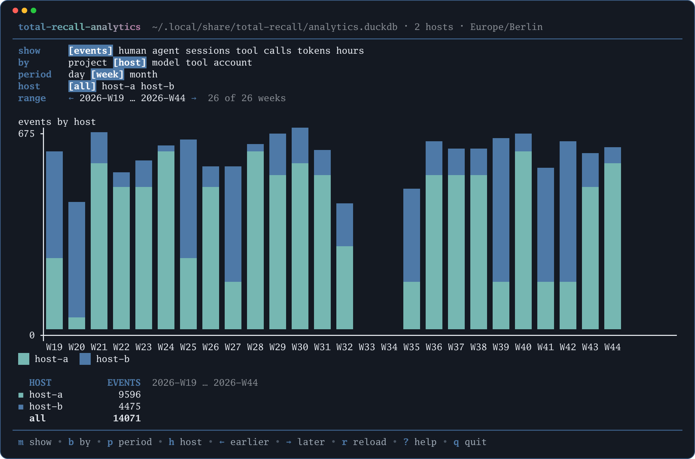

# Pool-Verzeichnis einrichten

Arbeiten Agenten auf mehreren Rechnern, wertet das [Analyse-Tool](../reference/15-analyse.md) ihre Archive gemeinsam aus. Dafür legt jeder Rechner sein neuestes Backup in ein gemeinsames Pool-Verzeichnis. Es gibt keinen Dienst und kein Netzprotokoll, nur Dateien. Der gemeinsame Ordner kann eine Netzfreigabe (SMB, NFS) sein oder ein synchronisierter Ordner (Syncthing, Nextcloud).

## Aufbau

Je Host ein Ordner, benannt wie der Schlüssel [`host`](../reference/20-konfiguration.md#host), darin genau eine Kopie, die neueste:

```text
/srv/pool/total-recall/
├── host-a/
│   └── archive-2026-11-28.db.zst
└── host-b/
    └── archive-2026-11-28.db.zst
```

Der Name des Ordners kommt aus `host`; ID und Host stehen außerdem im Archiv selbst ([`archive_meta`](../reference/40-schema.md#archive_meta)). Das Pool-Verzeichnis braucht deshalb Schema v11: vorher einmal `total-recall backup` und `total-recall migrate` ([Rechner im Pool benennen](68-host-benennen.md)).

## In der CLI

Auf jedem Rechner einmal den Pool eintragen; der Name des Rechners ist meist schon richtig (Default: Hostname):

```sh
total-recall config set backup.pool_dir /srv/pool/total-recall
total-recall config set host host-a        # nur, wenn der Hostname nicht passt
total-recall backup
```

Ab dann legt jedes Backup die Kopie auch in den Pool, auch das tägliche aus dem Hook (`backup --if-older 24h` bei `SessionEnd`, siehe [Hooks einrichten](20-hooks-einrichten.md)). Ausgabe auf zwei Rechnern gegen den [Demo-Pool](../explanation/design.md):

```text
$ total-recall backup        # auf host-a
backup written: /home/host-a/Documents/total-recall/archive-2026-11-28.db.zst
pool copy: /srv/pool/total-recall/host-a/archive-2026-11-28.db.zst

$ total-recall backup        # auf host-b
backup written: /home/host-b/Documents/total-recall/archive-2026-11-28.db.zst
pool copy: /srv/pool/total-recall/host-b/archive-2026-11-28.db.zst

$ total-recall backup --if-older 24h        # auf host-b
backup skipped: /home/host-b/Documents/total-recall/archive-2026-11-28.db.zst is 0s old (< 24h0m0s)
pool copy: /srv/pool/total-recall/host-b/archive-2026-11-28.db.zst (unchanged)
```

Prüfen, auf einem beliebigen Rechner mit Zugriff auf den Pool:

```text
$ total-recall status        # auf host-b, Zeile pool
pool                  /srv/pool/total-recall/host-b/archive-2026-11-28.db.zst  (0s ago)

$ total-recall pool
HOST    BACKUP                     AGE     SIZE       ARCHIVE HOST  ARCHIVE                           SCHEMA  SESSIONS  EVENTS  NOTE
host-a  archive-2026-11-28.db.zst  0s ago  1.8 MiB    host-a        de00000000000000000000000000b00a  v11     639       15058   ok
host-b  archive-2026-11-28.db.zst  0s ago  888.5 KiB  host-b        de00000000000000000000000000b00b  v11     297       6884    ok
```

[`pool`](../reference/10-befehle.md#pool) entpackt jede Kopie einmal in einen Cache und liest sie, ohne den Pool zu schreiben. `NOTE` meldet, was nicht passt, etwa dasselbe Archiv in zwei Ordnern, weil ein Rechner umbenannt wurde. Den alten Ordner dann von Hand löschen.

## In der TUI

```sh
total-recall tui config
```

1. Seite **settings**: ++tab++ einmal, oder ein Klick auf `settings` in der Umschaltzeile.
2. Mit ++down++ / `j` oder einem Klick zur Zeile `pool_dir` unter `[backup]`. ++enter++ oder ein zweiter Klick öffnet die Eingabezeile; den Pfad tippen, ++enter++ schreibt in die Config-Datei.



*Seite Settings: backup.pool_dir wird in der Eingabezeile auf ~/pool gesetzt*

3. Seite **actions**, Zeile `backup`, ++enter++, `y`: Das Backup legt die Kopie auch in den Pool. Die Meldung endet mit `· pool copy: <host>/archive-….db.zst`, darunter steht der volle Pfad.
4. Seite **status**: Die Zeile `pool` zeigt die Kopie dieses Hosts im Pool mit ihrem Alter. Fehlt sie noch, steht dort in Rot `no copy yet: the next backup writes one`.



*Seite Status: die Zeile pool zeigt die Kopie dieses Hosts im Pool-Verzeichnis*

Die Übersicht über die Kopien im Pool (`total-recall pool`) hat in der TUI keine eigene Ansicht; die Auswertung über alle Hosts zeigt die [TUI des Analyse-Tools](../reference/15-analyse.md#tui).

## Auswerten

Auf dem Rechner, der auswertet, lädt das [Analyse-Tool](../reference/15-analyse.md#pool) alle Hosts des Pools:

```sh
total-recall-analytics build --pool
total-recall-analytics usage --by host
```

Es entpackt jede Kopie einmal in den Cache, lädt jeden Host als eigene Quelle und zählt jedes Archiv einmal, auch wenn eine Kopie doppelt im Pool liegt. Die Ausgabe gegen den Demo-Pool steht in der [Referenz](../reference/15-analyse.md#pool). Im Terminal zeigt `total-recall-analytics tui` dieselben Zahlen als Diagramm, mit der Zeile `host` für einen einzelnen Rechner ([TUI](../reference/15-analyse.md#tui)):



*Analyse-TUI: Events je Host und Woche*

## Warum `backup` den Pool schreibt

Der Weg über `backup` braucht nichts außer der Config: Der Hook, der ohnehin täglich ein Backup schreibt, füllt auch den Pool, auf macOS wie auf Linux gleich. Ein eigener Abgleich mit `rsync` bräuchte einen zweiten Zeitplan (launchd, systemd-Timer, cron) je Rechner, der wissen müsste, welche Datei die neueste ist, und alte Kopien im Pool nicht löschen dürfte. `backup` schreibt die Kopie als Temporärdatei (`archive-*.tmp`, kein Backup-Name) und benennt sie erst fertig um. Ein Leser sieht deshalb nie eine halbe Kopie unter einem gültigen Namen; Synchronisierer wie Syncthing übertragen ebenfalls erst fertige Dateien.
