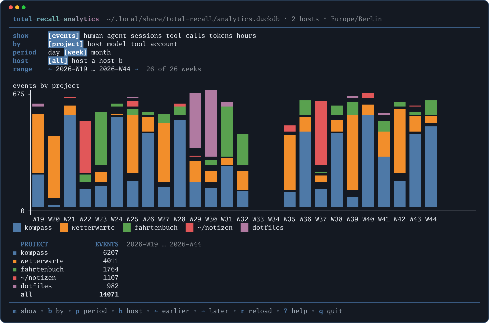
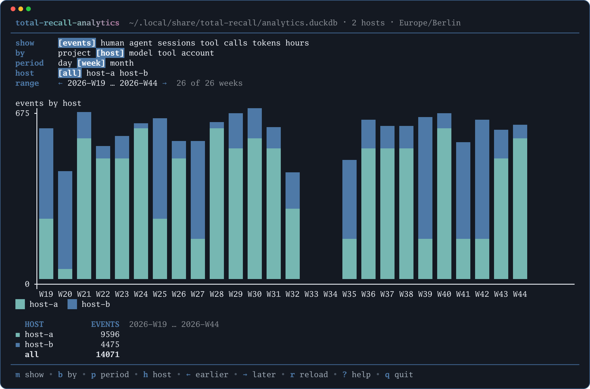

# Agenten-Pool auswerten

Arbeiten Agenten auf mehreren Rechnern, zeigt das [Analyse-Tool](../reference/15-analyse.md) `total-recall-analytics`, wie sie über alle Rechner genutzt werden: je Projekt, Host, Modell und Tool über die Zeit, mit Tokens und Arbeitszeit. Dieses Rezept führt vom ersten Rechner bis zur ersten Auswertung. Die Ausgaben stammen aus dem Demo-Pool: zwei erfundene Rechner, `host-a` (Notebook) und `host-b` (ein Rechner für Agenten), und ein gemeinsames Verzeichnis `/srv/pool/total-recall`.

Es gibt keinen Dienst: Jeder Rechner legt sein neuestes Backup in einen gemeinsamen Ordner, das Analyse-Tool liest von dort. Der Ordner kann eine Netzfreigabe (SMB, NFS) oder ein synchronisierter Ordner sein. Er enthält vollständige Archive, also auch alle Nachrichten; wer ihn lesen kann, kann alles lesen ([Datenschutz](../explanation/datenschutz.md#pool)).

## 1. Jeden Rechner benennen

Auf **jedem** Rechner mit `total-recall` ab v1.11.0: einmal migrieren, damit das Archiv seine Kennung bekommt, und prüfen, welchen Namen der Rechner trägt.

```sh
total-recall backup
total-recall migrate
total-recall status
```

In der Zeile `host` steht der Name, Standard ist der Hostname bis zum ersten Punkt. Passt er nicht (zwei Rechner heißen gleich, der Hostname ist nichtssagend), setzt `total-recall config set host <name>` einen eigenen. In der TUI geht das auf der Seite Settings der Ansicht Config. Einzelheiten mit Screenshots: [Rechner im Pool benennen](68-host-benennen.md).

## 2. Backups ins Pool-Verzeichnis legen

Auf jedem Rechner den gemeinsamen Ordner eintragen und einmal sichern:

```sh
total-recall config set backup.pool_dir /srv/pool/total-recall
total-recall backup
```

```text
backup written: /home/host-a/Documents/total-recall/archive-2026-11-28.db.zst
pool copy: /srv/pool/total-recall/host-a/archive-2026-11-28.db.zst
```

Ab dann hält das tägliche Backup aus dem Hook die Kopie aktuell; im Pool liegt je Rechner genau eine, die neueste. Prüfen auf einem Rechner, der den Ordner sieht:

```text
$ total-recall pool
HOST    BACKUP                     AGE     SIZE       ARCHIVE HOST  ARCHIVE                           SCHEMA  SESSIONS  EVENTS  NOTE
host-a  archive-2026-11-28.db.zst  0s ago  1.8 MiB    host-a        de00000000000000000000000000b00a  v11     639       15058   ok
host-b  archive-2026-11-28.db.zst  0s ago  888.5 KiB  host-b        de00000000000000000000000000b00b  v11     297       6884    ok
```

In der TUI zeigt die Seite Status der Ansicht Config die Zeile `pool` mit der Kopie dieses Rechners. Einzelheiten mit Screenshots: [Pool-Verzeichnis einrichten](69-pool-verzeichnis.md).

## 3. Das Analyse-Tool installieren

Nur auf dem Rechner, der auswertet. Es ist ein eigenes Programm mit DuckDB ([warum](../explanation/analyse-schema.md#warum-duckdb-und-ein-eigenes-programm)), mit Homebrew:

```sh
brew install --cask seletz/tap/total-recall-analytics
total-recall-analytics version
```

Ausgabe auf Linux (auf macOS steht `osx_arm64` oder `osx_amd64`):

```text
total-recall-analytics  1.11.0
DuckDB                  v2.0.1 (8d78114e90, linux_amd64)
extensions              core_functions, icu, json, parquet, sqlite_scanner (compiled in)
```

Release-Archive und der Bau aus dem Quellcode stehen unter [Installieren](10-installieren.md#analyse-tool). Das Tool liest dieselbe Konfiguration wie `total-recall`; auf einem Rechner, der nur auswertet, genügt darin `[backup] pool_dir` (oder `--pool-dir`).

## 4. Laden und auswerten

```sh
total-recall-analytics build --pool
```

```text
/home/mara/.local/share/total-recall/analytics.duckdb: pool /srv/pool/total-recall, 2 archives
  batch 1 (full) from host-a (host host-a), seq 0..15058: 15058 events in 639 sessions, 39 models, 9 tests passed, 1.334s
  batch 2 (full) from host-b (host host-b), seq 0..6884: 6884 events in 297 sessions, 39 models, 9 tests passed, 450ms
```

Jeder Rechner ist eine eigene Quelle. Spätere Läufe laden nur, was neu ist; liegt dieselbe Kopie zweimal im Pool, zählt sie einmal ([Pool](../reference/15-analyse.md#pool)). `build --pool` gehört deshalb gut in einen täglichen Lauf auf dem auswertenden Rechner.

### In der CLI

```text
$ total-recall-analytics usage --by host
TOTAL  HOST    SESSIONS  HUMAN  AGENT  TOOL CALLS  TOKENS IN  TOKENS OUT
total  host-a       639   2068   7528        5315   99166013     1232133
total  host-b       297   1033   3442        2354   45018319      563130

$ total-recall-analytics worktime --by host
TOTAL  HOST    DAYS   HOURS
total  host-a   120  299:19
total  host-b    91  140:24
```

Weiter mit `--by project|model|tool`, `--period day|week|month`, `--host`, `tokens` für die Aufteilung des Caches, `query` für eigenes SQL über die Views und `export` für Parquet oder CSV: [Befehle](../reference/15-analyse.md#befehle). Die Zahlen je Rechner sind dieselben wie `total-recall stats --json` auf dessen Archiv; die Arbeitszeit rechnet über alle Rechner zusammen, weil eine Lücke der Person gehört.

### In der TUI

```sh
total-recall-analytics tui
```



*Events je Projekt und Woche über alle Rechner*

Oben wählen fünf Zeilen, was gezeigt wird: `show` (Events, eigene Prompts, Agent, Sessions, Tool-Aufrufe, Tokens, Stunden), `by` (Projekt, Host, Modell, Tool, Login), `period`, `host` und `range`, das Fenster der Perioden. Ein Klick auf einen Eintrag wählt ihn, ebenso die Tasten `m`, `b`, `p` und `h`; ++left++ / ++right++, die Pfeile in der Zeile `range` und das Mausrad verschieben das Fenster. Ein Klick auf `host` in der Zeile `by` teilt nach Rechner:



*Events je Rechner und Woche*

Alle Ansichten, Tasten und weiteren Screenshots: [TUI](../reference/15-analyse.md#tui).
