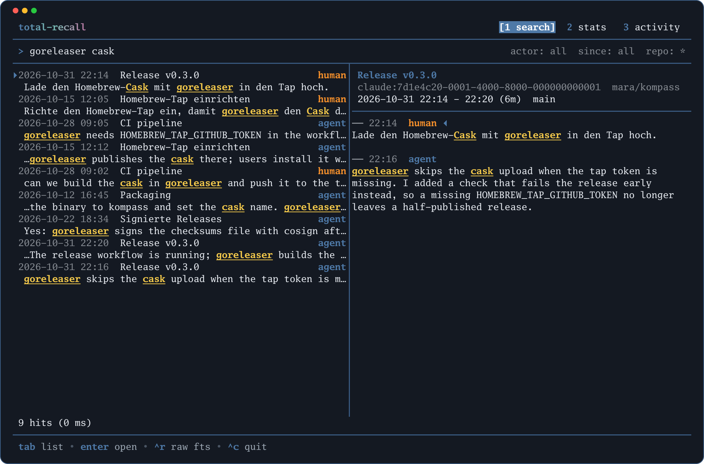

# total-recall

`total-recall` sichert die Sessions deiner Coding-Agenten in einer lokalen SQLite-Datenbank. Zuerst Claude Code, später weitere Harnesses.

*Die [TUI](tui.md): Volltextsuche mit Vorschau, dazu Statistik und Aktivität je Tag*

## Warum

Claude Code löscht alte Transkripte. Der Schalter dafür heißt `cleanupPeriodDays`. Was weg ist, ist weg. Damit verschwindet auch das Wissen darüber, was du wann mit welchem Agenten gemacht hast.

`total-recall` liest die Transkripte laufend ein und hebt sie auf. Danach kannst du sie auswerten:

- Was habe ich letzte Woche in Repo X gemacht?
- Wie viele Sessions hatte ich im Oktober, und an welchen Tagen?
- In welcher Session haben wir über Y entschieden?

## Wie es funktioniert

- **Hooks statt Daemon.** Claude Code ruft `total-recall` über Hooks auf, zum Beispiel am Ende jeder Antwort. Es läuft kein Hintergrunddienst.
- **Inkrementell.** Jede Datei wird ab der Stelle gelesen, an der der letzte Lauf aufgehört hat.
- **Nachlesen.** Beim Start einer Session wird alles nachgelesen, was bisher fehlt. So gehen auch Sessions nicht verloren, bei denen ein Hook ausgefallen ist.
- **Lokal.** Die Datenbank liegt auf deinem Rechner. Geheimnisse werden vor dem Speichern maskiert. Details: [Datenschutz](datenschutz.md).
- **Auswertbar.** Über die [Befehle](befehle.md), die [TUI](tui.md) im Terminal, Read-only-SQL und einen eingebauten Skill für Agenten ([Für Agenten](agenten.md)).

## Was es nicht tut

- Es spielt nichts in laufende Sessions zurück.
- Es gibt keine semantische Suche. Die Volltextsuche nutzt SQLite FTS5.
- Bisher wird nur Claude Code unterstützt.

## Stand

!!! note "Version 0.2"
    Alle Befehle auf der Seite [Befehle](befehle.md) sind umgesetzt, dazu die Terminal-Oberfläche [`total-recall tui`](tui.md). Unterstützt wird bisher nur Claude Code. Was sich je Version geändert hat, steht unter [Änderungen](aenderungen.md).

Die verbindliche Spezifikation steht in [Design (Spezifikation)](design.md).

Diese Dokumentation wird unter <https://seletz.github.io/total-recall/> veröffentlicht. Die Quellen liegen im Repository unter `docs/`.
