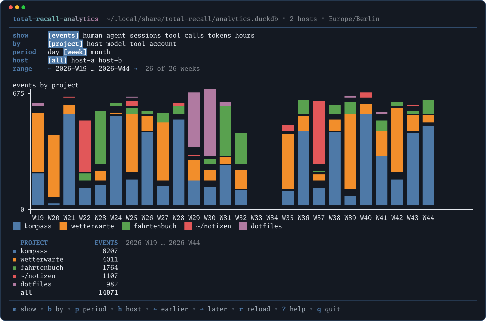
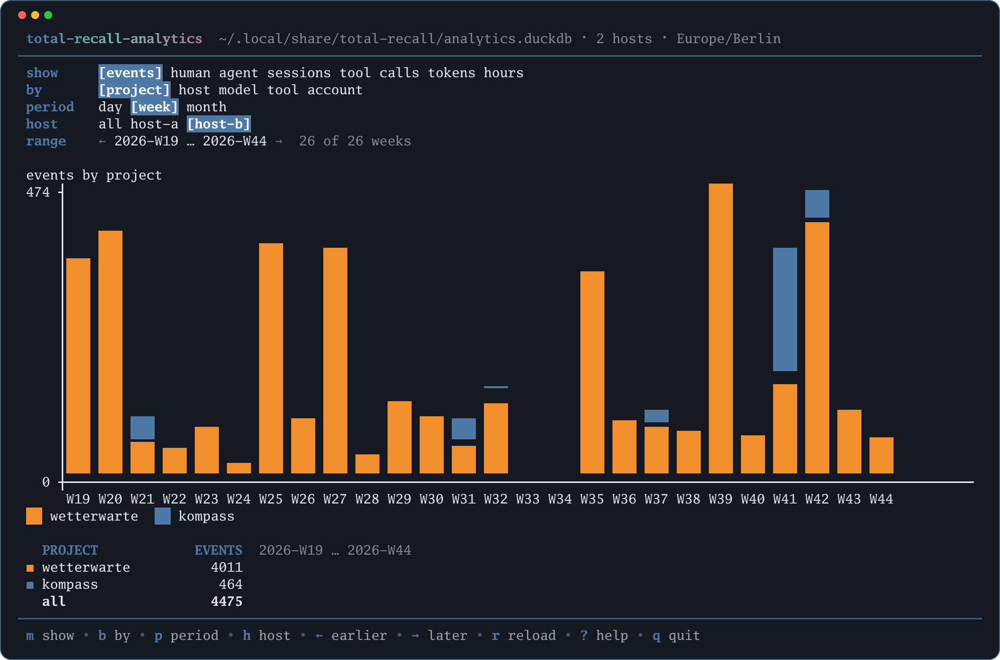
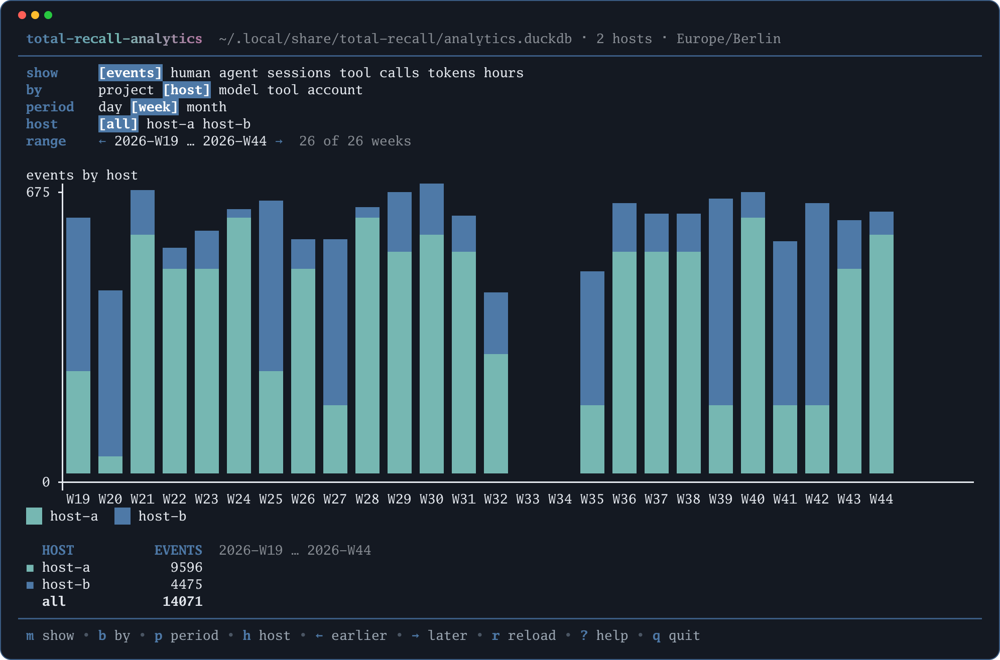
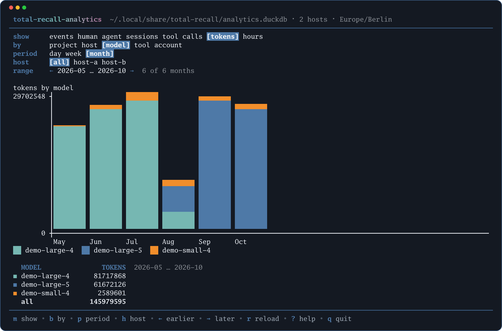
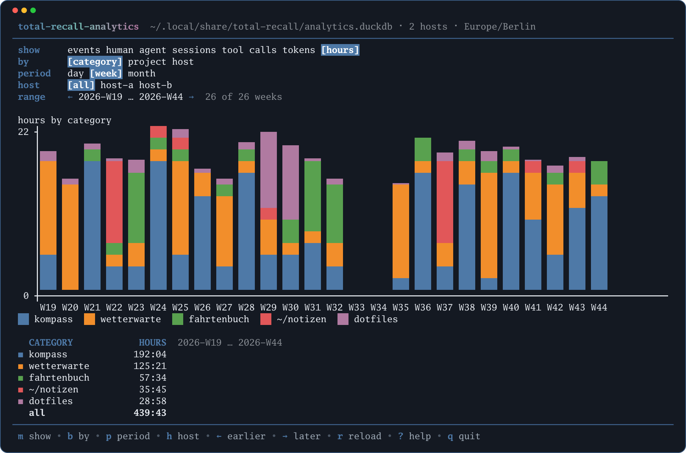
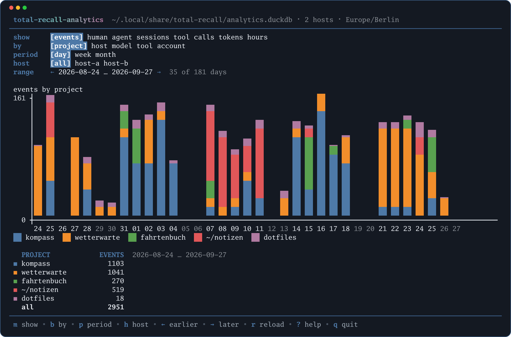
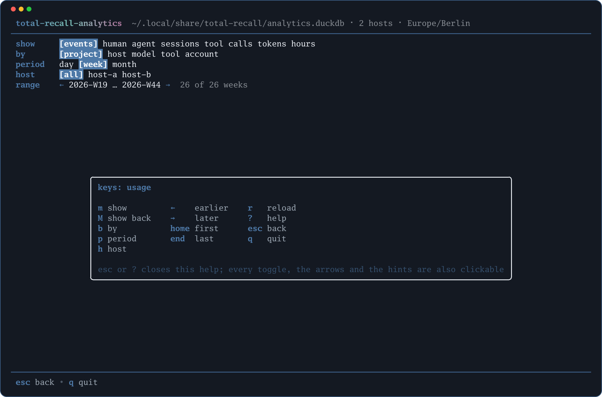

# Analyse-Tool

`total-recall-analytics` ist ein eigenes Programm neben `total-recall`. Es wertet die Archive eines oder mehrerer Hosts mit [DuckDB](https://duckdb.org/) aus: Es liest die Archive schreibgeschützt, baut daraus eine Analyse-Datenbank (Star-Schema) und beantwortet Fragen über alle Hosts eines Agenten-Pools. Die Archive selbst ändert es nie.

Typischer Ablauf: [`build`](#build) lädt das Archiv in die Analyse-Datenbank (beim ersten Mal ganz, danach nur Neues), [`usage`](#usage) und [`tokens`](#tokens) beantworten die häufigsten Fragen, [`query`](#query) und [`export`](#export) öffnen die [Views](#views-vertrag-v1) für eigene Auswertungen, [`status`](#status) und [`check`](#check) zeigen den Zustand. Installieren: [Installieren, Analyse-Tool](../how-to/10-installieren.md#analyse-tool).

## Aufbau

- **Eigenes Binary.** DuckDB kommt über den Go-Treiber [`github.com/duckdb/duckdb-go/v2`](https://github.com/duckdb/duckdb-go) (DuckDB v2.0.1), der eine C++-Bibliothek einbindet und deshalb cgo braucht. `total-recall` bleibt statisch und cgo-frei; das Analyse-Tool ist ein eigenes Go-Modul im Verzeichnis `analytics/` des Repos und hat eigene Build- und Release-Regeln (siehe [Release-Assets](50-release.md#analyse-tool)).
- **Archive über die SQLite-Erweiterung.** DuckDB liest SQLite-Dateien über seine Erweiterung `sqlite_scanner` und hängt jedes Archiv mit `ATTACH … (TYPE sqlite, READ_ONLY)` an. Schreiben in ein angehängtes Archiv lehnt DuckDB ab.
- **Erweiterungen eingebaut, nichts wird nachgeladen.** `sqlite_scanner` gehört nicht zur fertigen DuckDB-Bibliothek; DuckDB würde sie sonst beim ersten Gebrauch von `extensions.duckdb.org` laden. Das Analyse-Tool linkt stattdessen ein DuckDB, das beim Bauen aus dem Quellcode entsteht (`scripts/analytics-duckdb.sh`), mit `sqlite_scanner`, `parquet`, `json`, `icu` (Zeitzonen) und `core_functions` fest eingebaut. Version und Commit stehen in `analytics/duckdb/duckdb.lock`, die Erweiterungen samt Commit von `sqlite_scanner` in `analytics/duckdb/extensions.cmake`. Dieses DuckDB kann zur Laufzeit keine Erweiterung laden oder installieren: `LOAD` und `INSTALL` enden mit `Permission Error: … this build does not link the loadable_extensions library`. Es gibt also keinen Download, keine Erweiterungsdatei auf der Platte und kein `dlopen`; ein `~/.duckdb` einer DuckDB-CLI spielt keine Rolle. Zusätzlich ist automatisches Installieren und Laden abgeschaltet.
- **Plattformen:** macOS arm64 und amd64 (signiert und notarisiert, Hardened Runtime ohne Ausnahmen), Linux amd64 (gegen glibc und libstdc++ von Debian 12 gelinkt; Alpine/musl geht nicht).
- **Ausgabe** wie bei `total-recall`: `--json` gibt ein eingerücktes Dokument mit allen dokumentierten Schlüsseln aus, ein Fehler im JSON-Modus ist ein Objekt `{"error":{"kind":"…","message":"…"}}` auf stdout, die Meldung steht zusätzlich auf stderr, Exit-Code 1. `kind` ist `usage` (Flags, Argumente), `db` (Datenbank oder Archiv nicht zu öffnen), `sql` (DuckDB lehnt eine Abfrage ab) oder `internal`. Siehe [Ausgabevertrag](../explanation/design.md#ausgabevertrag-der-lesebefehle).
- **Pool:** Die Archive mehrerer Hosts kommen über ein gemeinsames Pool-Verzeichnis, in das `total-recall backup` mit [`[backup] pool_dir`](20-konfiguration.md#pool_dir) die neueste Kopie je Host legt ([Pool-Verzeichnis einrichten](../how-to/69-pool-verzeichnis.md)). `total-recall pool` prüft es, [`build --pool`](#pool) lädt es.

## Befehle

Alle Befehle außer `version` und `views` lesen die Konfiguration von `total-recall` (`~/.config/total-recall/config.toml` oder `TOTAL_RECALL_CONFIG`): das Archiv (`db`), die Zeitzone (`timezone`), die [Projekt-Definitionen](../how-to/67-projekte-definieren.md) und die Namen der Logins. So heißen Projekte und Konten hier wie in `total-recall stats`. Globale Optionen:

| Option | Bedeutung |
|---|---|
| `--config PATH` | Konfigurationsdatei von total-recall |
| `--archive PATH` | Archiv statt `db` der Konfiguration |
| `--db PATH` | Analyse-Datenbank; Standard: `analytics.duckdb` neben dem Archiv |
| `--tz ZONE` | primäre Zeitzone statt `timezone` der Konfiguration |

Die Beispiele laufen auf dem Demo-Archiv (Benutzer `mara`, Zone Europe/Berlin). Das Demo-Archiv hat keine Token-Angaben; die Token-Spalten sind dort 0. Die Beispiele zum [Pool](#pool) laufen auf dem Demo-Pool, dessen zwei Hosts Tokens und Modelle haben.

### build

```
total-recall-analytics build [--host NAME] [--source NAME] [--full] [--extra-tz ZONE]... [--json]
total-recall-analytics build --pool [--pool-dir DIR] [--cache DIR] [--full] [--extra-tz ZONE]... [--json]
```

Lädt das Archiv in die Analyse-Datenbank (legt sie beim ersten Mal an). Geladen werden alle Sessions mit Events über dem Wasserstand der Quelle, mit `--full` alle Events der Quelle neu. Danach rechnet der Lauf die Arbeitszeit über alle Quellen neu ([worktime](#worktime)). Ein Lauf ist eine Transaktion: Der Vertrag der Views und alle Datentests müssen bestehen, sonst bleibt die Datenbank, wie sie war. Was dabei passiert: [Analyse-Schema](../explanation/analyse-schema.md#laden).

| Option | Bedeutung |
|---|---|
| `--host NAME` | Host, zu dem das Archiv gehört; Standard: der Host, den das Archiv gespeichert hat ([`host`](20-konfiguration.md#host), ab Schema v11), sonst der kurze Name dieses Rechners |
| `--source NAME` | Name der Quelle für den Wasserstand; Standard: der Host |
| `--full` | alle Events der Quelle neu laden statt nur der neuen |
| `--extra-tz ZONE` | weitere Zone für `analytics_time_slot_v1` (mehrfach) |
| `--pool` | alle Hosts des Pool-Verzeichnisses laden statt eines Archivs (siehe [Pool](#pool)) |
| `--pool-dir DIR` | Pool-Verzeichnis statt [`[backup] pool_dir`](20-konfiguration.md#pool_dir); schließt `--pool` ein |
| `--cache DIR` | wohin `--pool` die Backups entpackt; Standard `<Cache-Verzeichnis des Benutzers>/total-recall/pool` |
| `--json` | Ausgabe als JSON |

```console
$ total-recall-analytics build --host host-a
/home/mara/.local/share/total-recall/analytics.duckdb: batch 1 (full) from host-a (host host-a), seq 0..21942: 21942 events in 936 sessions, 39 models, 9 tests passed, 1.557s
```

Der zweite Lauf findet nichts Neues:

```console
$ total-recall-analytics build --host host-a --json
{
  "analytics_db": "/home/mara/.local/share/total-recall/analytics.duckdb",
  "source": "host-a",
  "host": "host-a",
  "archive": "/home/mara/.local/share/total-recall/archive.db",
  "archive_id": "de00000000000000000000000000a001",
  "replaced": [],
  "tz": "Europe/Berlin",
  "batch_id": 2,
  "mode": "incremental",
  "seq_from": 21942,
  "seq_to": 21942,
  "events": 0,
  "sessions": 0,
  "models": 39,
  "tests": 9,
  "elapsed_ms": 954
}
```

JSON-Schlüssel: `analytics_db`, `source`, `host`, `archive`, `archive_id` (die ID des Archivs, `null` vor Schema v11), `replaced` (Quellen, die dasselbe Archiv unter einem früheren Host-Namen geladen hatten und ersetzt wurden), `tz`, `batch_id`, `mode` (`full` oder `incremental`), `seq_from` und `seq_to` (geladen wurden Sessions mit Events in `seq_from` < seq ≤ `seq_to`), `events` und `sessions` (alle Events der berührten Sessions), `models`, `tests`, `elapsed_ms`.
#### Pool { #pool }

Mit `--pool` kommen die Archive aus dem Pool-Verzeichnis ([Pool-Verzeichnis einrichten](../how-to/69-pool-verzeichnis.md)): je Host die neueste Kopie, einmal in den Cache entpackt und schreibgeschützt eingehängt. Jedes Archiv wird eine eigene Quelle unter dem Host, den es selbst gespeichert hat. Jedes Archiv zählt genau einmal:

- Ein Archiv ohne Kennung (Schema vor v11) wird übersprungen, mit dem Hinweis, auf diesem Host zu migrieren.
- Von mehreren Kopien desselben Archivs (gleiche ID, etwa der alte Ordner eines umbenannten Hosts) zählt nur die neueste.
- Zwei verschiedene Archive, die denselben Host nennen, werden beide übersprungen: Ihre Sessions ließen sich nach Host nicht trennen. Abhilfe: [`host`](20-konfiguration.md#host) auf einem der Rechner setzen.
- Lädt ein Archiv, das schon unter einem anderen Namen geladen war (umbenannter Host), ersetzt es diese Quelle (`replaced`), statt doppelt zu zählen. Ein neues Archiv unter einem bekannten Host-Namen (neu aufgesetzter Rechner) wird ganz geladen.

Der Pool ist die Summe der Hosts: Je Host sind Sessions, Events und Tokens dieselben wie in `total-recall stats --json` auf dem Archiv des Hosts, über den Pool dieselben wie auf einem Archiv mit allen Sessions. Die Arbeitszeit rechnet über alle Hosts zusammen, weil eine Lücke der Person gehört und nicht dem Rechner; ein Test prüft beides gegen den Demo-Pool.

Gegen den Demo-Pool (zwei Hosts, siehe [Pool-Verzeichnis einrichten](../how-to/69-pool-verzeichnis.md)):

```console
$ total-recall-analytics build --pool
/home/mara/.local/share/total-recall/analytics.duckdb: pool /srv/pool/total-recall, 2 archives
  batch 1 (full) from host-a (host host-a), seq 0..15058: 15058 events in 639 sessions, 39 models, 9 tests passed, 1.399s
  batch 2 (full) from host-b (host host-b), seq 0..6884: 6884 events in 297 sessions, 39 models, 9 tests passed, 468ms
```

Der zweite Lauf mit `--json` (gekürzt auf den ersten Host):

```console
$ total-recall-analytics build --pool --json
{
  "analytics_db": "/home/mara/.local/share/total-recall/analytics.duckdb",
  "pool": "/srv/pool/total-recall",
  "cache": "/home/mara/.cache/total-recall/pool",
  "builds": [
    {
      "analytics_db": "/home/mara/.local/share/total-recall/analytics.duckdb",
      "source": "host-a",
      "host": "host-a",
      "archive": "/home/mara/.cache/total-recall/pool/host-a/archive-2026-11-28.db",
      "archive_id": "de00000000000000000000000000b00a",
      "replaced": [],
      …
    },
    …
  ],
  "skipped": []
}
```

JSON: `analytics_db`, `pool`, `cache`, `builds` (je Archiv ein Objekt wie bei `build --json`) und `skipped` (je übersprungener Kopie `host` = Ordner, `backup` und `reason`).

Die Auswertungen trennen nach Host mit `--by host`:

```console
$ total-recall-analytics usage --by host
TOTAL  HOST    SESSIONS  HUMAN  AGENT  TOOL CALLS  TOKENS IN  TOKENS OUT
total  host-a       639   2068   7528        5315   99166013     1232133
total  host-b       297   1033   3442        2354   45018319      563130

$ total-recall-analytics tokens --by host
TOTAL  HOST    EVENTS     INPUT  FRESH  CACHE READ  CACHE WRITE  UNSPLIT   OUTPUT
total  host-a    7528  99166013  22584    91370456      7772973        0  1232133
total  host-b    3442  45018319  10326    41321787      3686206        0   563130

$ total-recall-analytics worktime --by host
TOTAL  HOST    DAYS   HOURS
total  host-a   120  299:19
total  host-b    91  140:24
```

Liegt dasselbe Backup ein zweites Mal im Pool, hier im Ordner `host-c`, zählt es nicht doppelt:

```console
$ total-recall-analytics build --pool
/home/mara/.local/share/total-recall/analytics.duckdb: pool /srv/pool/total-recall, 2 archives
  batch 5 (incremental) from host-a (host host-a), seq 15058..15058: 0 events in 0 sessions, 39 models, 9 tests passed, 955ms
  batch 6 (incremental) from host-b (host host-b), seq 6884..6884: 0 events in 0 sessions, 39 models, 9 tests passed, 345ms
skipped host-c: another copy of the archive of host-b, an older or equally new one
```

**Leistung.** Gemessen mit `mise run analytics:pool-bench` ([`scripts/analytics-pool-bench.sh`](https://github.com/seletz/total-recall/blob/develop/scripts/analytics-pool-bench.sh)) auf einem Apple M3 Max: der Demo-Pool (zwei Hosts) und derselbe Pool mit 10- und 100-mal so vielen Sessions und Events (kopiert, ohne Rohzeilen). Die Kopien im Pool schreibt das echte `total-recall backup`; das Skript prüft, dass die Analyse-Datenbank so viele Events hat wie die Archive.

| Pool | Events | Pool-Verzeichnis | Analyse-Datenbank | `build --pool` (alles) | `build --pool` (nichts Neues) | `usage --by host --period month` | `tokens --by model` | `worktime` |
|---|---:|---:|---:|---:|---:|---:|---:|---:|
| Demo | 21 942 | 2,7 MiB | 15 MiB | 1,2 s | 0,4 s | 51 ms | 48 ms | 43 ms |
| × 10 | 219 420 | 8,3 MiB | 27 MiB | 2,4 s | 1,1 s | 79 ms | 59 ms | 47 ms |
| × 100 | 2 194 200 | 62 MiB | 227 MiB | 13,1 s | 5,5 s | 113 ms | 72 ms | 45 ms |

Ein Lauf ohne neue Events kostet vor allem die Marts und die Arbeitszeit, die jeder Lauf je Host neu berechnet; die Abfragen bleiben auch bei 2,2 Millionen Events unter einer Fünftelsekunde.

### status

```
total-recall-analytics status [--json]
```

Zeigt die Analyse-Datenbank (Größe, Views, Zonen) und je Quelle Host, geladene Events und Sessions, Wasserstand, Rückstand (Events des Archivs über dem Wasserstand, die der nächste `build` lädt; `?`, wenn das Archiv nicht da ist), den letzten Lauf und das Archiv.

```console
$ total-recall-analytics status
/home/mara/.local/share/total-recall/analytics.duckdb: 14.8 MiB, 11 views, zone Europe/Berlin

SOURCE  HOST    EVENTS  SESSIONS  LAST SEQ  BACKLOG  LAST BATCH                          ARCHIVE
host-a  host-a  21942   936       21942     0        2 incremental 2026-11-27T23:58:39Z  /home/mara/.local/share/total-recall/archive.db
```

JSON: `analytics_db`, `size_bytes`, `tz`, `zones`, `views`, `sources` mit je `source`, `host`, `archive`, `archive_id` (`null` ohne Kennung), `archive_found`, `last_seq`, `backlog`, `events`, `sessions` und `last_batch` (`batch_id`, `mode`, `started_at`, `finished_at` in UTC, `seq_from`, `seq_to`, `events`, `sessions`).

### check

```
total-recall-analytics check [--json]
```

Prüft den Vertrag der Views und führt die Datentests aus, ohne etwas zu laden. Exit-Code 1, wenn etwas fehlschlägt, für CI und Cron. Bei einer Abweichung vom Vertrag listet die Ausgabe die betroffenen Zeilen (`-` erwartet, `+` gefunden).

```console
$ total-recall-analytics check
contract                    ok
accepted_values             ok
bridge_coverage             ok
marts_sum_equals_facts      ok
not_null_keys               ok
relationships_fact_event    ok
relationships_fact_session  ok
tokens_split                ok
unique_keys                 ok
worktime_slices_sum         ok
```

JSON: `analytics_db`, `ok`, `contract_ok`, `contract_diff` (Liste), `tests` mit je `name` und `failures` (Zahl der verletzenden Zeilen).

### views

```
total-recall-analytics views [VIEW...] [--json]
```

Listet die veröffentlichten Views mit Spalten und Typen aus dem Vertrag, ohne Datenbank. Die vollständige Liste steht unter [Views](#views-vertrag-v1).

```console
$ total-recall-analytics views analytics_daily_v1
analytics_daily_v1
  day_local            DATE
  host                 VARCHAR
  project              VARCHAR
  sessions             BIGINT
  human_prompts        BIGINT
  agent_events         BIGINT
  tool_calls           BIGINT
  tokens_in            BIGINT
  tokens_out           BIGINT
```

JSON: eine Liste mit je `view` und `columns` (`name`, `type`).

### query

```
total-recall-analytics query SQL [--format table|json|jsonl|csv] [--json]
```

Führt eine SQL-Abfrage auf der Analyse-Datenbank aus. Die Datenbank ist dabei nur lesbar geöffnet, ohne Zugriff auf Dateien (kein `ATTACH`, kein `read_csv`) und mit gesperrter Konfiguration; Schnittstelle sind die Views `analytics_*_v1`. `-` liest die Abfrage von stdin. Formate wie bei `total-recall sql`: JSON behält Zahlen als Zahlen, ein Datum als `YYYY-MM-DD`, Zeitpunkte als RFC 3339 in UTC, NULL als `null`.

```console
$ total-recall-analytics query "SELECT project, sum(calls) AS calls FROM analytics_tool_month_v1 WHERE month = '2026-10' GROUP BY project ORDER BY calls DESC"
project      calls
kompass      825
wetterwarte  419
fahrtenbuch  130
~/notizen    38
dotfiles     13
```

```console
$ total-recall-analytics query --format csv "SELECT iso_weekday, sum(human_events) AS human, sum(agent_events) AS agent FROM analytics_weekhour_v1 GROUP BY iso_weekday ORDER BY iso_weekday"
iso_weekday,human,agent
1,613,2265
2,665,2434
3,627,2184
4,576,1910
5,529,1830
6,76,271
7,15,76
```

Eine schreibende Abfrage ist ein Fehler der Art `sql`:

```console
$ total-recall-analytics query --json "CREATE TABLE x AS SELECT 1"
total-recall-analytics: Invalid Input Error: Cannot execute statement of type "EXECUTE" on database "analytics" which is attached in read-only mode!
{"error":{"kind":"sql","message":"Invalid Input Error: Cannot execute statement of type \"EXECUTE\" on database \"analytics\" which is attached in read-only mode!"}}
```

### export

```
total-recall-analytics export --out DIR [--format parquet|csv] [VIEW...] [--json]
```

Schreibt Views als Dateien `DIR/<view>.parquet` (Standard) oder `.csv`, für Notebooks und BI-Werkzeuge; ohne `VIEW` alle. Vorhandene Dateien werden ersetzt.

```console
$ total-recall-analytics export --out /home/mara/analyse
VIEW                        ROWS   FILE
analytics_daily_v1          304    /home/mara/analyse/analytics_daily_v1.parquet
analytics_events_v1         21942  /home/mara/analyse/analytics_events_v1.parquet
analytics_project_week_v1   101    /home/mara/analyse/analytics_project_week_v1.parquet
analytics_session_month_v1  30     /home/mara/analyse/analytics_session_month_v1.parquet
analytics_sessions_v1       936    /home/mara/analyse/analytics_sessions_v1.parquet
analytics_time_slot_v1      17338  /home/mara/analyse/analytics_time_slot_v1.parquet
analytics_tokens_day_v1     0      /home/mara/analyse/analytics_tokens_day_v1.parquet
analytics_tool_month_v1     104    /home/mara/analyse/analytics_tool_month_v1.parquet
analytics_weekhour_v1       94     /home/mara/analyse/analytics_weekhour_v1.parquet
analytics_worktime_day_v1   297    /home/mara/analyse/analytics_worktime_day_v1.parquet
analytics_worktime_v1       739    /home/mara/analyse/analytics_worktime_v1.parquet
```

JSON: eine Liste mit je `view`, `path` und `rows`.

### usage

```
total-recall-analytics usage [--by GRUPPE] [--period day|week|month|total] [--since YYYY-MM-DD] [--until YYYY-MM-DD] [--host HOST]... [--json]
```

Nutzung über die Zeit: Sessions, eigene Prompts (`human`), Agent-Events, Tool-Aufrufe und Tokens, gruppiert nach `--by` (`project` als Standard, `host`, `model`, `family`, `tool`, `account`, `repo`, `harness` oder `none`) und `--period` (lokale Tage, ISO-Wochen `2026-W42`, Monate oder `total`, Standard) in der primären Zone. `sessions` zählt die Sessions mit einem human- oder agent-Event in der Gruppe, wie `stats`. `--since` und `--until` begrenzen auf lokale Tage. Summe gleich Teile: Gesamt und je Tag stimmen mit `total-recall stats --json` überein, und jede Gruppierung summiert sich zum Gesamt (Test).

`--host HOST` (mehrfach) beschränkt `usage`, `tokens` und `worktime` auf diese Hosts; im Pool zum Beispiel host-b allein:

```console
$ total-recall-analytics usage --by project --host host-b
TOTAL  PROJECT      SESSIONS  HUMAN  AGENT  TOOL CALLS  TOKENS IN  TOKENS OUT
total  kompass            27    106    358         249    4850364       58899
total  wetterwarte       270    927   3084        2105   40167955      504231
```

```console
$ total-recall-analytics usage --by project
TOTAL  PROJECT      SESSIONS  HUMAN  AGENT  TOOL CALLS  TOKENS IN  TOKENS OUT
total  dotfiles           61    209    773         554          0           0
total  fahrtenbuch       116    389   1375         958          0           0
total  kompass           414   1335   4872        3444          0           0
total  wetterwarte       270    927   3084        2105          0           0
total  ~/notizen          75    241    866         608          0           0
```

```console
$ total-recall-analytics usage --by none --period month --since 2026-09-01
MONTH    SESSIONS  HUMAN  AGENT  TOOL CALLS  TOKENS IN  TOKENS OUT
2026-09       175    589   2142        1517          0           0
2026-10       178    585   2045        1425          0           0
```

```console
$ total-recall-analytics usage --by project --period week --since 2026-10-12 --until 2026-10-18 --json
[
  {
    "period": "2026-W42",
    "key": "dotfiles",
    "sessions": 1,
    "human": 3,
    "agent": 4,
    "tool_calls": 1,
    "tokens_in": 0,
    "tokens_out": 0
  },
  {
    "period": "2026-W42",
    "key": "fahrtenbuch",
    "sessions": 2,
    "human": 8,
    "agent": 32,
    "tool_calls": 24,
    "tokens_in": 0,
    "tokens_out": 0
  },
  {
    "period": "2026-W42",
    "key": "kompass",
    "sessions": 11,
    "human": 38,
    "agent": 114,
    "tool_calls": 74,
    "tokens_in": 0,
    "tokens_out": 0
  },
  {
    "period": "2026-W42",
    "key": "wetterwarte",
    "sessions": 26,
    "human": 75,
    "agent": 338,
    "tool_calls": 254,
    "tokens_in": 0,
    "tokens_out": 0
  },
  {
    "period": "2026-W42",
    "key": "~/notizen",
    "sessions": 1,
    "human": 4,
    "agent": 13,
    "tool_calls": 9,
    "tokens_in": 0,
    "tokens_out": 0
  }
]
```

JSON: eine Liste mit je `period`, `key` (`null` ohne Wert, etwa ein Event ohne Modell, und bei `--by none`), `sessions`, `human`, `agent`, `tool_calls`, `tokens_in`, `tokens_out`.

### tokens

```
total-recall-analytics tokens [--by GRUPPE] [--period …] [--since …] [--until …] [--json]
```

Events mit Token-Angaben und ihre Tokens, gruppiert wie bei `usage` (Standard `--by model`): Input mit seiner Aufteilung (frisch, Cache-Lesen, Cache-Schreiben, ohne Aufteilung; die vier ergeben zusammen den Input) und Output, mit denselben Schlüsseln wie `tokens` in `total-recall stats --json` und denselben Zahlen je Modell (Test). Auf dem Demo-Archiv ohne Token-Angaben ist die Liste leer:

```console
$ total-recall-analytics tokens --by model
TOTAL  MODEL  EVENTS  INPUT  FRESH  CACHE READ  CACHE WRITE  UNSPLIT  OUTPUT
```

JSON: eine Liste mit je `period`, `key`, `events`, `input`, `fresh`, `cache_read`, `cache_write`, `unsplit`, `output`.

### worktime

```
total-recall-analytics worktime [--by category|project|host|none] [--period …] [--since …] [--until …] [--host HOST]... [--json]
```

Arbeitszeit, geschätzt wie bei [`total-recall stats --worktime`](../how-to/40-arbeitszeit.md): aus den Lücken zwischen eigenen Prompts, mit `[worktime]` der Konfiguration (Höchstlücke, Gutschrift, Raster, Rundung, Kategorien) und dem Tagesbeginn `day_start`. Gerechnet wird über alle Hosts der Analyse-Datenbank zusammen: Eine Lücke gehört zur Person, nicht zum Host, und wer auf zwei Rechnern gleichzeitig arbeitet, bekommt die Zeit nur einmal gutgeschrieben. Gruppiert nach Kategorie (Standard), Projekt, Host (der Host der Session) oder gar nicht, je Arbeitstag, ISO-Woche, Monat oder gesamt. `HOURS` ist die gutgeschriebene Zeit, `BOOKED` die zu buchende, gerundet je Arbeitstag und Kategorie wie in `stats`; deshalb gibt es sie nur bei `--by category` und `none` und ohne `--host`. Summe gleich Teile: Gesamt, je Tag und je Tag und Kategorie gleich `stats --worktime --json` auf demselben Archiv (Test).

```console
$ total-recall-analytics worktime
TOTAL  CATEGORY     DAYS   HOURS  BOOKED
total  dotfiles       24   28:58   31:45
total  fahrtenbuch    53   57:34   62:15
total  kompass       106  192:04  206:15
total  wetterwarte    88  125:21  135:00
total  ~/notizen      26   35:45   39:00
```

```console
$ total-recall-analytics worktime --by project --period month --since 2026-10-01
MONTH    PROJECT      DAYS  HOURS
2026-10  dotfiles        3   1:01
2026-10  fahrtenbuch     9   7:31
2026-10  kompass        26  45:07
2026-10  wetterwarte    16  20:29
2026-10  ~/notizen       4   3:39
```

```console
$ total-recall-analytics worktime --by none --period week --since 2026-10-12 --until 2026-10-25 --json
[
  {
    "period": "2026-W42",
    "key": null,
    "raw_seconds": 60248,
    "rounded_seconds": 63900,
    "days": 6
  },
  {
    "period": "2026-W43",
    "key": null,
    "raw_seconds": 64935,
    "rounded_seconds": 72900,
    "days": 7
  }
]
```

JSON: eine Liste mit je `period`, `key`, `raw_seconds` (gutgeschrieben), `rounded_seconds` (zu buchen; 0 bei `--by project` und `host`), `days` (Arbeitstage mit Zeit).

### version

```
total-recall-analytics version [--json]
```

Zeigt die Version des Programms, die gelinkte DuckDB-Version mit Commit und Plattform und die eingebauten Erweiterungen. Weil der Befehl DuckDB öffnet, ist er zugleich die Probe, ob das Programm auf dem Rechner läuft.

| Option | Bedeutung |
|---|---|
| `--json` | Ausgabe als JSON |

Beispiel (Linux, Snapshot-Build, in einem Container ohne Netz):

```console
$ total-recall-analytics version
total-recall-analytics  1.11.0
DuckDB                  v2.0.1 (8d78114e90, linux_amd64)
extensions              core_functions, icu, json, parquet, sqlite_scanner (compiled in)
```

```console
$ total-recall-analytics version --json
{
  "version": "1.11.0",
  "duckdb": "v2.0.1",
  "duckdb_source": "8d78114e90",
  "platform": "linux_amd64",
  "extensions": [
    {
      "name": "core_functions",
      "version": "v2.0.1",
      "static": true
    },
    {
      "name": "icu",
      "version": "v2.0.1",
      "static": true
    },
    {
      "name": "json",
      "version": "v2.0.1",
      "static": true
    },
    {
      "name": "parquet",
      "version": "v2.0.1",
      "static": true
    },
    {
      "name": "sqlite_scanner",
      "version": "ce0987fda4",
      "static": true
    }
  ]
}
```

| Schlüssel | Inhalt |
|---|---|
| `version` | Version des Programms (`dev` bei einem Build ohne Release) |
| `duckdb` | Version der gelinkten DuckDB |
| `duckdb_source` | Commit von DuckDB, aus dem sie gebaut ist (gekürzt) |
| `platform` | DuckDB-Plattform (`osx_arm64`, `osx_amd64`, `linux_amd64`) |
| `extensions` | geladene Erweiterungen; nie `null` |
| `extensions[].name` | Name der Erweiterung |
| `extensions[].version` | Version der Erweiterung: die DuckDB-Version bei denen aus dem DuckDB-Repository, sonst der Commit (`sqlite_scanner`) |
| `extensions[].static` | `true`: fest eingebaut; dieses Programm lädt keine anderen |

Ein Fehler im JSON-Modus:

```console
$ total-recall-analytics version --json --bogus
total-recall-analytics: unknown flag: --bogus
{"error":{"kind":"usage","message":"unknown flag: --bogus"}}
```

## Views (Vertrag v1)

Die Views `analytics_*_v1` sind die einzige Schnittstelle der Analyse-Datenbank für Abfragen, Notebooks und BI-Werkzeuge; die Tabellen dahinter (Dimensionen, Fakten, Marts) können sich ändern. Spalten und Typen stehen in `analytics/internal/star/project/contract.txt` und werden nach jedem Lauf geprüft: Weicht eine View ab, bricht der Lauf ab und die Datenbank bleibt, wie sie war. Spalten kommen nur dazu; ein Bruch ergibt eine View `_v2` neben `_v1`. Zeiten sind UTC (`TIMESTAMP`), lokale Tage und Stunden in der primären Zone des Laufs; andere Zonen über `analytics_time_slot_v1` und `slot_key` (Unix-Sekunden / 900). Warum das Schema so aussieht: [Analyse-Schema](../explanation/analyse-schema.md).

### `analytics_daily_v1`

lokaler Tag × Host × Projekt.

| Spalte | Typ |
|---|---|
| `day_local` | `DATE` |
| `host` | `VARCHAR` |
| `project` | `VARCHAR` |
| `sessions` | `BIGINT` |
| `human_prompts` | `BIGINT` |
| `agent_events` | `BIGINT` |
| `tool_calls` | `BIGINT` |
| `tokens_in` | `BIGINT` |
| `tokens_out` | `BIGINT` |

### `analytics_events_v1`

eine Zeile je Event (Fakt `fact_event`), lokale Zeit in der primären Zone.

| Spalte | Typ |
|---|---|
| `event_id` | `VARCHAR` |
| `session_id` | `VARCHAR` |
| `host` | `VARCHAR` |
| `project` | `VARCHAR` |
| `repo` | `VARCHAR` |
| `is_subagent` | `BOOLEAN` |
| `ts` | `TIMESTAMP` |
| `day_local` | `DATE` |
| `hour_local` | `INTEGER` |
| `weekday_local` | `INTEGER` |
| `slot_key` | `BIGINT` |
| `kind` | `VARCHAR` |
| `role` | `VARCHAR` |
| `actor` | `VARCHAR` |
| `input_kind` | `VARCHAR` |
| `tool_name` | `VARCHAR` |
| `tool_kind` | `VARCHAR` |
| `mcp_server` | `VARCHAR` |
| `model` | `VARCHAR` |
| `model_family` | `VARCHAR` |
| `harness` | `VARCHAR` |
| `account_name` | `VARCHAR` |
| `account_group` | `VARCHAR` |
| `tokens_in` | `BIGINT` |
| `tokens_out` | `BIGINT` |
| `tokens_cache_read` | `BIGINT` |
| `tokens_cache_write` | `BIGINT` |
| `tokens_fresh` | `BIGINT` |
| `tokens_unsplit` | `BIGINT` |

### `analytics_project_week_v1`

ISO-Woche × Projekt.

| Spalte | Typ |
|---|---|
| `iso_year` | `INTEGER` |
| `iso_week` | `INTEGER` |
| `project` | `VARCHAR` |
| `sessions` | `BIGINT` |
| `active_days` | `BIGINT` |
| `human_events` | `BIGINT` |
| `agent_events` | `BIGINT` |
| `tool_calls` | `BIGINT` |
| `tokens_in` | `BIGINT` |
| `tokens_out` | `BIGINT` |

### `analytics_session_month_v1`

lokaler Monat des Session-Beginns × Projekt.

| Spalte | Typ |
|---|---|
| `month` | `VARCHAR` |
| `project` | `VARCHAR` |
| `sessions` | `BIGINT` |
| `subagent_sessions` | `BIGINT` |
| `avg_duration_min` | `DOUBLE` |
| `total_duration_h` | `DOUBLE` |
| `human_events` | `BIGINT` |
| `agent_events` | `BIGINT` |
| `agent_per_human` | `DOUBLE` |
| `model_switch_sessions` | `BIGINT` |

### `analytics_sessions_v1`

eine Zeile je Session (Fakt `fact_session`).

| Spalte | Typ |
|---|---|
| `session_id` | `VARCHAR` |
| `host` | `VARCHAR` |
| `harness` | `VARCHAR` |
| `harness_version` | `VARCHAR` |
| `project` | `VARCHAR` |
| `repo` | `VARCHAR` |
| `git_branch` | `VARCHAR` |
| `model` | `VARCHAR` |
| `account_id` | `VARCHAR` |
| `account_name` | `VARCHAR` |
| `account_group` | `VARCHAR` |
| `parent_id` | `VARCHAR` |
| `is_subagent` | `BOOLEAN` |
| `started_at` | `TIMESTAMP` |
| `ended_at` | `TIMESTAMP` |
| `duration_s` | `BIGINT` |
| `events` | `BIGINT` |
| `human_events` | `BIGINT` |
| `agent_events` | `BIGINT` |
| `tool_calls` | `BIGINT` |
| `distinct_models` | `BIGINT` |
| `model_switches` | `BIGINT` |
| `tokens_in` | `BIGINT` |
| `tokens_out` | `BIGINT` |

### `analytics_time_slot_v1`

die Zeitzonen-Brücke: Zone × UTC-Viertelstunde → lokaler Tag, Stunde, Wochentag.

| Spalte | Typ |
|---|---|
| `tz` | `VARCHAR` |
| `slot_key` | `BIGINT` |
| `local_date` | `DATE` |
| `local_hour` | `INTEGER` |
| `iso_weekday` | `INTEGER` |

### `analytics_tokens_day_v1`

lokaler Tag × Modell, nur Events mit Token-Angaben.

| Spalte | Typ |
|---|---|
| `day_local` | `DATE` |
| `model` | `VARCHAR` |
| `model_family` | `VARCHAR` |
| `events` | `BIGINT` |
| `tokens_in` | `BIGINT` |
| `tokens_fresh` | `BIGINT` |
| `tokens_cache_read` | `BIGINT` |
| `tokens_cache_write` | `BIGINT` |
| `tokens_unsplit` | `BIGINT` |
| `tokens_out` | `BIGINT` |

### `analytics_tool_month_v1`

lokaler Monat × Projekt × Tool.

| Spalte | Typ |
|---|---|
| `month` | `VARCHAR` |
| `project` | `VARCHAR` |
| `tool_name` | `VARCHAR` |
| `tool_kind` | `VARCHAR` |
| `mcp_server` | `VARCHAR` |
| `calls` | `BIGINT` |

### `analytics_weekhour_v1`

Wochentag × Stunde (lokal), human- und agent-Events.

| Spalte | Typ |
|---|---|
| `iso_weekday` | `INTEGER` |
| `local_hour` | `INTEGER` |
| `human_events` | `BIGINT` |
| `agent_events` | `BIGINT` |

### `analytics_worktime_day_v1`

Arbeitszeit je Arbeitstag × Kategorie: gutgeschrieben und zu buchen (gerundet), wie `stats --worktime`.

| Spalte | Typ |
|---|---|
| `day_local` | `DATE` |
| `category` | `VARCHAR` |
| `raw_seconds` | `BIGINT` |
| `rounded_seconds` | `BIGINT` |

### `analytics_worktime_v1`

Arbeitszeit je Arbeitstag × Kategorie × Session (gutgeschriebene Sekunden), mit Projekt und Host der Session; über alle Hosts gerechnet.

| Spalte | Typ |
|---|---|
| `day_local` | `DATE` |
| `category` | `VARCHAR` |
| `project` | `VARCHAR` |
| `host` | `VARCHAR` |
| `session_id` | `VARCHAR` |
| `raw_seconds` | `BIGINT` |

## TUI { #tui }

```
total-recall-analytics tui [--show WAS] [--by GRUPPE] [--period day|week|month] [--host HOST] [--no-mouse]
```

Die Nutzung des Pools als Diagramm über die Zeit, mit den Summen darunter. Die Zahlen sind die von [`usage`](#usage) und [`worktime`](#worktime), aus denselben Abfragen; ein Test vergleicht die Tabelle der Ansicht mit ihnen. Die Analyse-Datenbank ist nur offen, solange eine Ansicht lädt, so kann daneben ein `build` laufen; `r` lädt neu.



*Analyse-TUI: Events je Projekt und Woche über alle Hosts des Pools*

Oben stehen fünf Zeilen, in denen die gewählte Möglichkeit in Klammern auf farbigem Grund steht. Jede Möglichkeit ist anklickbar und hat eine Taste:

| Zeile | Möglichkeiten | Taste |
|---|---|---|
| `show` | `events` (eigene Prompts und Agent-Events), `human`, `agent`, `sessions`, `tool calls`, `tokens` (Eingabe und Ausgabe), `hours` (Arbeitszeit) | `m`, zurück `M` |
| `by` | `project`, `host`, `model`, `tool`, `account`; bei `hours` `category`, `project`, `host` | `b` |
| `period` | `day`, `week` (ISO), `month` | `p` |
| `host` | `all` oder ein Host des Pools | `h` |
| `range` | das Fenster der Perioden: `←` und `→` verschieben es um ein halbes Fenster | ++left++ / ++right++, ++home++ / ++end++, Mausrad |

Darunter das gestapelte Balkendiagramm des Fensters: die sechs größten Schlüssel einzeln, der Rest als `other`, die Farben bleiben beim Umschalten gleich. Bei Tagen sind Wochenenden auf der Achse blass. Die Tabelle darunter zeigt die Summen des Fensters je Schlüssel und in der Zeile `all` über alle; Sessions zählen dort einmal je Fenster, nicht je Periode, wie bei `usage --since --until`. Die Fußzeile nennt zuerst die Tasten der Ansicht, dann Hilfe und Beenden; jeder Eintrag ist anklickbar. `?` öffnet die Hilfe mit allen Tasten, ++esc++ oder `?` schließt sie, `q` beendet.

Ein Klick auf `host-b` in der Zeile `host` zeigt nur diesen Host:



*Analyse-TUI: dieselbe Auswertung nur für host-b, per Klick in der Zeile host*

Ein Klick auf `host` in der Zeile `by` teilt nach Host:



*Analyse-TUI: Events je Host und Woche, per Klick in der Zeile by*

`tokens` nach `model` und `month`; im Demo-Pool wechseln die Hauptsessions im August das Modell:



*Analyse-TUI: Tokens je Modell und Monat; der Modellwechsel im August ist zu sehen*

`hours` zeigt die Arbeitszeit, über alle Hosts zusammen gerechnet wie bei `worktime`:



*Analyse-TUI: Arbeitszeit je Kategorie und Woche über alle Hosts*

Mit `day` passt nur ein Teil der Tage ins Fenster (`35 of 181 days`); `←` in der Zeile `range` geht ein halbes Fenster zurück:



*Analyse-TUI: Tage, mit dem Pfeil in der Zeile range zwei halbe Fenster zurück*



*Analyse-TUI: die Hilfe mit allen Tasten*

| Option | Bedeutung |
|---|---|
| `--show WAS` | was gezählt wird, wie in der Zeile `show`; Standard `events` |
| `--by GRUPPE` | Aufteilung; Standard die erste der Zeile `by` |
| `--period P` | `day`, `week` (Standard) oder `month` |
| `--host HOST` | nur dieser Host |
| `--no-mouse` | keine Mausmeldungen vom Terminal anfordern (dann markiert das Terminal Text wie gewohnt) |

Ohne Analyse-Datenbank endet `tui` mit dem Hinweis, erst `build` auszuführen.

**Was es nur in der Kommandozeile gibt.** Die TUI zeigt die Auswertungen von `usage`, `tokens` (in Summe von Eingabe und Ausgabe; die Aufteilung des Caches nur in `tokens`) und `worktime`. Laden (`build`), prüfen (`status`, `check`, `views`), eigenes SQL (`query`), `export` und `version` haben kein Gegenstück in der TUI; die Kopfzeile der TUI nennt die Analyse-Datenbank, die Zahl der Rechner und die Zone, also das, was `status` zuerst zeigt. Die Screenshots entstehen mit `mise run analytics:screenshots` gegen den Demo-Pool; ein Test vergleicht ihren Text mit `analytics/internal/shots/testdata/frames`.
