# TUI

`total-recall tui` öffnet das Archiv in einer Vollbild-Oberfläche im Terminal: Volltextsuche mit Vorschau beim Tippen, eine Detailansicht je Session, eine Statistik der Aktivität als Chart, Tabelle und Heatmap, die erste und letzte Aktivität je Tag und eine Ansicht [Config](#config) mit Status, Einstellungen, Wartungsaktionen und Prüfung der Installation. Die Datenbank wird nur lesend geöffnet; allein die Aktionen der Ansicht Config schreiben, nach Bestätigung und wie die gleichnamigen Befehle.

!!! note "Herkunft"
    Die TUI ist das Ergebnis eines Spikes und seit v0.2.0 fester Bestandteil von `total-recall`. Entwurf, Abweichungen, Messwerte und die Entscheidung zur Übernahme stehen in [Spike: TUI](../explanation/spike-tui.md). Die Oberfläche ist Englisch wie die übrige CLI-Ausgabe. Die Textbeispiele auf dieser Seite sind erfunden, ebenso die Bilder: Sie zeigen das synthetische Demo-Archiv (`mise run demo:db`), eine erfundene Entwicklerin mit erfundenen Projekten und Sessions von Mai bis Oktober 2026. Erzeugt werden sie mit `mise run docs:screenshots`; wer die TUI ändert, erzeugt sie neu, und `mise run docs:screenshots:check` prüft, ob sie noch stimmen, siehe [Design](../explanation/design.md#technik).

## Aufruf

```sh
total-recall tui                          # startet in der Suche
total-recall tui stats                    # startet in der Statistik
total-recall tui activity                 # startet in der Aktivität je Tag
total-recall tui config                   # startet in Status, Einstellungen, Aktionen, Setup
total-recall tui --query "goreleaser"     # Suche mit vorbelegtem Suchtext
total-recall tui stats --graphics text    # Chart als Text, kein Bild
```

| Argument / Option | Bedeutung |
|---|---|
| `search` \| `stats` \| `activity` \| `config` | Ansicht beim Start, Default `view` aus `[tui]`, sonst `search` |
| `--query TEXT` | Suchtext vorbelegen; die Suche läuft sofort beim Start |
| `--graphics auto\|text\|kitty` | Chart-Darstellung in der Statistik, Default `graphics` aus `[tui]`, sonst `auto`; siehe [Grafikmodi](#grafikmodi) |
| `--no-mouse` | Maus dem Terminal überlassen: kein Mausrad, keine Klicks, dafür Textauswahl durch einfaches Ziehen; siehe [Maus](#maus). Default `mouse` aus `[tui]`; `--no-mouse=false` schaltet die Maus für einen Aufruf wieder ein |
| `--reload DAUER` | Intervall, in dem die TUI das Archiv auf Änderungen prüft und die sichtbare Ansicht neu lädt, etwa `--reload 2s`; `--reload 0` schaltet das Neuladen ab, mindestens `1s`. Default `reload` aus `[tui]`, sonst `5s`; siehe [Neuladen](#neuladen) |

Die [globalen Optionen](10-befehle.md#globale-optionen) `--db`, `--tz` und `--config` gelten wie überall; `--tz` bzw. `timezone` aus der Config bestimmt Tages-, Wochen- und Monatsgrenzen, `day_start` die Tagesgrenze der Aktivitätsansicht. Der Abschnitt [`[tui]`](20-konfiguration.md#tui) der Konfiguration setzt die Defaults von Ansicht, Grafikmodus und Maus sowie Periode und Dimension der Statistik und das Fenster der Aktivität; Flags und Argument gehen vor. Beenden mit `q` oder ++ctrl+c++ (++ctrl+c++ immer, `q` nur, solange kein Eingabefeld den Fokus hat).

Alle Tasten auf dieser Seite sind die Standardbelegung. Sie ist auf ein deutsches Mac-Layout ausgelegt und lässt sich über den Abschnitt `[keys]` der Konfiguration ändern, siehe [Tastenbelegung anpassen](#tastenbelegung-anpassen).

Die Oberfläche braucht mindestens 80×24 Zeichen; die Bilder auf dieser Seite zeigen 120×36 Zeichen, die kompakten Layouts 80×24. Bei weniger Platz werden Fußzeile und Tabellen abgeschnitten (`…`), die Heatmap wechselt in ein kompaktes Layout und blendet sich darunter aus.

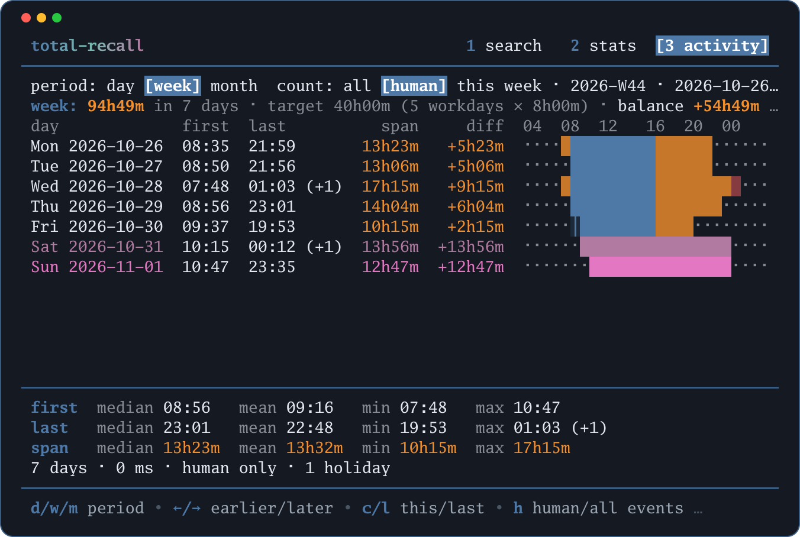

*Aktivität bei 80×24: Kopf- und Fußzeile werden gekürzt, die Zeitachse wird schmaler*


## Aufbau

Alle Ansichten teilen denselben Rahmen:

- **Kopfzeile:** links der Programmname in einem Farbverlauf, in der Mitte gedämpft der Stand der Daten (`updated 14:03:12`, siehe [Neuladen](#neuladen)), rechts die Ansichten als Tabs. Die aktive steht in eckigen Klammern auf der Akzentfarbe (`[1 search]  2 stats  3 activity  4 config`), damit sie auch ohne Farbe erkennbar ist. Ist eine Session geöffnet, hängt ihr Name an der Suche: `[1 search] › session`. Wird es eng, weicht der Stand den Tabs.
- **Fußzeile:** die wichtigsten Tasten der aktuellen Ansicht, dann die globalen (`1 search • 2 stats • 3 activity • ? help • q quit`; `4 config` steht nur in der Hilfe, damit die Zeile bei 100 Spalten passt), die Tasten in der Akzentfarbe, die Beschreibungen gedämpft. Hat ein Eingabefeld den Fokus, steht dort nur noch `ctrl+c quit`, weil alle anderen Tasten in das Feld gehen.
- **Hilfe:** `?` legt ein Overlay mit allen Tasten der aktuellen Ansicht und den globalen Tasten über den Inhalt, in einem abgerundeten Rahmen in der Akzentfarbe. ++esc++ oder `?` schließt es. Das Overlay wird aus derselben Tastenbelegung erzeugt wie die Fußzeile.
- **Farben:** alle Ansichten teilen ein Theme, siehe [Farben](#farben).
- **Maus:** ein Klick auf einen Tab in der Kopfzeile wechselt die Ansicht, das Mausrad blättert im Inhalt; siehe [Maus](#maus).

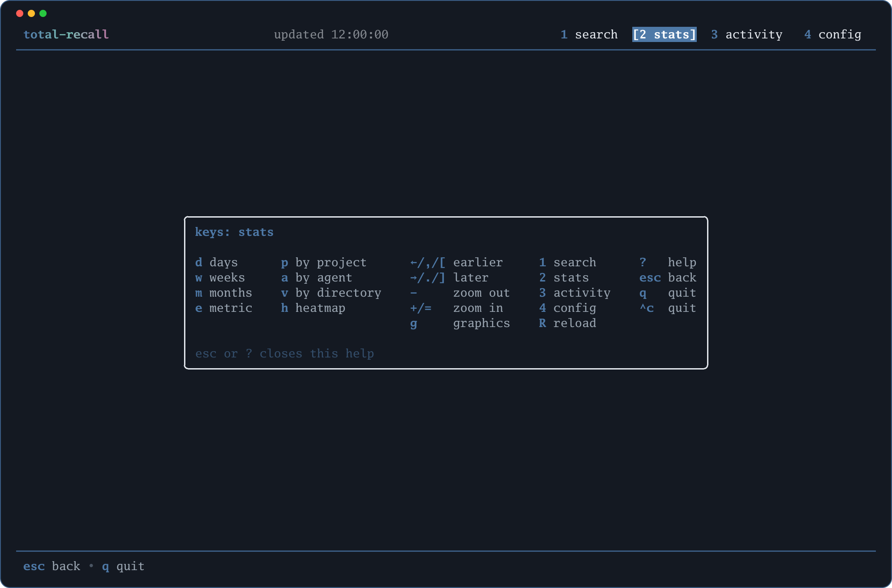

*Hilfe-Overlay (`?`) in der Statistik: die Tasten der Ansicht, dann die globalen Tasten*

## Neuladen { #neuladen }

Die Hooks schreiben weiter ins Archiv, während die TUI offen ist. Damit neue Sessions und Events ohne Neustart erscheinen, prüft die TUI alle fünf Sekunden (`reload` in [`[tui]`](20-konfiguration.md#tui), `--reload`), ob sich die Datenbank geändert hat, und lädt dann die sichtbare Ansicht neu:

- **Nur bei Änderung.** Die Prüfung ist eine einzige Abfrage (`PRAGMA data_version` auf einer eigenen Verbindung, dazu ein `stat` der Datei); solange niemand schreibt, löst sie keine weitere Abfrage aus. Ein offenes Archiv im Leerlauf erzeugt also keine Last.
- **Nur die sichtbare Ansicht.** Die Suche läuft mit der aktuellen Abfrage und den aktuellen Filtern erneut, die Statistik und die Aktivität laden ihr Fenster neu (die Caches der anderen Fenster werden verworfen), eine offene Session liest ihre Events nach. Die anderen Ansichten merken sich die Änderung und laden, sobald sie wieder sichtbar werden.
- **Zustand bleibt.** Markierung, Scrollposition, Fokus und Eingabe bleiben erhalten; in der Suche bleibt die Markierung auf demselben Treffer, auch wenn neue Treffer davor einsortiert werden. In der Session kommen neue Events unten hinzu, ohne dass die Ansicht springt; steht sie am Ende, läuft sie mit wie `tail -f`.
- **Stand in der Kopfzeile.** `updated 14:03:12` ist die Uhrzeit, zu der die Daten zuletzt geladen wurden (Zeitzone `timezone`). Schlägt eine Prüfung fehl, steht dort stattdessen der Fehler in Rot bis zur nächsten erfolgreichen Prüfung.
- **`R` lädt sofort** (`global_reload`), auch mit `reload = "0"`; solange ein Eingabefeld den Fokus hat, ist `R` Text wie jede andere Taste.
- **Wartung.** Tauscht [`maintenance`](10-befehle.md#maintenance) die Datei aus, bemerkt die nächste Prüfung die neue Datei, öffnet sie und lädt alles neu. Zwischen zwei Prüfungen hält die TUI keine Lesetransaktion offen, deshalb blockiert ein offenes Archiv den WAL-Checkpoint der Wartung nicht.

Mit `--reload 0` bzw. `reload = "0"` lädt die TUI nur beim Start, beim Wechsel von Ansicht oder Fenster und mit `R`.

## Farben

Alle Ansichten zeichnen mit demselben Theme. Die Farbtöne sind die Reihenfarben der Statistik-Charts; das Theme weist ihnen Rollen zu:

| Rolle | Farbe | Wo |
|---|---|---|
| Akzent | Blau | Programmname (Verlauf von Blau über Türkis nach Violett), aktiver Tab und aktive Umschalter (weiß auf Blau), Trennlinien, Rahmen der Hilfe, Tasten der Fußzeile, Überschriften, Spaltenköpfe, Markierungen `▸` und `◄` |
| Mensch | Orange | Actor `human` in Trefferliste, Vorschau und Session, Zähler im Session-Kopf, Kachel `human` |
| Agent | Blau | Actor `agent`, Zähler, Kachel `agent` |
| Peer | Violett | Actor `peer` |
| Tool | Türkis | Trennzeilen von Tool-Aufrufen und -Ergebnissen; ihr Text ist gedämpft |
| Treffer | Gelb | Suchwörter in Textausschnitt, Vorschau und Session (fett und unterstrichen); der gewählte Treffer ist invertiert |
| Auswahl | Hinterlegung | der markierte Treffer, solange die Liste den Fokus hat |
| Bewertung | Türkis, Grün, Orange | Spanne und Saldo der Aktivität unter, im und über dem Rahmen |
| Wochenende, Feiertag | Violett, Magenta | Zeilen und Namen in Aktivität und Statistik |
| Projekt | Reihenfarben | Segmente und Legende der Aktivität mit `p`; ein Projekt hat in Statistik und Aktivität dieselbe Farbe |
| Fehler | Rot | Fehlermeldungen in den Statuszeilen |

Das Theme folgt dem Terminalhintergrund: beim Start fragt die TUI das Terminal nach seiner Hintergrundfarbe; auf hellem Hintergrund werden die Farben abgedunkelt, die Heatmap läuft dort von Hellblau nach Blau, auf dunklem von Dunkelblau nach Hellblau. Bis die Antwort kommt, gilt das dunkle Theme. Mit `NO_COLOR` oder in einem Terminal ohne Farben bleibt alles lesbar: jede farbige Stelle unterscheidet sich auch in Zeichen, Schriftschnitt oder Position (Klammern um den aktiven Tab, `▸` und `◄`, Unterstreichung der Treffer, Schattierungen in Heatmap und Aktivitätsbalken, ein eigenes Zeichen je Projekt in den Projektbalken der Aktivität).

Die Projektfarben kommen zuerst aus den Definitionen [`[[project]]`](20-konfiguration.md#project): Ein Projekt mit `color` hat diese Farbe in Chart, Legende und Aktivitätsbalken. Die übrigen Farben vergibt die TUI in der Reihenfolge, in der sie die Projekte zum ersten Mal zeigt, Statistik und Aktivität gemeinsam: Das erste Projekt ohne feste Farbe bekommt die erste freie Reihenfarbe (Blau, Orange, Grün, Rot, Violett, Türkis; die fest vergebenen werden übersprungen), das nächste die nächste; sind sie aufgebraucht, beginnt es von vorn. Ein Projekt behält seine Farbe, solange die TUI läuft, auch wenn Periode, Fenster oder Ansicht wechseln.

## Maus

Die TUI fordert Mausmeldungen vom Terminal an (Cell Motion: Klicks und Rad, keine Bewegung). Klickbar ist, was es auch per Taste gibt, und ein Klick tut genau das, was die Taste tut; nichts geht nur mit der Maus. Überall gilt:

| Maus | Wirkung |
|---|---|
| Rad | blättert, was unter dem Zeiger liegt: die Trefferliste (bewegt die Markierung wie ++up++/++down++), die Vorschau, den Verlauf einer Session, die Tage der Aktivität (wie ++up++/++down++ dort: am Rand einen Tag weiter in der Zeit) |
| Klick auf einen Tab in der Kopfzeile | wechselt die Ansicht wie `1`, `2`, `3`, `4`; schließt eine offene Session |
| Klick auf einen Tastenhinweis in der Fußzeile | drückt die Taste: `? help` öffnet die Hilfe, `esc back` schließt die Session oder die Hilfe, `q quit` beendet, `T tools on/off` blendet die Tool-Events ein. Bei einem Hinweis mit mehreren Tasten (`d/w/m period`, `↑/↓ scroll`) ist jede Taste einzeln klickbar, die Beschreibung nicht; bei einem Hinweis mit einer Taste der ganze Hinweis. Was die Fußzeile abschneidet (`…`), ist nicht klickbar |
| Klick außerhalb der Hilfe | schließt sie wie ++esc++; ein Klick in das Fenster tut nichts |

In den Ansichten:

| Maus | Wirkung |
|---|---|
| Klick auf einen Treffer | markiert ihn und gibt der Liste den Fokus; ein zweiter Klick auf den markierten Treffer öffnet die Session wie ++enter++ |
| Klick auf die Vorschau | öffnet den markierten Treffer wie ++enter++, egal ob Eingabe oder Liste den Fokus hat |
| Klick auf eine Datei, Version oder Änderung im Memory-Viewer | markiert sie; ein zweiter Klick auf die markierte Datei oder Änderung öffnet ihren Verlauf wie ++enter++ |
| Klick auf einen Reiter im Anhang-Viewer | markiert den Anhang wie ++left++/++right++ |
| Klick auf die Eingabezeile der Suche | gibt der Eingabe den Fokus |
| Klick auf einen Typ in der Linie der Suche (`event`, `session`, `memory`) | schaltet den Typ ein oder aus wie `e`, `s`, `m` |
| Klick auf `project:` in der Linie der Suche | öffnet die Liste der Projekte wie `P`; ein Klick auf ein Projekt pinnt es |
| Klick auf das `✕` hinter dem Pin | hebt den Pin auf wie `p` |
| Klick auf `day`, `week`, `month` oder `project`, `agent`, `directory` in der Statistik | wählt die Periode wie `d`/`w`/`m` bzw. die Dimension wie `p`/`a`/`v` |
| Klick auf `day`, `week`, `month` oder `all`, `human` in der Aktivität | wählt das Fenster wie `d`/`w`/`m` bzw. die Zählweise wie `h` |
| Klick auf die Kennzahlen der Aktivität | blendet sie aus wie `s`; `s` oder der Hinweis `s summary figures` in der Fußzeile blendet sie wieder ein |
| Klick auf einen Seitennamen in der Config | wechselt die Seite wie ++tab++ / ++shift+tab++ |
| Klick auf eine Zeile in der Config | markiert den Schlüssel, die Definition, die Aktion oder die Prüfung wie ++up++/++down++; ändert und startet nichts |

Klicks anderswo (Chart, Tabelle und Heatmap der Statistik, die Tage der Aktivität, der Verlauf einer Session, Linien und Statuszeilen) tun nichts. Früher/später und Zoom der Statistik und der Aktivität, Kennzahl, Heatmap und Grafikmodus der Statistik, die Treffer in einer Session und alles Weitere erreicht die Maus über die Hinweise in der Fußzeile; was dort nicht steht (`e`, `h`, `g` der Statistik), nur über die Taste. Das Mausrad in der Vorschau verschiebt den Austausch zeilenweise; mit dem nächsten Treffer springt die Vorschau wieder an die automatische Position mit dem Treffer im oberen Drittel.

**Textauswahl:** Solange die Maus an das Programm geht, wählt einfaches Ziehen keinen Text mehr aus. Die Terminals erlauben die Auswahl trotzdem mit einer Zusatztaste: ++shift++ und Ziehen in Ghostty und kitty, ++option++ und Ziehen in Terminal.app und iTerm2. In herdr und tmux kommen die Mausmeldungen beim Programm an, die Auswahl mit Zusatztaste geht an das äußere Terminal. Wer ganz ohne Maus arbeiten will, startet mit `--no-mouse` oder setzt `mouse = false` im Abschnitt [`[tui]`](20-konfiguration.md#tui) der Konfiguration; dann bleibt die Maus beim Terminal und die Bedienung ist rein über die Tastatur. `--no-mouse=false` schaltet sie für einen Aufruf wieder ein.

## Suche

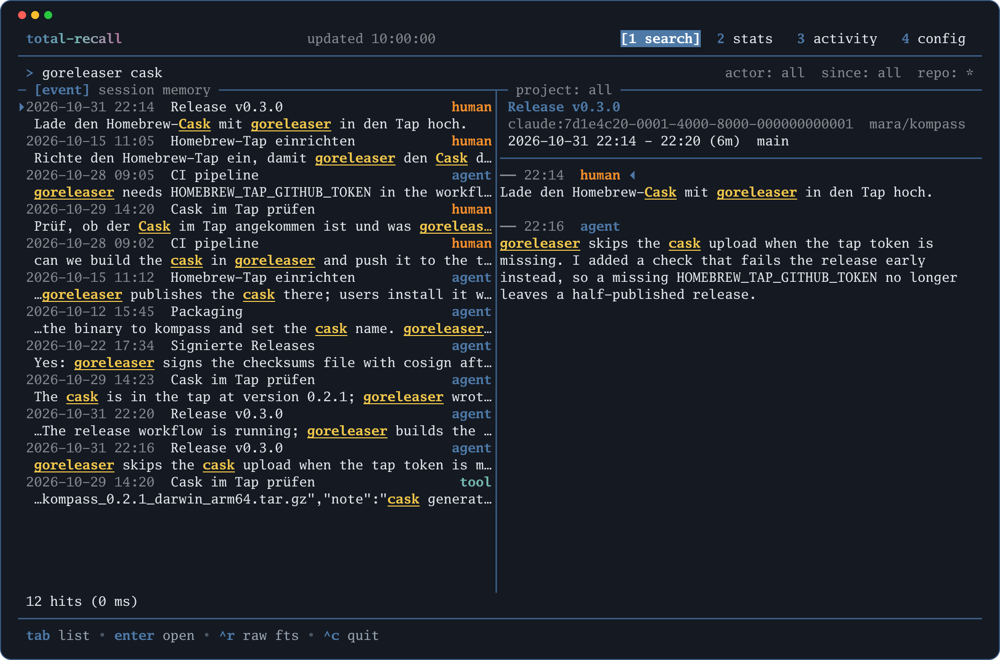

*Suche mit Vorschau: Trefferliste links, der Austausch um den markierten Treffer rechts*

- **Eingabe** oben, mit dem Fokus beim Start. Jede Änderung startet nach 150 ms Ruhe eine Suche wie `search`: ohne Rohsyntax wird jedes Wort in Anführungszeichen gesetzt, alle Wörter müssen vorkommen. Höchstens 200 Treffer je Typ werden geholt; die Statuszeile sagt `200 of 1234 hits, limit reached`, wenn es mehr gäbe. Rechts in der Eingabezeile stehen die aktiven Filter.
- **Linie** unter der Eingabe: links der [Typ-Umschalter](#typen-und-projekt), rechts der Projekt-Pin.
- **Trefferliste** links, zwei Zeilen je Treffer, im Format des Typs (siehe [Typen und Projekt](#typen-und-projekt)). Beim Typ `event`: Zeit (gedämpft), Session-Name und Actor (in seiner Farbe, siehe [Farben](#farben)), darunter der Textausschnitt mit den Suchwörtern gelb, fett und unterstrichen. Sortierung wie `search`: Rang, dann Zeit. Der markierte Treffer trägt `▸`; hat die Liste den Fokus, ist seine Kopfzeile zusätzlich hinterlegt.
- **Vorschau** rechts, folgt der Markierung (nach 100 ms Ruhe) und zeigt den [Viewer](#viewer) des Treffertyps. Beim Typ `event` und einer Nachricht: der Session-Kopf (Name in der Akzentfarbe, ID und Repo gedämpft, Zeitraum und Branch), dann der Austausch um den Treffer, also die menschliche Nachricht davor und die Antwort des Agenten danach. Die Trennzeilen nennen Zeit und Actor in seiner Farbe, der Treffer-Event ist mit `◄` markiert, die Suchwörter sind hervorgehoben wie in der Liste.
- **Fokus:** ++tab++ wechselt zwischen Eingabe und Liste, siehe [Fokus](#fokus). In der Liste bewegen ++up++/++down++ und `k`/`j`, ++enter++ öffnet die Session des markierten Treffers (auch direkt aus der Eingabe; eine Memory-Datei hat noch keine Detailansicht, dort tut ++enter++ nichts). Mit der [Maus](#maus): das Rad über der Liste bewegt die Markierung, ein Klick markiert den Treffer, ein zweiter Klick öffnet ihn.
- **Statuszeile:** Trefferzahl und Dauer der Abfrage (`5 hits (12 ms)`), mit mehreren Typen die Zahl je Typ (`event 12, session 0, memory 1 (3 ms)`), sonst `type to search`, `searching…` mit einem drehenden Spinner davor, solange die Abfrage läuft, `no hits` oder die Fehlermeldung.

### Typen und Projekt { #typen-und-projekt }

Die Suche durchsucht die Objekttypen des Archivs, dieselben wie [`search --type`](10-befehle.md#search): `event` (Nachrichten, Tool-Aufrufe und Tool-Ergebnisse), `session` (Name, Titel, Agentenname) und `memory` (aktueller Inhalt der Gedächtnis-Dateien). Der Default ist `event`; solange nichts umgeschaltet wird, sucht und zeigt die Ansicht wie bisher.

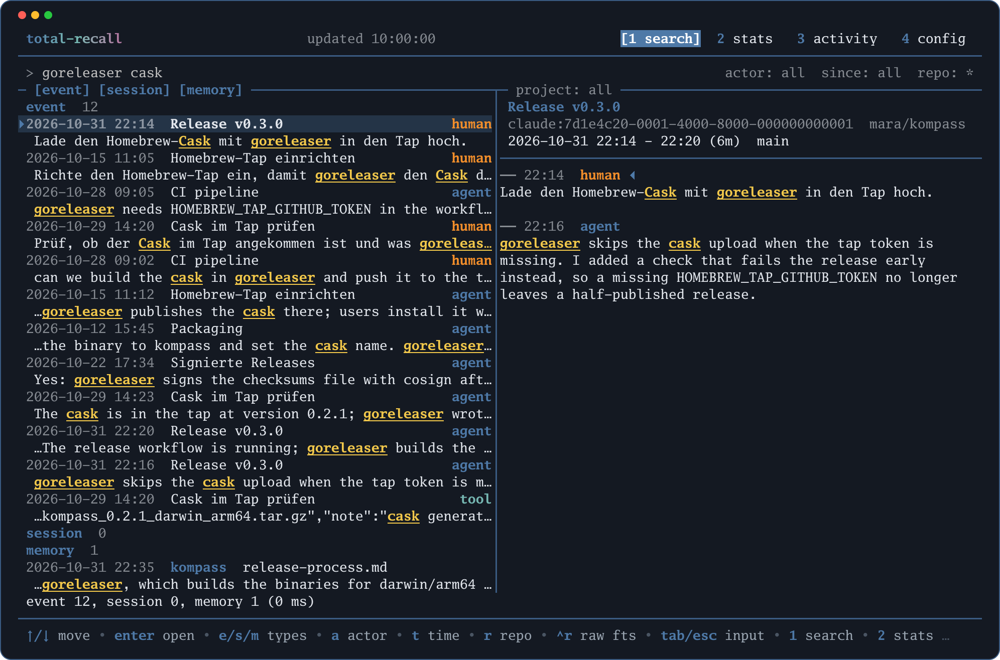

*Suche über Events, Sessions und Gedächtnis: der Typ-Umschalter in der Linie, die Treffer in einer Gruppe je Typ*

- **Umschalter:** In der Linie unter der Eingabe stehen die Typen. Ein gewählter Typ steht in Klammern (`[event]`). Ein Klick schaltet ihn ein oder aus, ebenso `e`, `s` und `m` in der Liste (`search_type_event`, `search_type_session`, `search_type_memory`); in der Eingabe wären sie Suchtext. Mehrfachauswahl ist möglich, der letzte gewählte Typ bleibt immer stehen. Jede Änderung sucht sofort neu.
- **Gruppen:** Mit mehr als einem Typ steht vor jeder Gruppe eine Kopfzeile mit dem Typ und der Zahl der Treffer, auch bei 0. Wurde die Gruppe vom Limit gekürzt, steht dort `200 of 1234, limit reached`; die Statuszeile nennt es ebenso. Die Typen haben keinen gemeinsamen Rang, weil bm25 aus verschiedenen Indizes nicht vergleichbar ist; die Gruppen stehen in der Reihenfolge `event`, `session`, `memory`, und die Markierung läuft durch alle.
- **Formate:** `event` wie oben beschrieben. `session`: Startzeit, der Name, der gepasst hat, mit den Suchwörtern hervorgehoben; darunter die Zahl der Events und das Projekt. `memory`: Zeit der Fassung, Projekt und Dateipfad; darunter der Ausschnitt aus der Datei.
- **Projekt-Pin:** Rechts in der Linie steht `project: all`. Ein Pin schränkt **jeden** Typ auf ein Projekt ein, mit demselben Namen wie `stats --by project` und `search --project`. `p` pinnt das Projekt des markierten Treffers (bei einer Memory-Datei auch dann, wenn nur ihr Gedächtnis-Projekt bekannt ist), nochmal `p` hebt den Pin auf. `P` oder ein Klick auf das Wort öffnet die Liste der Projekte des Archivs: ++up++/++down++ bewegen, ++enter++ pinnt das Projekt unter der Markierung (`all projects` hebt den Pin auf), ++esc++ lässt alles, wie es war. Ein Klick auf das `✕` hebt den Pin ebenfalls auf.

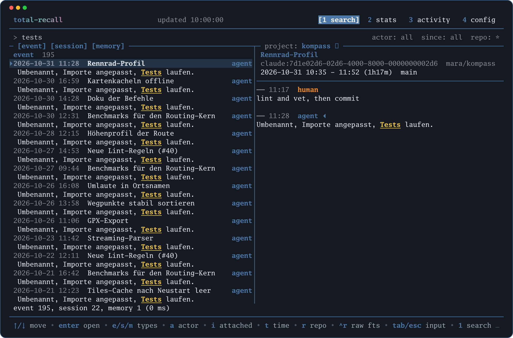

*Projekt-Pin: das Projekt des markierten Treffers schränkt alle Typen ein, der Pin steht rechts in der Linie*

Nicht jeder [Filter](#filter) gilt für jeden Typ: Actor nur für `event`, Rohsyntax für `event` und `memory`; Zeitraum und Repo für alle drei. Wo ein Typ einen Filter nicht anwendet, lässt die TUI ihn für diesen Typ weg, statt einen Fehler zu zeigen (die CLI meldet dort einen `usage`-Fehler).

### Viewer { #viewer }

Die Vorschau wählt den Viewer nach dem Typ des markierten Treffers. Alle Viewer haben dieselbe Schnittstelle (`internal/tui/viewer`): Sie bekommen Daten, die die Suche geladen hat, und liefern Kopfzeilen, die stehen bleiben, und Zeilen, die das Mausrad verschiebt; ein Viewer für einen weiteren Typ (Bild, Diff) hängt sich dort ein.

| Treffer | Viewer |
|---|---|
| `event`, Nachricht | der Austausch um den Treffer, wie oben beschrieben |
| `event`, Tool-Aufruf oder Tool-Ergebnis | **Eingabe und Ausgabe getrennt**, je unter einer Trennzeile (Tool, Zeit); der Treffer ist mit `◄` markiert. Ist der Text ein JSON-Objekt oder -Array, wird er eingerückt. Das Gegenstück steht dabei: zum Ergebnis der Aufruf davor, zum Aufruf das Ergebnis danach |
| `session` | der Kopf der Session, die Zahl der Events (menschlich, Agent) und die ersten fünf Nachrichten, je höchstens sechs Zeilen |
| `event` mit Anhang | wie die anderen Event-Viewer, unter dem Text jedes Events mit Anhängen eine Zeile `▣ image/png 34,2 KiB` je Anhang; `v` öffnet den [Anhang-Viewer](#anhaenge) |
| `memory` | die Datei als lesbares Markdown: Front Matter und Codeblöcke gedämpft, Überschriften in der Akzentfarbe ohne `#`, Aufzählungen als `•`, Absätze umbrochen, ohne die Zeichen für fett und Code. Im Kopf stehen der Pfad, das Projekt mit dem Harness und die Zeit der Fassung. Liegt der erste Treffer tief in der Datei, springt die Vorschau dorthin, sonst steht die Datei am Anfang |

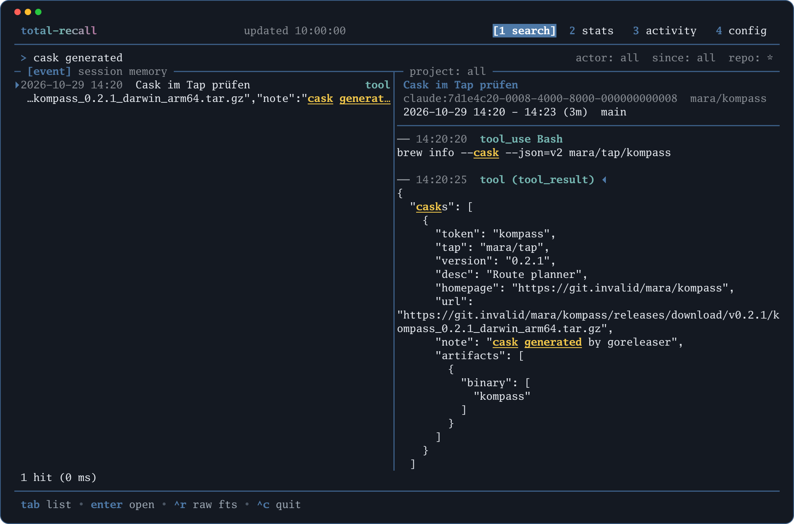

*Treffer in einer Tool-Ausgabe: rechts Aufruf und Ausgabe getrennt, das JSON eingerückt*

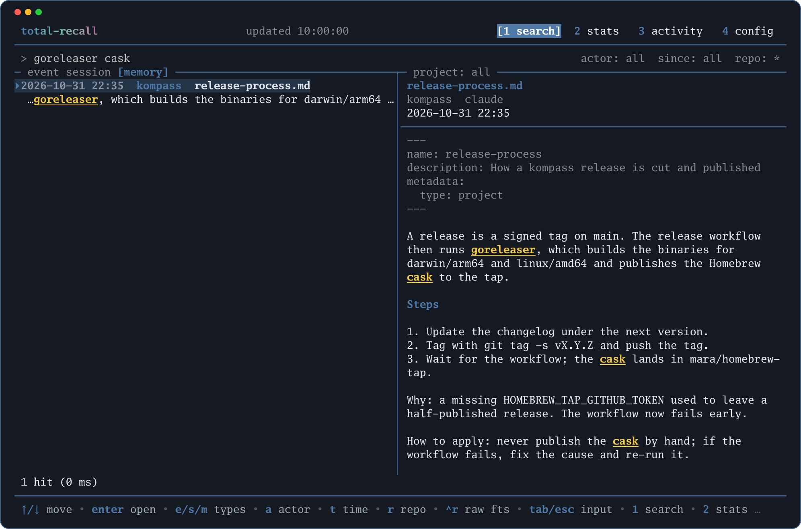

*Suche nur im Gedächtnis: Treffer mit Projekt und Datei, rechts die Datei als lesbares Markdown*

### Fokus

Innerhalb der Suche können zwei Elemente den Fokus haben: die **Eingabe** und die **Trefferliste**. Die Vorschau ist reine Anzeige und folgt der Markierung. Der Repo-Filter ist ein modales Feld, das `r` aus der Liste öffnet; er gehört nicht zur Reihenfolge.

- ++tab++ und ++shift+tab++ wechseln zwischen Eingabe und Liste, in beide Richtungen, und bleiben dabei in der Suche. Die Ansichten wechseln nur `1` bis `4`; ++tab++ ist dafür nicht belegt.
- ++esc++ geht eine Ebene zurück: aus dem Repo-Filter in die Liste (die Änderung wird verworfen), aus der Liste in die Eingabe. In der Eingabe tut ++esc++ nichts.
- Hat die **Eingabe** den Fokus, sind alle Tasten Suchtext. Ausnahmen sind nur ++tab++/++shift+tab++ (Fokus), ++enter++ (markierten Treffer öffnen), ++ctrl+r++ (Rohsyntax) und ++ctrl+c++ (beenden). `a`, `t`, `r`, `e`, `s`, `m`, `p`, `P`, `q`, `?`, `R` und `1` bis `4` landen im Suchtext und lösen nichts aus.
- Hat die **Liste** den Fokus, gelten ihre Tasten (bewegen, öffnen, Filter) und die globalen Tasten der App: `1` bis `4`, `R`, `?`, `q`.
- Im **Repo-Filter** übernehmen ++enter++ und ++tab++ den Wert, ++esc++ verwirft ihn; alles andere ist Text.
- Die **Projektliste** (`P`) ist ebenfalls modal: ++up++/++down++ bewegen, ++enter++ pinnt, ++esc++ bricht ab.
- Die **Maus** folgt derselben Ordnung: ein Klick auf einen Treffer gibt der Liste den Fokus, ein Klick auf die Eingabezeile der Eingabe; das Rad ändert den Fokus nicht. Solange der Repo-Filter offen ist, tut die Maus nichts.
- Sichtbar ist der Fokus am Cursor und an der Markierung: in der Eingabe und im Repo-Filter steht der Cursor des Terminals im Feld; hat die Liste den Fokus, ist der markierte Treffer hinterlegt. Das `▸` vor dem markierten Treffer bleibt in jedem Fall, weil ++enter++ ihn aus beiden Elementen öffnet und die Vorschau ihn zeigt. Die Fußzeile nennt die Tasten des fokussierten Elements.

Der Fokus bleibt beim Wechsel der Ansicht und beim Öffnen einer Session erhalten; ++esc++ aus der Session führt dorthin zurück, wo man war.

### Filter

Die Filter werden in der **Liste** umgeschaltet (in der Eingabe wären die Buchstaben Suchtext). Jede Änderung sucht sofort neu.

| Taste | Filter | Werte |
|---|---|---|
| `a` | Actor | `all` → `human` → `agent` → `peer` → `all` |
| `t` | Zeitraum (Zeit des Events) | `all` → `7d` → `30d` → `90d` → `all` |
| `r` | Repo | Teilstring von Remote-URL, Git-Root oder Arbeitsverzeichnis. Öffnet ein Eingabefeld in der Statuszeile: ++enter++ oder ++tab++ übernimmt, ++esc++ verwirft. Leer löscht den Filter |
| ++ctrl+r++ | Rohsyntax | FTS5-Syntax unverändert durchreichen (`AND`, `OR`, `NOT`, `"Phrase"`, `präfix*`), wie `search --raw`. Geht auch aus der Eingabe |

Die Hervorhebung in Vorschau und Detailansicht nimmt die Wörter der Eingabe; in Rohsyntax ohne Operatoren, Anführungszeichen und Sterne.

## Session

++enter++ auf einem Treffer öffnet die Session als Ebene über der Suche. Die Suche bleibt darunter erhalten: ++esc++ führt mit Eingabe, Treffern, Markierung und Fokus zurück. `1` bis `4` schließen die Detailansicht ebenfalls.


*Session-Detail mit Treffer, Tool-Aufrufe eingeblendet (`T`)*

- **Kopf:** Name (Akzentfarbe) und volle Session-ID (gedämpft), darunter Repo, Branch, Zeitraum mit Dauer, Anzahl menschlicher und Agenten-Events in den Farben der Actors, bei Subagent-Sessions die Eltern-ID. Wurde die Session fortgesetzt oder setzt sie eine andere fort, folgt eine dritte Zeile mit `continued from` bzw. `continued in` und der jeweiligen Session-ID (im Screenshot: die Release-Session setzt „Signierte Releases“ fort). In schmalen Fenstern gewinnt der Name, die ID wird gekürzt.
- **Trennlinie mit Status:** der oberste sichtbare Event (`3/17 events`), der gewählte Treffer (`hit 1/4`), die Position im Verlauf, wenn er länger als das Fenster ist (`top`, `42%`, `bot`), `tools`, wenn Tool-Events eingeblendet sind, und kurz `copied` nach dem Kopieren.
- **Verlauf** wie `show`: eine Trennzeile je Event mit Zeit (gedämpft) und Actor in seiner Farbe, Tool-Aufrufe mit dem Werkzeugnamen in Türkis und gedämpftem Text, damit sie hinter dem Gespräch zurücktreten; Text am Wortende umbrochen. Die Suchwörter sind gelb, fett und unterstrichen, der gewählte Treffer ist invertiert, der markierte Event trägt `◄`. Beim Öffnen steht der Treffer-Event oben; ist er ein Tool-Event, werden Tools automatisch eingeblendet.
- **Blättern** mit ++up++/++down++, ++pgup++/++pgdn++ oder dem Mausrad (drei Zeilen je Schritt).
- `n`/`N` springen zum nächsten/vorigen Treffer, am Ende wieder von vorn. `T` blendet Tool-Aufrufe, Ergebnisse und Automatik ein und aus (wie `show --all`); die Position bleibt am markierten Event. `y` kopiert die Session-ID über OSC 52 in die Zwischenablage, für `show`, `sql` oder Agenten.

## Memory { #memory }

++enter++ auf einem Treffer des Typs `memory` öffnet den **Memory-Viewer** des Projekts, als zweite Ebene neben der Session: Die Suche bleibt darunter erhalten, ++esc++ führt zurück, `1` bis `4` schließen die Ebene. Der Tab in der Kopfzeile zeigt `› memory`. Die Daten kommen aus dem archivierten [Projekt-Gedächtnis](../explanation/design.md#memory), dieselben wie beim Befehl [`memory`](10-befehle.md#memory); gelesen wird nur, geschrieben nichts.

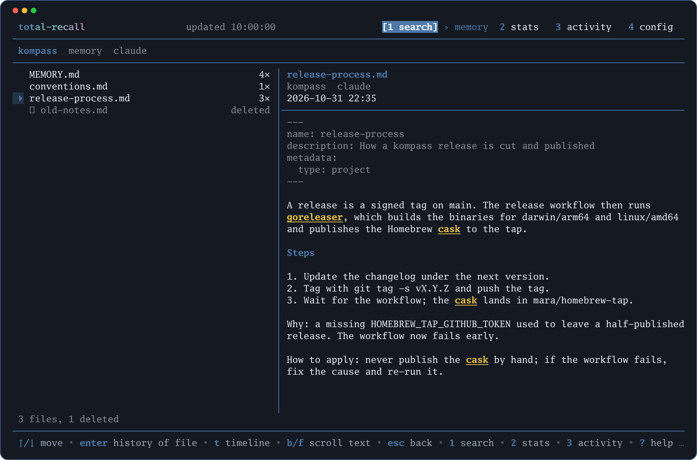

*Memory-Viewer eines Projekts: links die Dateien mit MEMORY.md als Index, die gelöschte Datei zuletzt, rechts der Inhalt als lesbares Markdown*

Der Viewer hat drei Seiten; ++esc++ geht immer eine Seite zurück, von den Dateien schließt es die Ebene.

- **Dateien:** links die Dateien des Projekts, `MEMORY.md` (der Index) zuerst, dann die übrigen nach Pfad, **gelöschte Dateien zuletzt**, gedämpft und mit `✗`. Rechts steht der Inhalt der markierten Datei wie in der Vorschau der Suche, als lesbares Markdown; die Suchwörter sind hervorgehoben, liegt der erste Treffer tief in der Datei, steht die Ansicht dort. Die Datei des Treffers ist beim Öffnen markiert. Je Zeile steht die Zahl der Versionen (`3×`). Die Statuszeile zählt Dateien und Löschungen.
- **Verlauf:** ++enter++ auf einer Datei listet ihre Versionen, die neueste oben: Zeitpunkt, Größe, `now` für den heutigen Stand, `✗ … deleted` für eine Löschung. Rechts steht der Inhalt der markierten Version, im Kopf `version 2 of 3`: so zeigt die Ansicht einen **früheren Stand**. Bei einer Löschung steht dort ein Hinweis; die Version darunter zeigt, was die Datei zuletzt enthielt.

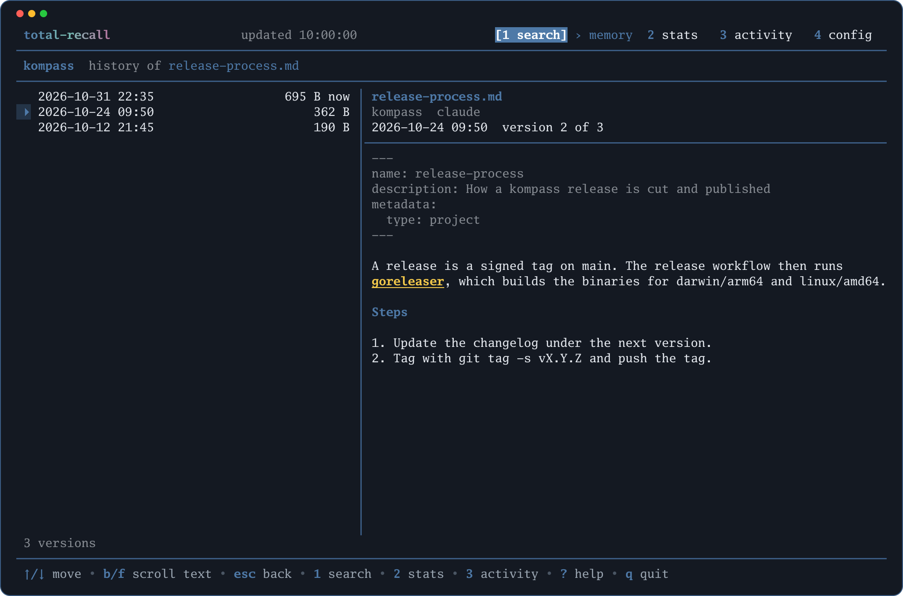

*Verlauf einer Memory-Datei: links die Versionen, neueste zuerst, rechts ein früherer Stand*

- **Diff:** `d` schaltet die rechte Spalte des Verlaufs auf den **Zeilendiff** um, zuerst gegen die Version davor (die erste Version gegen nichts, alle Zeilen sind neu). `c` merkt die markierte Version als **Basis** (`base` in der Liste): Der Diff läuft dann von der Basis zur markierten Version, egal in welcher Reihenfolge, bis ein zweites `c` auf derselben Version die Basis wieder löst. So lassen sich zwei beliebige Versionen vergleichen. Hinzugefügte Zeilen stehen grün hinter `+`, entfernte rot hinter `-`, je Änderung ein Block mit drei Zeilen Kontext und der Kopfzeile `@@ -alt +neu @@`; die Farben sind nur die Zugabe, `+` und `-` tragen die Information. Der Kopf nennt beide Versionen mit Zeit und die Zahl der Zeilen (`+8 -3`). Eine Löschung hat keinen Diff; die Version nach einer Löschung gilt als neu.
- **Zeitleiste:** `t` (auf den Dateien oder im Verlauf) zeigt, **was im Projekt wann geschah**: eine Zeile je Version einer Datei, die neueste oben, mit Zeit, Zeichen (`+` hinzugefügt, `~` geändert, `✗` gelöscht), Pfad und der Änderung der Größe. Eine Datei, die nach einer Löschung wiederkommt, gilt als hinzugefügt. Rechts steht der Diff der markierten Änderung, bei einer Ergänzung der Inhalt, bei einer Löschung ein Hinweis. ++enter++ öffnet den Verlauf der Datei auf dieser Version; ++esc++ führt von dort in die Zeitleiste zurück.

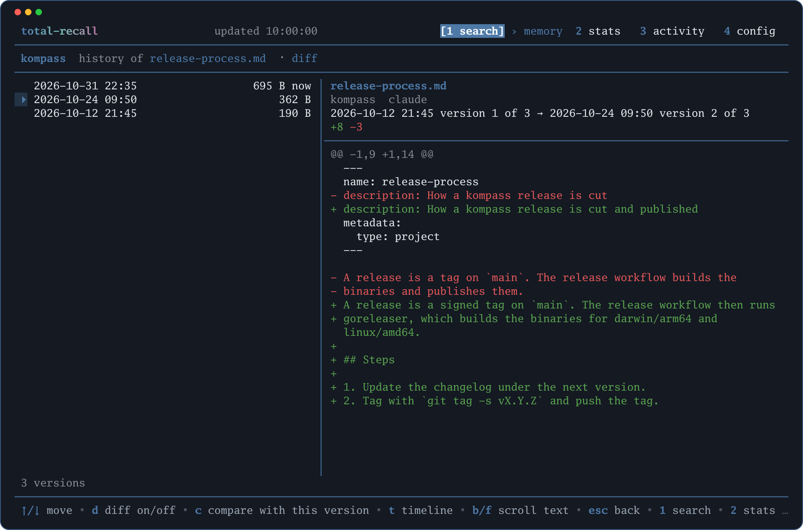

*Diff zweier Versionen einer Memory-Datei: hinzugefügte Zeilen grün mit +, entfernte rot mit -, je Änderung ein Block mit Kontext*

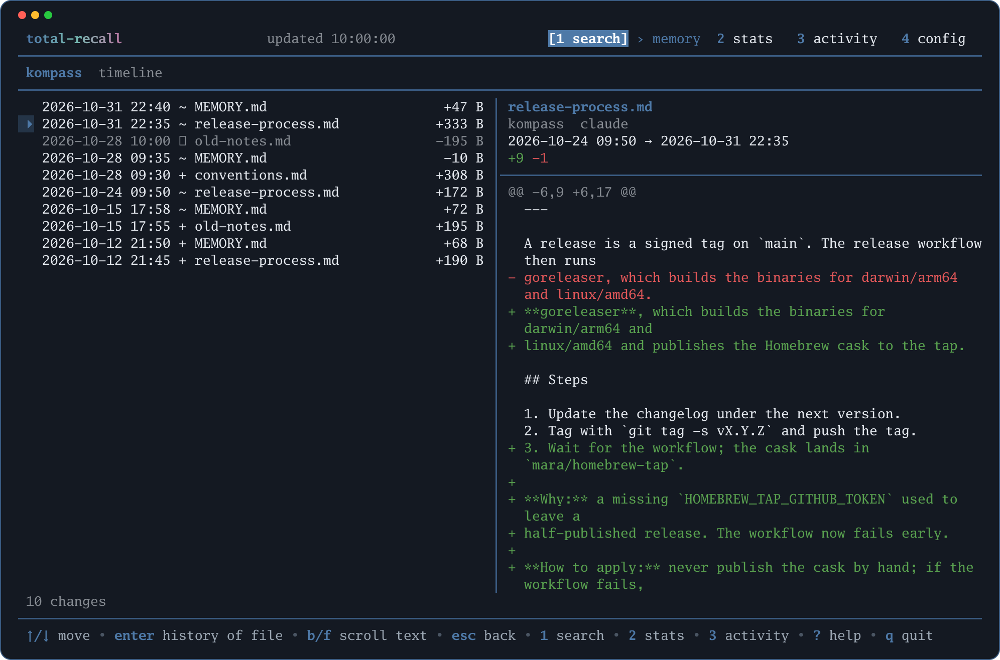

*Zeitleiste eines Projekts: was wann hinzukam, sich änderte oder gelöscht wurde, rechts der Diff der markierten Änderung*

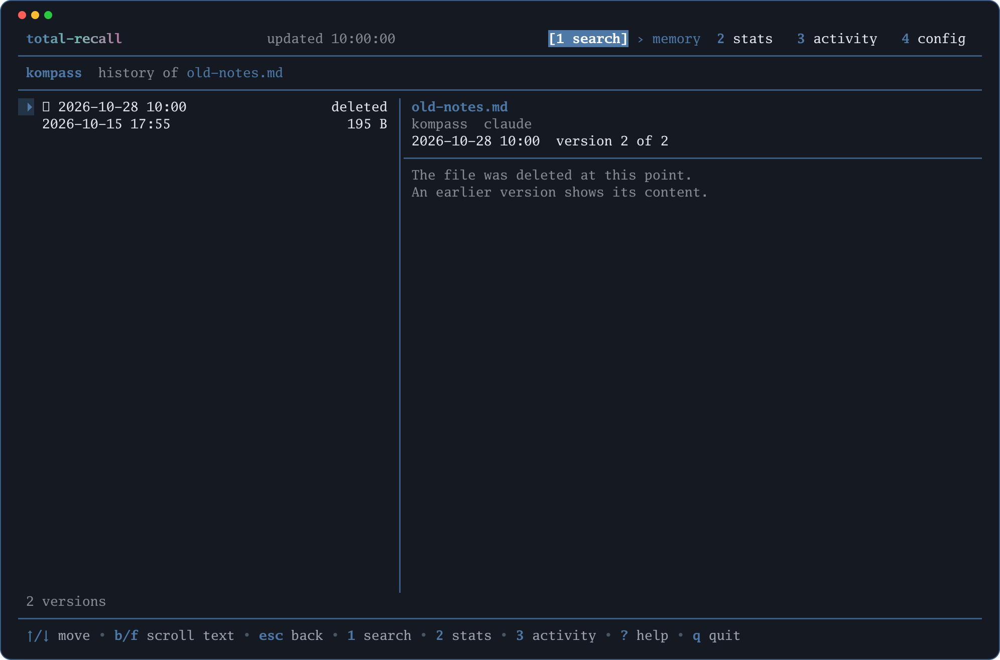

*Verlauf einer gelöschten Memory-Datei: die Löschung steht als eigene Version oben*

Der Zeitpunkt einer Version ist die Änderungszeit der Datei, bei einer Löschung der Zeitpunkt des Scans, der sie vermisst hat. Gesehen wird nur, was ab dem ersten Lauf nach [Migration 8](../explanation/design.md#memory) archiviert wurde; frühere Stände gibt es nicht. Der Zeitpunkt in der Zeitleiste ist der der Version. Blättern im Text mit `b`/`f` (++pgup++/++pgdn++) oder dem Mausrad über der rechten Spalte, die Markierung mit ++up++/++down++ oder dem Mausrad über der Liste.

## Anhänge { #anhaenge }

Bilder und Dokumente, die Claude Code in einer Nachricht oder einem Tool-Ergebnis mitschickt, liegen als Blob im Archiv ([`blobs`](../explanation/design.md#blobs), Schema v5, aufgenommen seit v1.3.0). Die TUI zeigt sie an drei Stellen:

- **Markierung in der Trefferliste:** Ein Event-Treffer mit Anhang trägt hinter der Zeit `▣` und die Zahl der Anhänge (`▣2`); die Vorschau nennt unter dem Text des Events jeden Anhang mit Typ und Größe, die Fußzeile den Hinweis `v view attachments`. Sessions und Treffer ohne Anhänge bleiben unverändert. Eine Nachricht mit Bildern besteht im Archiv aus mehreren Events derselben Transkriptzeile: erst der Text (`[Image #1] …`), dann je ein Event pro Bild oder Dokument. Eine Textsuche trifft meist den Text; damit man von dort zum Bild kommt, trägt auch das Text-Event die Anhänge seiner Nachricht (die der anderen Events derselben Zeile), und `v` öffnet das erste dieser Bilder. Ein `[Image #n]` ohne Blob im Archiv (nicht gespeichert, nicht mitgeliefert) bleibt unmarkiert.
- **Markierung in der Session:** Die Trennzeile eines Events mit Anhängen endet auf `▣` und der Zahl; die Fußzeile nennt `v` nur in einer Session, die Anhänge hat. Mit ausgeblendeten Tools zählen nur die Events, die zu sehen sind.
- **Anhang-Viewer:** `v` öffnet ihn als dritte Ebene neben Session und Memory: Er blättert durch **alle Anhänge der Session** in der Reihenfolge des Verlaufs, beginnend beim Anhang des Events, bei dem man war (in der Session: der markierte Event, sonst der erste Event mit Anhang ab der obersten sichtbaren Zeile). Der Tab zeigt `› attachments`, aus der Session `› session › attachments`; ++esc++ führt dorthin zurück, wo man herkam, `1` bis `4` schließen die Ebene. Über dem Inhalt stehen die Reiter der Anhänge (Nummer, Typ, Größe, der markierte in Klammern); ++left++/++right++ oder ein Klick auf einen Reiter wechseln, ++up++/++down++ und ++pgup++/++pgdn++ scrollen, was länger ist als das Fenster.

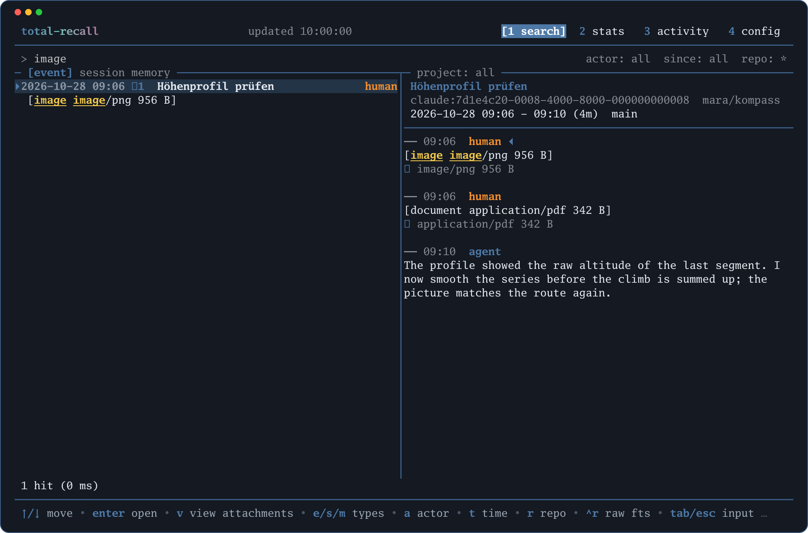

*Treffer mit Anhang: in der Liste die Markierung ▣ mit der Zahl der Anhänge, in der Vorschau eine Zeile je Anhang, in der Fußzeile die Taste v*

Was der Viewer zeigt, richtet sich nach dem Medientyp (`internal/docmeta`):

| Typ | Darstellung |
|---|---|
| PNG, JPEG, GIF, WebP | das **Bild als Text** (`internal/imgtext`): eine Zelle je Block von Pixeln, ein Schattenzeichen (` ░▒▓█`) nach der Helligkeit des Blocks, in der Farbe des Blocks. Das Zeichen trägt das Bild allein, es bleibt deshalb auch mit `NO_COLOR` lesbar; auf einem hellen Terminal ist die Schattierung umgekehrt. Das Bild wird an Breite und Höhe des Fensters angepasst, ohne es zu verzerren (eine Zelle ist doppelt so hoch wie breit), und nie größer gezeichnet als es ist. Über 40 Millionen Pixel wird es nicht dekodiert |
| PDF | die **Metadaten**: Version, Seitenzahl, Titel, Autor, Erzeuger. Sie werden aus den Bytes der Datei gelesen (keine PDF-Bibliothek); steht der Seitenbaum in einem komprimierten Objektstrom, fehlt die Seitenzahl, und ein Titel in Hex-Schreibweise wird nicht angezeigt |
| Text (`text/*`, JSON, SVG) | der **Anfang des Textes** (höchstens 64 KiB), umbrochen; Daten, die kein UTF-8 sind, zeigt der Viewer nicht |
| anderes | der Medientyp, die Größe und der Hash |

Zu jedem Anhang gehört der Kopf (Typ, Größe, Position unter den Anhängen, die ersten zwölf Zeichen des Hashes) und am Ende der Befehl, der die Daten in eine Datei schreibt: `total-recall blob HASH --out DATEI` ([`blob`](10-befehle.md#blob)); das ist die Rückfallebene für alles, was die TUI nicht zeigt, und für Terminals, die gar nichts zeigen.

**Extern öffnen:** `o` oder ++enter++ schreibt den Anhang in eine Datei in einem privaten Verzeichnis (`total-recall-…` im temporären Verzeichnis, Modus 0700, Datei 0600, Name aus Hash und Endung des Medientyps) und übergibt sie dem Programm des Systems: `open` unter macOS, `xdg-open` unter Linux und den BSDs, `start` unter Windows. Die Statuszeile nennt den Pfad. Geht es nicht (kein Programm, Daten nicht gespeichert), steht dort der Grund und der Befehl `total-recall blob`. Das Verzeichnis bleibt stehen, weil das Programm die Datei noch lesen kann, wenn die TUI endet; das System räumt sein temporäres Verzeichnis selbst auf.

**Ohne Daten:** Mit `[ingest] store_blobs = false` bleibt der Verweis im Archiv, die Daten nicht; der Viewer zeigt dann `data not stored` und lässt das Öffnen aus.

**Kitty-Grafik** für Bilder (wie bei den Charts, siehe [Grafikmodi](#grafikmodi)) gibt es im Anhang-Viewer noch nicht, Bilder erscheinen nur als Text; sie sind als eigener Schritt geplant ([#184](https://github.com/seletz/total-recall/issues/184)).

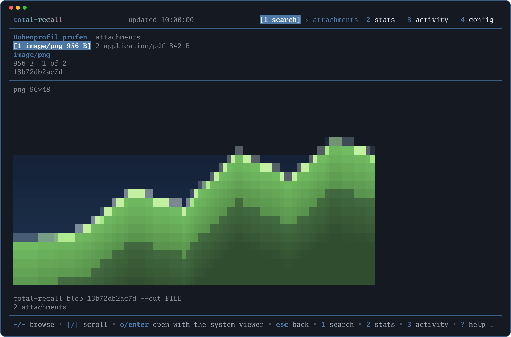

*Anhang-Viewer: ein Bild als Text (Schattierung und Farbe je Zelle), oben die Reiter der Anhänge der Session, unten der Befehl total-recall blob*

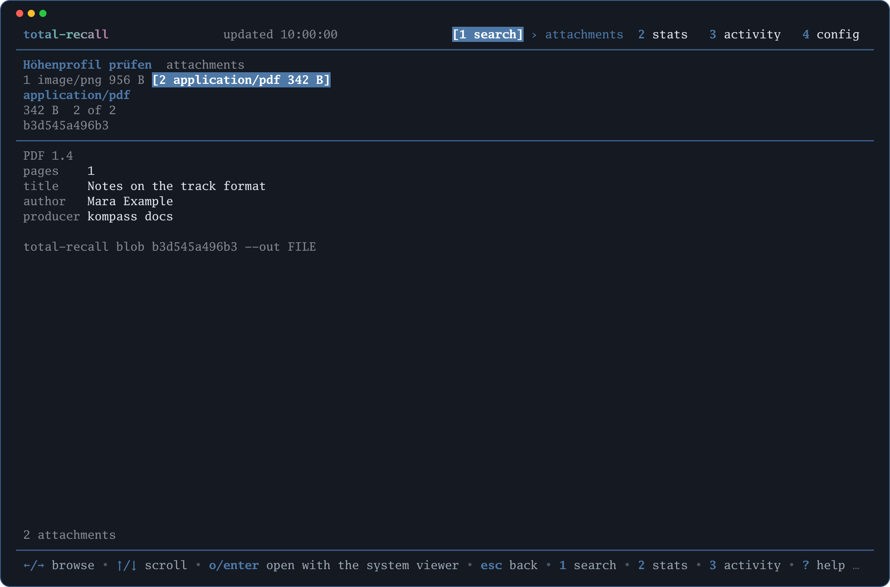

*Anhang-Viewer: ein Dokument mit seinen Metadaten (PDF: Seiten, Titel, Autor)*

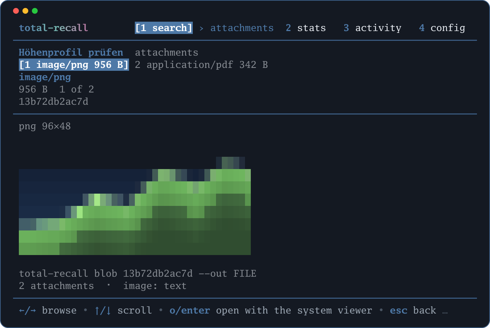

*Anhang-Viewer in einem schmalen Terminal (80×24): das Bild wird an Breite und Höhe angepasst*

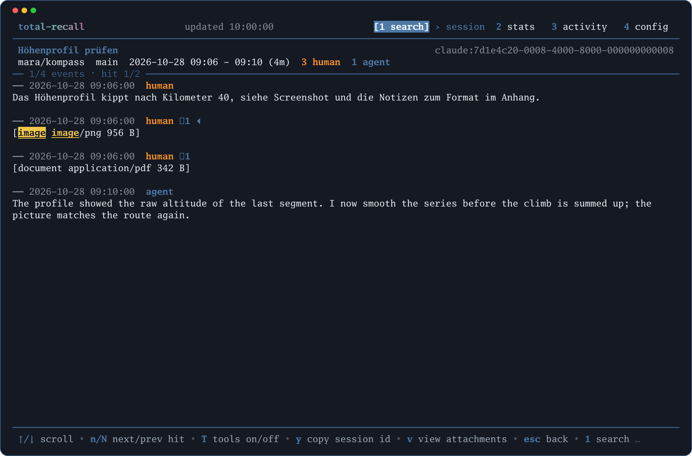

*Session mit Anhängen: hinter dem Kopf eines Events mit Bild oder Dokument steht ▣ mit der Zahl, `v` öffnet den Viewer*

## Statistik

![Statistik: gestapeltes Chart je Tag und Projekt, Kacheln mit Kennzahlen, Tabelle; kompass (blau), wetterwarte (violett) und fahrtenbuch (türkis) in den Farben aus `[[project]]`](../assets/screenshots/stats.png)

*Statistik: gestapeltes Chart je Tag und Projekt, Kacheln mit Kennzahlen, Tabelle; kompass (blau), wetterwarte (violett) und fahrtenbuch (türkis) tragen ihre Farbe aus `[[project]]`, die übrigen Projekte die freien Reihenfarben*

- **Umschalter** oben: Periode (`d` Tage, `w` Wochen, `m` Monate) und Dimension (`p` Projekt, `a` Agent, `v` Verzeichnis), der aktive Wert in Klammern. Rechts der gezeigte Zeitraum.
- **Zeitfenster:** Standard sind die letzten 28 Tage, 16 Wochen oder 12 Monate bis heute. ++left++ und ++right++ (ebenso `,` und `.` oder `[` und `]`) verschieben um ein ganzes Fenster, `-` und `+` halbieren bzw. verdoppeln die Anzahl Perioden (mindestens eine, höchstens das Achtfache des Standardfensters). Ein Periodenwechsel springt auf das Standardfenster, das die zuletzt gezeigte Periode enthält. Periode und Dimension beim Start: `stats_period` und `stats_dimension` in [`[tui]`](20-konfiguration.md#tui).
- **Kacheln** unter den Umschaltern: die Events des Fensters (davon menschliche und Agenten-Events in den Farben der Actors), die eindeutigen Sessions und die Perioden mit Aktivität, jede Zahl fett hinter einem Akzentbalken. Die Zeile weicht, wenn das Chart sonst unter seine Mindesthöhe von acht Zeilen fiele, etwa mit Heatmap bei 80×24.
- **Kennzahl:** `e` wechselt zwischen `events` (menschliche plus Agenten-Events), `human` und `sessions`. Der Titel über dem Chart nennt sie.
- **Chart:** eine gestapelte Säule je Periode, Segmente sind die sechs größten Werte der Dimension über das ganze Fenster plus `other`. Die Legende steht darunter; die Farben bleiben beim Umschalten stabil. Farben unterscheiden die Segmente. Perioden ohne Aktivität bleiben leer, die Achse ist lückenlos. Bei Periode Tag sind die Achsenbeschriftungen von Feiertagen (aus `bundesland` in [`[work]`](20-konfiguration.md#work)) magenta und die des Wochenendes blass, nur im Text-Chart.
- **Tabelle** (Spaltenköpfe in der Akzentfarbe): dieselben Reihen mit zwei Session-Zahlen, menschlichen und Agenten-Events und Anteil an allen Events. `sessions` zählt die eindeutigen Sessions im ganzen Zeitfenster, jede einmal. `session-days`, `session-weeks` bzw. `session-months` (je nach Periode) summiert die Sessions je Periode, so wie das Chart sie zeigt: eine Session, die an drei Tagen aktiv war, zählt bei Tagen dreimal. Die Differenz der beiden Spalten zeigt, wie viele Sessions über Periodengrenzen liefen.
- **Statuszeile:** Grafikmodus, Anzahl Perioden, Dauer der Abfrage, Zustand der Heatmap. Ergebnisse werden je Kombination gecacht; Zurückschalten ist sofort.

Die Dimensionen:

| Dimension | Schlüssel | Anzeige |
|---|---|---|
| `project` | Git-Root der Session, sonst ihr Arbeitsverzeichnis; Subagent-Sessions zählen zur Eltern-Session, Worktrees zum Hauptrepo | Basisname des Pfads. Gleiche Basisnamen bekommen das Elternverzeichnis dazu (`a/tools`, `b/tools`) |
| `agent` | `claude main` (Session ohne Eltern) oder `claude subagent` | unverändert |
| `directory` | Arbeitsverzeichnis der Session, bei Subagents das der Eltern-Session | voller Pfad |

### Heatmap

`h` blendet unter dem Chart die Heatmap Wochentag × Stunde für das Zeitfenster ein (Daten wie `stats`, Kennzahl wie das Chart). Je voller die Zelle (`░▒▓█`), desto näher am Maximum, das der Titel nennt; die Farbe läuft dazu von blass nach kräftig, auf dunklem Hintergrund von Dunkel- nach Hellblau, auf hellem umgekehrt. Leere Zellen bleiben frei.

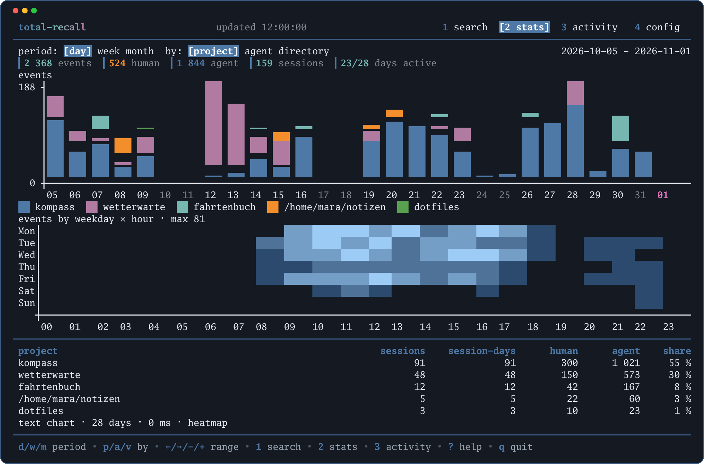

*Heatmap Wochentag × Stunde unter dem Chart*

Die Heatmap braucht zehn Zeilen. Bleibt dem Chart daneben weniger als seine Mindesthöhe von acht Zeilen, wechselt sie in ein **kompaktes Layout** mit neun Zeilen: die Stundenbeschriftung rückt in die Achsenzeile, die Legende der Schattierungen von leer bis Maximum (`░▒▓█`) steht im Titel. Bei 80×24 passen so Chart und Heatmap untereinander; die Tabelle bleibt dafür ausgeblendet. In beiden Layouts werden die Zellen schmaler, bis jede Stunde eine Spalte hat, dann steht nur noch jede zweite Stunde dran.

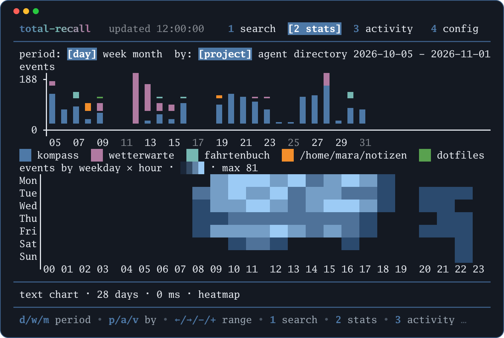

*Statistik mit Heatmap bei 80×24: kompaktes Layout, Stunden in der Achsenzeile, Legende im Titel, Tabelle ausgeblendet*

Reichen auch neun Zeilen nicht (Terminal unter 24 Zeilen), bleibt die Heatmap ausgeblendet und die Statuszeile sagt `heatmap needs more rows`.

## Aktivität

Die dritte Ansicht (`3`, `total-recall tui activity`) zeigt je Tag die **erste und letzte Aktivität**: ein Notnagel für vergessenes Ein- und Ausstempeln. Dieselben Daten liefert [`stats --workday`](10-befehle.md#stats-workday) als Text und JSON.

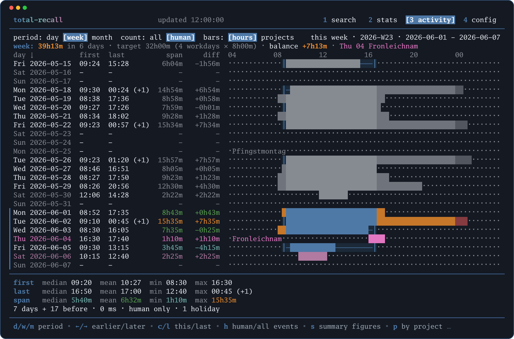

*Eine Woche: Kernzeit 09–17 als Band, Balken je Tag, Feiertag, Wochenarbeitszeit und Kennzahlen*


*Ein Monat (`m`): Monatsarbeitszeit gegen das Soll der Arbeitstage, Feiertag ohne Soll*

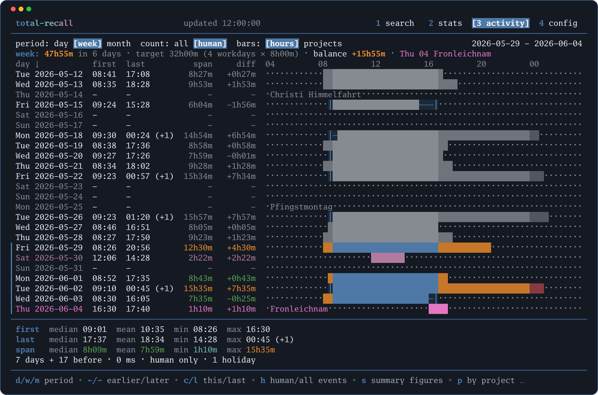

*Mit ++up++ drei Tage zurückgeblättert: ein gleitendes Fenster von sieben Tagen, Freitag bis Donnerstag, mit Kopfzeile und Kennzahlen für genau diese Tage; die Tage davor füllen den Bildschirm, gedämpft*


*Mit `o` der neueste Tag oben: die Woche steht markiert am Anfang, die Tage davor folgen darunter*

![Mit `p` die Balken in Projektfarben: jedes Segment zeigt das Projekt mit den meisten Nachrichten in dieser Zeit, Lücken bleiben gedämpft, die Legende nennt die Projekte der Woche mit Farbe, Zeichen und Zahl der Nachrichten; kompass (blau), wetterwarte (violett) und fahrtenbuch (türkis) haben ihre Farbe aus `[[project]]`, die übrigen die freien Reihenfarben](../assets/screenshots/activity-projects.png)

*Mit `p` die Balken in Projektfarben: jedes Segment zeigt das Projekt mit den meisten Nachrichten in dieser Zeit, Lücken bleiben gedämpft, die Legende nennt die Projekte der Woche mit Farbe, Zeichen und Zahl der Nachrichten; kompass (blau), wetterwarte (violett) und fahrtenbuch (türkis) haben ihre Farbe aus `[[project]]`, die übrigen die freien Reihenfarben*

- **Umschalter** oben: Zeitfenster (`d` ein Tag, `w` eine ISO-Woche ab Montag, `m` ein Monat), was zählt (`human`, der Standard: nur eigene Nachrichten, denn Agent-Events laufen nachts weiter und dehnen die Spanne; `h` schaltet auf `all`, eigene Nachrichten und Agent-Events wie in der Statistik; den Standard setzt `count` in [`[work]`](20-konfiguration.md#work)) und was die Balken färbt (`bars: hours` nach Kernzeit, der Standard; `p` schaltet auf `projects`, siehe [Projektfarben](#aktivitat); den Standard setzt `activity_projects` in [`[tui]`](20-konfiguration.md#tui)). Rechts das Fenster: `this week`/`last week` (bzw. `today`/`yesterday`, `this month`/`last month`), Kalenderwoche oder Monat und der erste und letzte Tag; ein Feiertag steht bei einem einzelnen Tag mit Namen dahinter. Wird die Zeile zu schmal, entfallen rechts zuerst `this week` und die Kalenderwoche, dann stehen Kalenderwoche oder Monat allein.
- **Kopfzeile** bei Woche und Monat: die Arbeitszeit der Periode (Summe der Spannen, fett und gefärbt: türkis unter, grün im Rahmen, orange über dem Wochenrahmen `weekly_low`–`weekly_high`, bei einer Woche mit fünf Arbeitstagen 32–48 h, sonst anteilig), die Tage mit Aktivität, das Soll (Tagessoll × Arbeitstage der Periode) mit dem Saldo dagegen und die Feiertage der Periode mit Namen. Arbeitstage sind Montag bis Freitag ohne Feiertage, mit oder ohne Aktivität, aber nur bis heute: in der laufenden Woche oder dem laufenden Monat zählen künftige Tage noch nicht. Ein vergessener Tag oder Urlaub drückt den Saldo also, ein Feiertag nicht.
- **Zeitfenster:** Start ist die aktuelle Woche (`activity_window` in [`[tui]`](20-konfiguration.md#tui)). Die Periode (`d`, `w`, `m`) bestimmt, **welche Tage Kopfzeile, Soll, Saldo, Kennzahlen und Legende zusammenfassen**, nicht die Länge der Liste: Die Zeilen füllen immer die ganze Höhe zwischen Kopf- und Fußzeile. Vor der Periode stehen so viele frühere Tage, wie Platz ist, gedämpft; die Tage der Periode tragen links die Markierung `▎`. Auf einem hohen Terminal sind das viele Tage, auf einem kleinen wenige, nach einer Größenänderung passt sich die Liste sofort an. Ist die Periode länger als der Platz (ein Monat auf 24 Zeilen), scrollen ihre Zeilen. ++left++ und ++right++ (ebenso `,` und `.` oder `[` und `]`) verschieben die Periode um eine ganze Periode: einen Tag, eine Woche oder einen Monat. `c` springt in die aktuelle Periode (heute, diese Woche, dieser Monat), `l` in die vorige (gestern, letzte Woche, letzter Monat). Ein Periodenwechsel behält den zuletzt gezeigten Tag bei: aus der letzten Woche führt `m` in den Monat, der ihren letzten Tag enthält.
- **Tageweise blättern:** ++up++ und ++down++ (`k`/`j`, ebenso das Mausrad) zeigen die Zeile über der obersten bzw. unter der untersten. Passen nicht alle Zeilen der Periode auf den Bildschirm, scrollen sie erst; sonst rückt die Periode um einen Tag, und mit ihr die ganze Liste. Woche und Monat werden so zu einem **gleitenden Fenster**, das seine Länge behält: sieben Tage bzw. die Tage des Monats, in dem es begann (Dezember: 31, auch über den Jahreswechsel). Kopfzeile, Soll, Saldo und Kennzahlen gelten für genau die markierten Tage; die Kalenderwoche bzw. der Monat stehen rechts oben nur, wenn das Fenster wieder eine ganze Woche (Montag bis Sonntag) oder einen ganzen Monat zeigt. `c`, `l`, `d`, `w` und `m` richten wieder am Kalender aus. Das Fenster endet nie nach der laufenden Periode: in dieser Woche oder diesem Monat führt der Schritt Richtung Gegenwart nicht weiter, weiter zurück führt er bis in die laufende Periode; ++right++ springt eine Periode vor, höchstens bis dahin.
- **Reihenfolge:** Der neueste Tag steht unten, wie in einem Protokoll; `o` (oder ein Klick auf `day` im Spaltenkopf) stellt ihn nach oben und zurück. Der Pfeil im Spaltenkopf zeigt, wohin die Zeit läuft: `day ↓` neuester Tag unten, `day ↑` neuester Tag oben. ++up++ und ++down++ zeigen immer die Zeile darüber bzw. darunter: mit dem neuesten Tag oben führt ++down++ also in die Vergangenheit und ++up++ Richtung heute. Beim Umschalten bleiben die sichtbaren Zeilen dieselben. Den Start setzt `activity_newest` in [`[tui]`](20-konfiguration.md#tui), Default `bottom`.
- **Zeilen:** je Tag Wochentag und Datum, erste und letzte Aktivität als Uhrzeit, die Spanne dazwischen, die Differenz zum Tagessoll und ein Balken auf einer Zeitachse. Tage ohne Aktivität stehen mit `-` und leerem Balken da, damit Lücken auffallen. Die Tage vor der Periode sind ganz gedämpft: Datum, Uhrzeiten, Spanne, Differenz und Balken grau, nur das Kernzeit-Band bleibt; ohne Farben (`NO_COLOR`) unterscheidet die Markierung `▎`.
- **Normalarbeitszeit:** Kernzeit und Tagessoll kommen aus `[work]` in der [Konfiguration](20-konfiguration.md#work), Standard 09:00–17:00 und 8 h. Die Kernzeit liegt als Band mit Linien an Anfang und Ende auf der Achse jedes Werktags (`│───│`, farbig hinterlegt). Der Balken ist innerhalb der Kernzeit blau (`█`), davor und danach orange (`▓`), nach Mitternacht rot (`▒`); am Wochenende violett ohne Band. Ohne Farben (`NO_COLOR`) unterscheiden die Zeichen.
- **Spanne und Differenz:** Die Spanne eines Arbeitstags wird gegen `daily_low`/`daily_high` bewertet und mit der Differenz zum Soll (`+1h15m`, `-2h35m`) gefärbt: türkis unter, grün im Rahmen, orange deutlich über Soll. Wochenende und Feiertage haben kein Soll, ihre ganze Spanne ist die Differenz; ein Tag ohne Aktivität hat keine (`-`), zählt bei Woche und Monat aber als Arbeitstag mit (siehe Kopfzeile).
- **Feiertage** kommen aus `bundesland` in [`[work]`](20-konfiguration.md#work) (Standard Baden-Württemberg, unbekannt oder leer: nur die bundesweiten). Ein Feiertag ist magenta: Datum, Spanne und Balken; die Zeitachse hat kein Band, und der Name steht auf ihr, links vorn oder hinter dem Balken, wo Platz ist. Ein Feiertag am Wochenende zählt als Feiertag. Die Statuszeile zählt die Feiertage des Fensters.
- **Tagesgrenze:** Ein Tag beginnt um `day_start` aus der [Konfiguration](20-konfiguration.md#day_start), Standard 04:00 Ortszeit. Aktivität davor zählt zum Vortag und wird als `01:30 (+1)` angezeigt; die Zeitachse läuft entsprechend von 04 bis 04 Uhr. Die Spanne ist die tatsächlich verstrichene Zeit, auch über eine Zeitumstellung hinweg.
- **Kennzahlen** unter der Linie bei Woche und Monat: Median, Mittelwert, Minimum und Maximum von erster Aktivität, letzter Aktivität (als Uhrzeit, nach Mitternacht mit `(+1)`) und Spanne über die Tage mit Aktivität; die Spannen sind nach der Tagesbewertung gefärbt. `s` blendet den Block aus und ein; er weicht von selbst, wenn sonst weniger als drei Tageszeilen blieben.
- **Projektfarben:** `p` färbt die Balken statt nach der Kernzeit nach **Projekt**: Die Zeitachse eines Tags ist in Zeichenzellen geteilt, und jede Zelle zeigt das Projekt mit den meisten gezählten Events in dieser Zeit (eigene Nachrichten bei `human`, eigene und Agent-Events bei `all`), in derselben Farbe wie das Projekt im Chart der [Statistik](#statistik) und mit derselben Zuordnung: zuerst die Definitionen [`[[project]]`](20-konfiguration.md#project) (Name und `color`; mehrere Repositories einer Definition sind ein Projekt), sonst Git-Root bzw. Arbeitsverzeichnis; Subagenten zählen zur Eltern-Session. Zellen der Spanne ohne Event bleiben als gedämpfte Lücke (`░`) stehen, damit sichtbar ist, wo nicht gearbeitet wurde; bei `human` sind die Lücken zahlreicher als bei `all`. Darunter steht eine **Legende** mit den Projekten der Periode nach Volumen: Zeichen in der Projektfarbe, Name wie in der Statistik und Zahl der gezählten Events. Die sechs größten Projekte bekommen Reihenfarben und je ein eigenes Zeichen (`█ ▓ ▒ ▞ ▚ ▌`), alle weiteren sind grau als `other` zusammengefasst (`▪`), wie in der Statistik. Die Tage vor der Periode sind ebenso gefärbt, nur zählt die Legende sie nicht; ein Projekt, das in der Periode nicht vorkommt, erscheint dort grau wie `other`. Ohne Farben (`NO_COLOR`) unterscheiden die Zeichen die Projekte, die Legende ordnet sie zu. Kernzeit-Band und Linien bleiben im Hintergrund, Datum, Spanne und Differenz behalten ihre Farben. Die Projektdaten holt dieselbe Abfrage wie die Tage, mit demselben Vorlauf, und sie werden wie die Tage je Tag und Zählweise gecacht; beim Blättern wechselt der Bildschirm erst, wenn Tage und Projekte des Fensters da sind, und flackert nicht. Start mit `activity_projects` in [`[tui]`](20-konfiguration.md#tui), Default aus.
- **Farben** kommen aus dem gemeinsamen [Theme](#farben) und folgen damit dem Terminalhintergrund; Magenta ist den Feiertagen vorbehalten, die Projektfarben sind die der Statistik.
- **Statuszeile:** Anzahl Tage der Periode und der Tage davor (`7 days + 11 before`), Dauer der Abfrage, Zählweise (`human only` oder `all events`) und Feiertage der Periode. Passt ein Monat nicht in die Höhe, zeigt sie die sichtbaren Zeilen (`rows 1–21 of 31`); ++up++/++down++ bzw. `k`/`j` und das Mausrad scrollen erst durch die Zeilen und blättern dann tageweise weiter. Die Tage werden je Zählweise einzeln gecacht; eine Abfrage holt die Zeilen samt einer Periode (mindestens sieben Tagen) Vorlauf und Nachlauf, sodass Tagesschritte und die Nachbarperioden ohne neue Abfrage erscheinen. Bis die Antwort da ist, bleibt der bisherige Inhalt stehen, auch nach einer Größenänderung.

Der Balken ist immer Text (Blockzeichen), unabhängig vom [Grafikmodus](#grafikmodi); bei weniger als etwa 65 Spalten entfällt er (und mit ihm der Feiertagsname auf der Achse), die Uhrzeiten, Spanne und Differenz bleiben. Die Kopfzeile wird bei schmalen Fenstern rechts abgeschnitten (`…`); die Feiertage stehen dann noch in den Zeilen.

## Config { #config }

Die vierte Ansicht (`4`, `total-recall tui config`) bündelt, was sonst `status`, `doctor`, `config show`, `backup`, `maintenance`, `reindex` und `hooks print` erledigen, auf fünf Seiten: **status**, **settings**, **projects**, **actions** und **setup**. Die Seiten wechseln mit ++tab++ / ++shift+tab++ (ebenso ++right++ / ++left++) oder einem Klick auf den Namen in der Umschaltzeile; rechts in dieser Zeile steht die Config-Datei. Auf jeder Seite bewegen ++up++/++down++ (`k`/`j`) und das Mausrad die Markierung, ein Klick auf eine Zeile markiert sie. Die Fußzeile zeigt die Tasten der aktiven Seite.

Es ist die einzige Ansicht, die schreibt: in die Config-Datei (Settings, Projects, Setup) und über die Aktionen in das Archiv. Jede schreibende Aktion fragt vorher nach (`y` bestätigt, ++esc++ bricht ab) und nimmt dieselben Sperren wie der gleichnamige Befehl; außer der eigenen Config-Datei und dem Backup-Verzeichnis schreibt die Ansicht in keine Datei, insbesondere nie in `~/.claude/settings.json`.

### Status

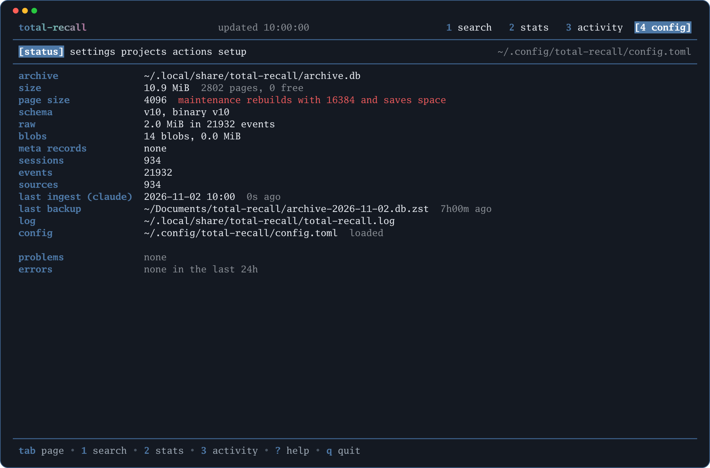

*Seite Status: Archiv, Schema, Zähler, letztes Backup, Fehler des Logs*

Was [`status`](10-befehle.md#status) ausgibt, als Tabelle: Pfad und Größe des Archivs mit Seitenzahl, Seitengröße (mit Hinweis, solange sie unter 16384 liegt), Schema der Datenbank und der Binary (`v4, binary v5` mit `migration pending: back up, then run migrate (actions)`, wenn die Datenbank hinter der Binary liegt), `raw` (die komprimierte Größe aller Rohzeilen und die Zahl der Events mit und ohne `raw`, siehe [Schema](40-schema.md#raw); bis zur Migration `unknown until the migration ran`; das Kompressionsverhältnis, das `status` aus einer Stichprobe schätzt, fehlt hier), Sessions, Events, Quellen, letztes Einlesen je Harness, letztes Backup, Log- und Config-Datei. Darunter die Probleme der Konfiguration, die nur die TUI und `stats` betreffen (siehe [Prüfung](20-konfiguration.md#pruefung)), und die `ERROR`-Zeilen des Logs der letzten 24 Stunden, neueste zuerst; ältere nur als Zahl (`status --all-errors` zeigt sie). Die Seite lädt mit dem [Neuladen](#neuladen) der TUI nach, nach jeder Aktion sofort.

### Settings

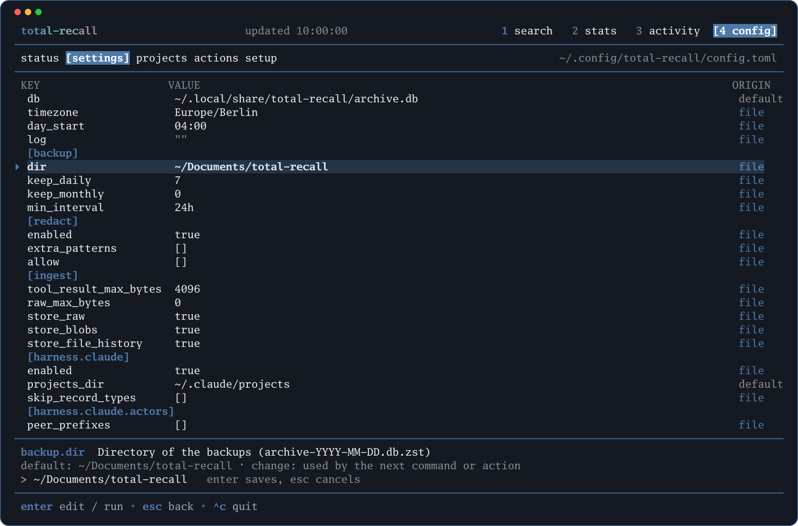

*Seite Settings: das Backup-Verzeichnis wird in der Eingabezeile bearbeitet*

Jeder Schlüssel der Konfiguration mit Wert und Herkunft (`default`, `file`, `env`, `flag`), nach Tabellen gruppiert wie [`config show`](10-befehle.md#config). Unter der Linie stehen zum markierten Schlüssel der Hilfetext, bei Aufzählungen die erlaubten Werte, und der Default. ++up++/++down++ (`k`/`j`), das Mausrad und ein Klick bewegen die Markierung.

++enter++ (`config_select`) ändert den markierten Wert: Ein Wahrheitswert kippt, eine Aufzählung (`view`, `rounding`, `count`, …) nimmt den nächsten Wert, alles andere öffnet eine Eingabezeile mit dem aktuellen Wert; ++enter++ übernimmt, ++esc++ verwirft. Der Text wird wie in der Datei gelesen: Zahlen (auch Dezimalzahlen wie `chart.scale`), Dauern (`20m`, `1h30m`, `0`), Uhrzeiten (`04:00`), Pfade, Listen als TOML-Array (`["a", "b"]`) oder durch Kommas getrennte Wörter (die Farbskala `chart.heatmap`). `d` (`config_default`) setzt den Schlüssel auf den Default zurück: die Zeile wird in der Datei auskommentiert.

Geschrieben wird nur, was die Prüfung besteht: Der neue Wert muss zum Typ passen und darf keinen neuen Fehler erzeugen, den `config show` melden würde; die Datei wird dazu so geladen wie beim Start. Ein abgelehnter Wert lässt die Datei unverändert, die Meldung steht in der Eingabezeile. Beim Schreiben bleiben alle Kommentare und die übrigen Zeilen erhalten, nur die eine Zeile ändert sich; ein in der Vorlage auskommentierter Schlüssel (`# reload = "5s"`) wird an seiner Stelle aktiviert, ein fehlender Schlüssel ans Ende seiner Tabelle gesetzt, eine fehlende Tabelle angelegt, eine fehlende Datei aus der Vorlage geschrieben. Vor jedem Schreiben entsteht `config.toml.bak`, geschrieben wird atomar (temporäre Datei, dann umbenannt). Wirkung: Die Zeile `default` unter der Linie sagt zu jedem Schlüssel, was eine Änderung tut, und die Meldung nach dem Schreiben wiederholt es.

- `applied at once`: Die laufende TUI übernimmt den Wert sofort, ohne Neustart und ohne Verlust von Markierung, Scrollposition und Eingabe. Das gilt für `reload` und `mouse`, die Tastenbelegung `[keys]` (Tasten, Fußzeile und Hilfe wechseln in allen Ansichten), `day_start` und die ganze Tabelle `[work]` (die Aktivität zeichnet ihre Zeilen mit den neuen Kernzeiten, dem neuen Ziel und den neuen Grenzen neu; eine neue Tagesgrenze oder ein anderes Bundesland lädt das Fenster neu, und die Statistik markiert die Feiertage neu; `count` schaltet die Zählweise um wie `h`), `tui.activity_projects` (schaltet die Projektfarben um wie `p`), `tui.activity_newest` (stellt den neuesten Tag nach oben oder unten wie `o`) und die Liste `[[project]]` (siehe [Projects](#projects)).
- `takes effect at the next start`: `db`, `timezone`, `view`, `graphics`, `stats_period`, `stats_dimension` und `activity_window` liest die TUI nur beim Start; sie bestimmen das Archiv und die Fenster der Ansichten, die bei einem Wechsel verloren gingen.
- `used by the next command or action`: alles andere nutzt die TUI nicht selbst. Hooks und Befehle lesen die Datei bei jedem Lauf, die [Aktionen](#actions) dieser Ansicht arbeiten mit dem Stand nach dem Schreiben.

Hat eine Tabelle nach einer Änderung im Editor (`E`) einen Fehler, den erst die Prüfung meldet (etwa ein Tastenkonflikt oder Kernzeiten vor `day_start`), behält die TUI die bisherigen Werte; der Status nennt das Problem.

Nicht auf dieser Seite änderbar: Werte, die eine Umgebungsvariable oder ein Flag setzt (die Datei wäre wirkungslos; die Meldung nennt die Quelle) und die Tabellen `[accounts]` und `[[worktime.category]]` (die Zeile zeigt je Kategorie Name, Muster und Farbe); dafür öffnet `E` (`config_editor`) die Datei in `$EDITOR`, nach dem Schließen liest die TUI die Konfiguration neu. Die Liste `[[project]]` steht hier ebenfalls als eine Zeile und wird auf der Seite [Projects](#projects) gepflegt.

### Projects

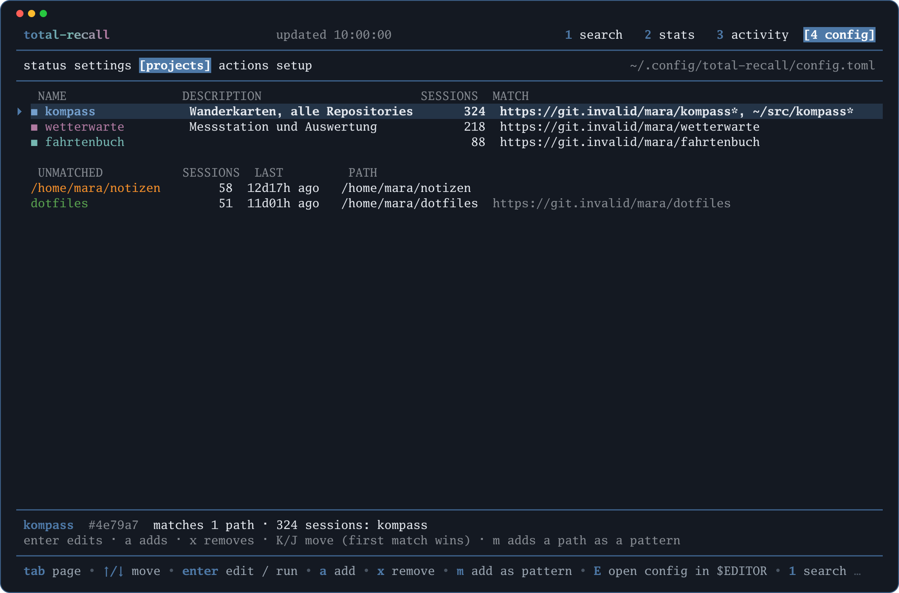

*Seite Projects: die Definitionen aus `[[project]]` mit Farbe, Beschreibung, Sessions und Mustern, darunter die Pfade des Archivs ohne Definition*

Die Projektdefinitionen der Konfiguration ([`[[project]]`](20-konfiguration.md#project)) in Dateireihenfolge, je Zeile ein Farbfeld in der konfigurierten Farbe (`·` ohne Farbe: das Projekt nimmt die nächste freie der Palette), Name, Beschreibung, die Zahl der Sessions des Archivs, die die Definition trifft, und die Muster. Darunter `UNMATCHED`: die Git-Roots und Verzeichnisse des Archivs, die keine Definition trifft, so wie die Statistik sie ohne Definition nennt, mit Sessionzahl, letzter Aktivität, Pfad und Remote-URL. Die Namen stehen in der Projektfarbe, der Definitionen wie der Pfade, genau wie in Statistik und Aktivität: die konfigurierte Farbe, sonst die automatische; in der markierten Zeile wird eine Farbe, die auf dem Hintergrund der Markierung schlecht lesbar wäre, heller oder dunkler, und im Formular folgt der Name der gewählten Farbe, ein neues Projekt bekommt seine automatische Farbe erst beim Speichern. Ohne Farben (`NO_COLOR`) bleibt der Name normal. Unter der Linie steht zur markierten Definition der Farbwert (`#4e79a7`), was sie trifft (`matches 2 paths · 57 sessions: kompass, kompass-api`) und was eine frühere Definition ihr wegnimmt (`kompass-api goes to kompass (earlier)`); zu einem Pfad seine Sessions und die Tasten, die etwas aus ihm machen. Hat die Liste einen Fehler (doppelter Name, unbekannte Farbe, Muster fehlt), steht er rot in der untersten Zeile, die Einträge bleiben bearbeitbar; `stats` und die Statistik der TUI arbeiten dann mit den abgeleiteten Namen. Ohne Definitionen erklärt die Kopfzeile, wie Sessions sonst heißen.

Tasten der Liste: ++enter++ (`config_select`) öffnet die markierte Definition im Formular, auf einem Pfad unter `UNMATCHED` ein neues Projekt aus ihm (Name wie abgeleitet, Muster die Remote-URL, ohne Repository der Pfad mit `~`); `a` (`config_add`) ebenso, auf einer Definition ein leeres Projekt; `x` (`config_remove`) entfernt die markierte Definition nach Rückfrage (`y` bestätigt, ++esc++ bricht ab); `K` / `J` (`config_move_up`, `config_move_down`) verschieben sie um eine Stelle, denn die erste passende Definition gewinnt; `m` (`config_pattern`) nimmt den markierten Pfad als Muster und fragt mit ++up++/++down++ und ++enter++, welche Definition es bekommt; `E` (`config_editor`) öffnet die Datei in `$EDITOR`.

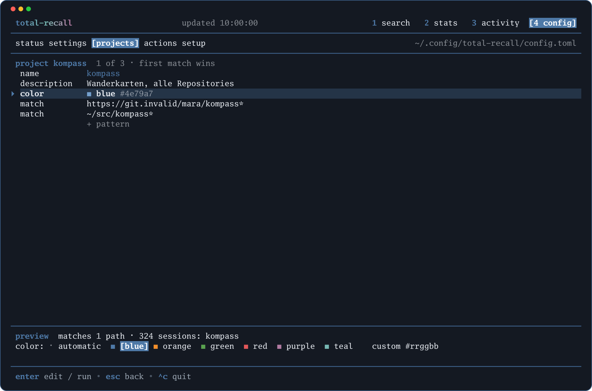

*Das Formular einer Definition mit offener Farbwahl; die Zeile `preview` sagt, was die Definition im Archiv trifft*

**Formular.** Eine Definition wird als Ganzes bearbeitet und mit `y` (`config_confirm`) geschrieben. Die Zeilen: `name`, `description`, `color`, je Muster `match`, zuletzt `+ pattern`. ++up++/++down++ bewegen die Markierung, ++enter++ öffnet beim Namen, der Beschreibung und einem Muster die Eingabezeile unten (++enter++ übernimmt den Text, ++esc++ verwirft ihn; ein leer gelassenes neues Muster verschwindet), bei `+ pattern` ein neues Muster, bei `color` die Farbwahl: eine Zeile mit `automatic`, den sechs Palettenfarben mit Farbfeld und `custom #rrggbb`; ++left++/++right++ (auch ++tab++, ++up++/++down++) wählen, ++enter++ nimmt die Wahl, `custom` öffnet die Eingabe für einen Wert `#rrggbb` (ein Palettenname geht dort auch), ++esc++ schließt die Farbwahl. `a` fügt ein Muster an, `x` entfernt das markierte, `d` (`config_default`) leert die Beschreibung bzw. setzt die Farbe auf automatisch. ++esc++ verlässt das Formular; bei ungesicherten Änderungen erst beim zweiten Mal, die Meldung sagt es. Im Formular nimmt die Seite jede Taste, auch ++tab++; die Fußzeile zeigt nur ihre Tasten.

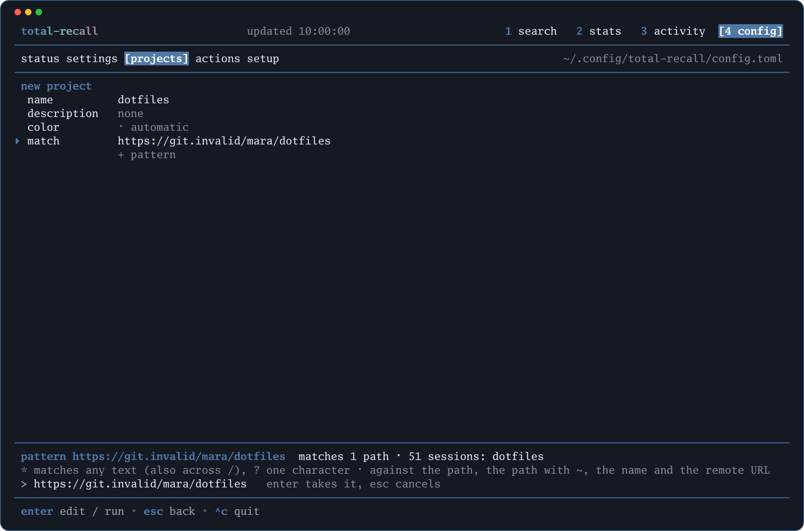

*Ein Muster in der Eingabezeile: die Zeile `pattern` zeigt beim Tippen, was es trifft*

**Vorschau.** Die Zeile unter der Linie rechnet den Entwurf gegen das Archiv: Ist ein Muster markiert oder in der Eingabezeile, zeigt `pattern <muster>` die Pfade, die genau dieses Muster trifft, mit ihrer Sessionzahl und den Namen, die sie ohne Definition hätten; sonst zeigt `preview` dasselbe für alle Muster der Definition. Ein Pfad, den eine frühere Definition bekommt, steht als `… goes to <name> (earlier)` dabei. Fehlt noch der Name oder ein Muster, sagt die Zeile das; ein doppelter Name erscheint hier, bevor er geschrieben wird. Die Vorschau zählt wie `UNMATCHED` Sessions der obersten Ebene, Subagenten zählen zur Eltern-Session.

**Schreiben.** Jede Änderung geht wie auf der Seite Settings in die Config-Datei: Anlegen hängt eine Tabelle `[[project]]` ans Ende der Liste (ein Muster als Text, mehrere als Liste), Bearbeiten ändert die Schlüssel der Tabelle und kommentiert eine geleerte Beschreibung oder Farbe aus, Löschen entfernt die Tabelle, Verschieben setzt sie an die andere Stelle; Kommentare und alle übrigen Zeilen bleiben, vorher entsteht `config.toml.bak`, geschrieben wird atomar und nur, was die Prüfung beim Laden besteht. Ein abgelehnter Entwurf (ohne Namen, ohne Muster, leeres Muster, unbekannte Farbe, doppelter Name) lässt die Datei unverändert, die Meldung steht in der untersten Zeile. Nach dem Schreiben übernimmt die TUI die Definitionen sofort: Statistik und Aktivität tauschen die Zuordnung aus, vergeben die Farben neu (konfigurierte zuerst, dann die freien der Palette in der Reihenfolge des Erscheinens) und laden neu; ein Neustart ist nicht nötig, die Meldung sagt `stats and activity reload`. Rezept: [Projekte definieren](../how-to/67-projekte-definieren.md).

### Actions

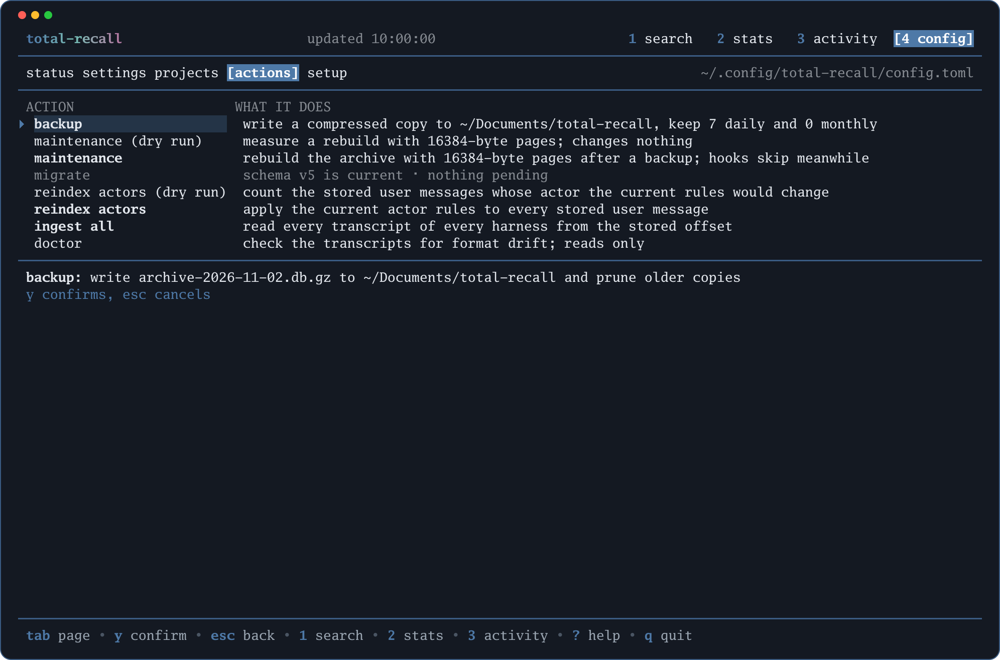

*Seite Actions: Backup wartet auf die Bestätigung*

Die Wartungsbefehle, im Prozess der TUI mit denselben Funktionen, Sperren und Logs wie in der CLI:

| Aktion | Entspricht | Schreibt |
|---|---|---|
| `backup` | [`backup`](10-befehle.md#backup) | ja: eine komprimierte Kopie in `dir` aus `[backup]`, ältere nach `keep_daily`/`keep_monthly` entfernt |
| `maintenance (dry run)` | [`maintenance --dry-run`](10-befehle.md#maintenance) | nein: misst den Neuaufbau |
| `maintenance` | [`maintenance`](10-befehle.md#maintenance) | ja: Backup, Neuaufbau mit 16-KiB-Seiten, Austausch; Hooks überspringen ihren Lauf |
| `migrate` | [`migrate`](10-befehle.md#migrate) | ja: nur anwählbar, solange der Status `migration pending` zeigt; legt `archive.db.pre-v<N>.bak` neben die Datenbank und migriert; Hooks überspringen ihren Lauf |
| `reindex actors (dry run)` | [`reindex --actors --dry-run`](10-befehle.md#reindex) | nein |
| `reindex actors` | [`reindex --actors`](10-befehle.md#reindex) | ja |
| `ingest all` | [`ingest --all`](10-befehle.md#ingest) | ja |
| `doctor` | [`doctor`](10-befehle.md#doctor) | nein: Formatprüfung der Transkripte |

++enter++ startet die markierte Aktion. Eine schreibende Aktion zeigt erst, was sie tun wird (`backup: write archive-2026-11-02-1000.db.zst to ~/Documents/total-recall and prune older backups`), und wartet auf `y` (`config_confirm`); ++esc++ bricht ab. Während eine Aktion läuft, stehen ihre Fortschrittszeilen unter der Liste (die Schritte von `maintenance`, die Fehler von `ingest`, der Bericht von `doctor`), ++esc++ bricht sie ab, und das automatische Neuladen der TUI pausiert, damit kein Leser die Wartung stört. Am Ende steht die Zusammenfassung des Befehls mit der Dauer, der Status lädt neu, und ein ausgetauschtes Archiv wird neu geöffnet. Fehlt das Archiv noch, sind nur `ingest all` und `doctor` anwählbar.

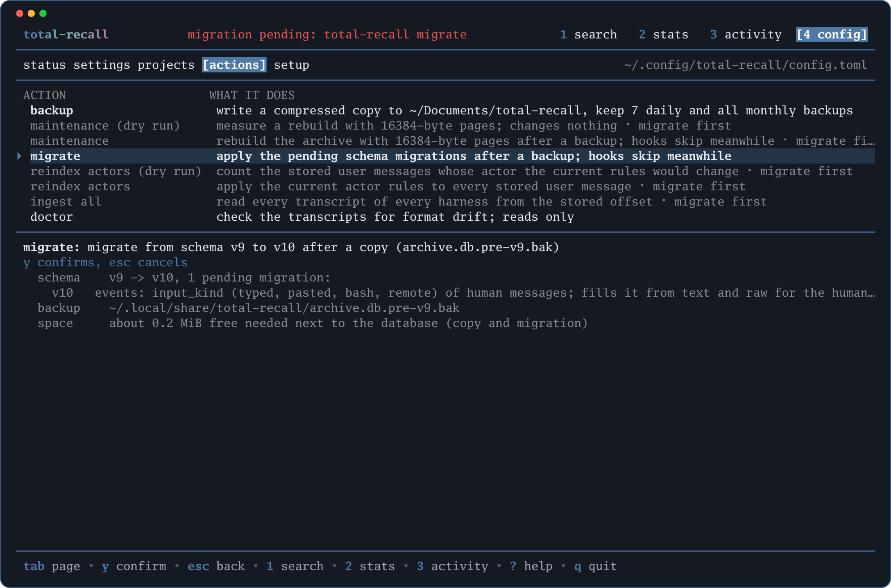

*Seite Actions bei anstehender Migration: der Plan wartet auf die Bestätigung*

**Anstehende Migration.** Liegt die Datenbank hinter dem Schema der Binary (Status: `migration pending`), schreibt außer `backup` nichts ins Archiv: `maintenance`, `reindex actors`, `ingest all` und die Probeläufe stehen mit `migrate first` da, wie die Befehle in der CLI. `migrate` ist dann anwählbar und zeigt vor der Bestätigung denselben Plan wie [`migrate`](10-befehle.md#migrate): die Versionen (`schema v4 -> v5, 1 pending migration`), je ausstehender Migration ihre Beschreibung, den Pfad der Kopie `archive.db.pre-v<N>.bak` und wie viel Platz neben der Datenbank frei sein muss (`space about 2.1 GiB …`). Gibt es noch kein Backup, sagt die Zeile `no backup yet, run backup first`. Nach `y` legt die Aktion die Kopie an, prüft den Platz, sperrt das Archiv wie `maintenance` und migriert; eine lange Migration meldet alle paar Sekunden ihren Fortschritt (`migration v5: 120000/233000 (51 %)`), ++esc++ bricht ab, die Datenbank bleibt dann, wie sie war. Danach lädt der Status neu, die Kopfzeile verliert ihren Hinweis, und der nächste Hook liest nach. Wie in der CLI ist die Datei direkt nach der Migration größer als vorher; `maintenance` baut sie neu auf, siehe [Aktualisieren](../how-to/10-installieren.md#aktualisieren).

### Setup

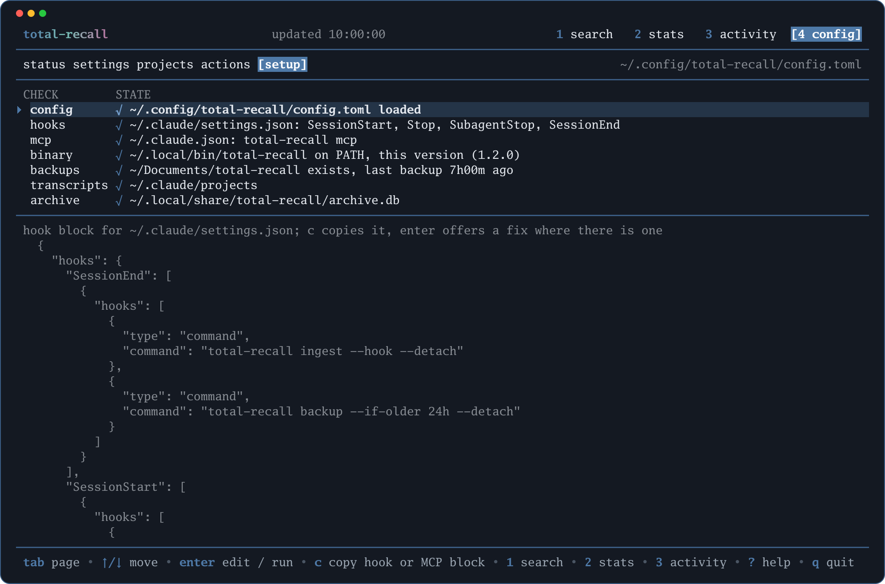

*Seite Setup: Prüfungen der Installation und der Hook-Block*

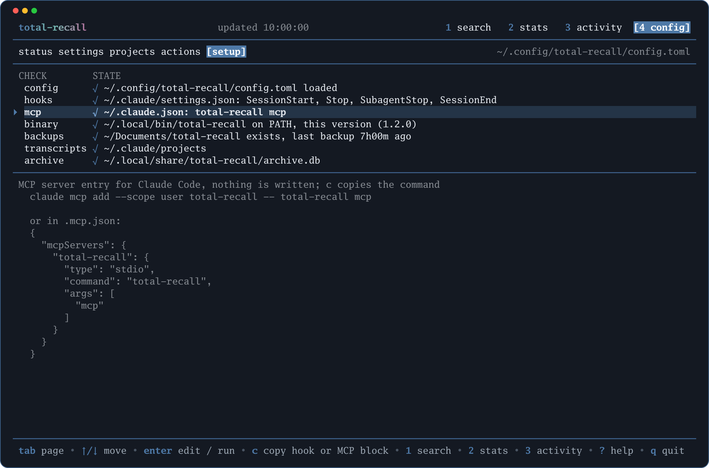

*Seite Setup: Die Zeile `mcp` ist markiert, darunter steht der Eintrag für den MCP-Server*

Sieben Prüfungen der Installation, je Zeile `√`, `!` (in Ordnung, mit Hinweis) oder `×`:

- **config:** Die Config-Datei ist geladen; Anzahl der Probleme, falls welche. Fehlt sie, bietet ++enter++ an, die kommentierte Vorlage zu schreiben (wie `config init`).
- **hooks:** `~/.claude/settings.json` (bzw. `$CLAUDE_CONFIG_DIR/settings.json`) hat für `SessionStart`, `Stop`, `SubagentStop` und `SessionEnd` einen Hook mit `total-recall ingest --hook`, `SessionEnd` zusätzlich das Backup; fehlende Ereignisse werden genannt. Die Datei wird nur gelesen.
- **mcp:** Der MCP-Server ist bei Claude Code eingetragen ([Archiv per MCP anbinden](../how-to/55-mcp-anbinden.md)): Die Seite liest nur den Schlüssel `mcpServers` aus `~/.claude.json` (bzw. `$CLAUDE_CONFIG_DIR/.claude.json`) und aus der `.mcp.json` im Arbeitsverzeichnis, sucht einen Eintrag `total-recall mcp` und prüft, dass sein Befehl existiert. Ohne Eintrag ist die Zeile ein `×` mit dem Hinweis „optional“. Beide Dateien werden nie geschrieben, und nichts sonst aus ihnen wird gelesen oder gezeigt. Ist die Zeile markiert, zeigt die Seite statt des Hook-Blocks den Befehl `claude mcp add …` und den JSON-Eintrag; ++c++ kopiert den Befehl.
- **binary:** `total-recall` liegt im `PATH`; ist es eine andere Datei als die laufende, wird ihre Version verglichen (`is 1.1.0, this is 1.2.0`).
- **backups:** Das Backup-Verzeichnis existiert und wann das letzte Backup war. Fehlt es, legt ++enter++ es nach Bestätigung an.
- **transcripts:** Das Transkript-Verzeichnis der Harness (`projects_dir`) existiert.
- **archive:** Die Datenbank existiert.

Unter den Prüfungen steht der Hook-Block für Claude Code, wie ihn [`hooks print`](10-befehle.md#hooks-print) ausgibt; `c` (`config_copy`) kopiert ihn in die Zwischenablage (über das Terminal, OSC 52). Eintragen muss man ihn selbst, siehe [Hooks einrichten](../how-to/20-hooks-einrichten.md); die TUI schreibt nicht in die Einstellungen von Claude Code.

## Tasten

Die Standardbelegung ist für ein deutsches Mac-Layout gewählt: Keine Aktion hängt an einer Taste, die dort nur mit ++option++ erreichbar ist (`[ ] { } | \ ~ @`). Wo `[` und `]` naheliegen, sind sie Zweitbelegung hinter ++left++/++right++ und `,`/`.`. Die Fußzeile und die Hilfe (`?`) zeigen immer die tatsächlich wirksamen Tasten. Jede Aktion lässt sich umbelegen, siehe [Tastenbelegung anpassen](#tastenbelegung-anpassen); die Aktionsnamen stehen in den Tabellen.

### Überall

| Taste | Aktion | Wirkung |
|---|---|---|
| `1` / `2` / `3` / `4` | `global_search` / `global_stats` / `global_activity` / `global_config` | Suche / Statistik / Aktivität / Config; schließt eine offene Session |
| ++tab++ / ++shift+tab++ | `search_focus` | Fokus innerhalb der Ansicht wechseln: in der Suche Eingabe ↔ Liste. Wechselt nie die Ansicht |
| `?` | `global_help` | Hilfe ein/aus |
| ++esc++ | `global_back` | eine Ebene zurück: Session → Suche, Hilfe schließen, Liste → Eingabe, Repo-Filter abbrechen |
| `q` | `global_quit` | beenden (nicht, solange Eingabe oder Repo-Filter den Fokus haben; eine Belegung mit ++ctrl++ beendet auch dort) |
| `R` | `global_reload` | die sichtbare Ansicht sofort neu laden, siehe [Neuladen](#neuladen) |
| ++ctrl+c++ | – | beenden, immer; nicht umbelegbar |
| Maus | – | Rad blättert, Klick auf einen Tab wechselt die Ansicht, Klick auf einen Tastenhinweis in der Fußzeile drückt die Taste; siehe [Maus](#maus) |

### Suche

| Taste | Aktion | Eingabe hat den Fokus | Liste hat den Fokus |
|---|---|---|---|
| ++tab++ / ++shift+tab++ | `search_focus` | in die Liste | in die Eingabe |
| ++esc++ | `global_back` | – | in die Eingabe |
| ++enter++ | `search_open` | markierten Treffer öffnen | markierten Treffer öffnen |
| ++up++ / `k`, ++down++ / `j` | `search_up`, `search_down` | – | Markierung bewegen |
| `a`, `t`, `r` | `search_actor`, `search_time`, `search_repo` | Suchtext | Filter Actor, Zeitraum, Repo |
| `e`, `s`, `m` | `search_type_event`, `search_type_session`, `search_type_memory` | Suchtext | Typ `event`, `session`, `memory` ein/aus |
| `p`, `P` | `search_pin`, `search_project` | Suchtext | Projekt des markierten Treffers pinnen oder den Pin aufheben; Liste der Projekte öffnen |
| `v` | `search_attach` | Suchtext | Anhänge des markierten Events ansehen (nur bei einem Treffer mit Anhang) |
| ++ctrl+r++ | `search_raw` | Rohsyntax ein/aus | Rohsyntax ein/aus |

Im Repo-Filter: ++enter++ (`search_open`) oder ++tab++ (`search_focus`) übernimmt, ++esc++ (`global_back`) verwirft; siehe [Fokus](#fokus). In der Projektliste: ++up++/++down++ (`search_up`, `search_down`) bewegen, ++enter++ (`search_open`) pinnt, ++esc++ (`global_back`) bricht ab.

### Session

| Taste | Aktion | Wirkung |
|---|---|---|
| ++up++ / `k`, ++down++ / `j` | `session_up`, `session_down` | eine Zeile |
| `b` / ++pgup++, `f` / ++pgdn++ / ++space++ | `session_page_up`, `session_page_down` | eine Seite |
| `u` / ++ctrl+u++, `d` / ++ctrl+d++ | `session_half_up`, `session_half_down` | eine halbe Seite |
| `g` / ++home++, `G` / ++end++ | `session_top`, `session_bottom` | Anfang / Ende |
| `n` / `N` | `session_next`, `session_prev` | nächster / voriger Treffer |
| `T` | `session_tools` | Tool-Events ein/aus |
| `y` | `session_copy` | Session-ID kopieren |
| `v` | `session_attach` | Anhänge der Session ansehen (nur in einer Session mit Anhängen) |
| ++esc++ | `global_back` | zurück zur Suche |

### Memory

| Taste | Aktion | Wirkung |
|---|---|---|
| ++up++ / `k`, ++down++ / `j` | `memory_up`, `memory_down` | Markierung bewegen (Dateien oder Versionen) |
| ++enter++ | `memory_open` | Verlauf der markierten Datei; in der Zeitleiste der Verlauf der Datei auf der markierten Version |
| `d` | `memory_diff` | im Verlauf: Diff statt Inhalt, ein/aus |
| `c` | `memory_base` | im Verlauf: die markierte Version als Basis des Diffs merken oder lösen |
| `t` | `memory_timeline` | Zeitleiste des Projekts |
| `b` / ++pgup++, `f` / ++pgdn++ / ++space++ | `memory_page_up`, `memory_page_down` | den Text blättern |
| ++esc++ | `global_back` | eine Seite zurück, von den Dateien zur Suche |

### Anhänge

| Taste | Aktion | Wirkung |
|---|---|---|
| ++left++ / `p`, ++right++ / `n` | `attach_prev`, `attach_next` | voriger / nächster Anhang der Session |
| ++up++ / `k`, ++down++ / `j` | `attach_up`, `attach_down` | den Inhalt zeilenweise scrollen |
| `b` / ++pgup++, `f` / ++pgdn++ / ++space++ | `attach_page_up`, `attach_page_down` | den Inhalt seitenweise scrollen |
| `o` / ++enter++ | `attach_open` | den Anhang mit dem Programm des Systems öffnen |
| ++esc++ | `global_back` | zurück zur Suche bzw. zur Session |

### Statistik

| Taste | Aktion | Wirkung |
|---|---|---|
| `d` / `w` / `m` | `stats_days`, `stats_weeks`, `stats_months` | Periode Tag / Woche / Monat |
| `p` / `a` / `v` | `stats_project`, `stats_agent`, `stats_directory` | Dimension Projekt / Agent / Verzeichnis |
| ++left++ / ++right++, `,` / `.`, `[` / `]` | `stats_earlier`, `stats_later` | ein Fenster zurück / vor |
| `-` / `+` | `stats_zoom_out`, `stats_zoom_in` | Fenster halbieren / verdoppeln (`=` wie `+`) |
| `e` | `stats_metric` | Kennzahl: events → human → sessions |
| `h` | `stats_heatmap` | Heatmap ein/aus |
| `g` | `stats_graphics` | Grafikmodus: auto → text → kitty → auto |

### Aktivität

| Taste | Aktion | Wirkung |
|---|---|---|
| `d` / `w` / `m` | `activity_day`, `activity_week`, `activity_month` | Fenster ein Tag / eine Woche / ein Monat |
| ++left++ / ++right++, `,` / `.`, `[` / `]` | `activity_earlier`, `activity_later` | eine Periode zurück / vor (nicht über die laufende hinaus) |
| `c` | `activity_current` | heute / diese Woche / dieser Monat |
| `l` | `activity_last` | gestern / letzte Woche / letzter Monat |
| `h` | `activity_human` | Zählweise: nur eigene Nachrichten ↔ alle Events |
| `s` | `activity_figures` | Kennzahlen (Median, Mittelwert, Min/Max) ein/aus |
| `p` | `activity_projects` | Balken nach Projekt statt nach Kernzeit färben, mit Legende |
| `o` | `activity_order` | neuester Tag unten ↔ oben |
| ++up++ / `k`, ++down++ / `j` | `activity_up`, `activity_down` | die Zeile darüber / darunter: erst durch die Zeilen der Periode scrollen, dann die Periode um einen Tag rücken (mit dem neuesten Tag unten ist ++up++ zurück, ++down++ vor; oben umgekehrt) |

### Config

| Taste | Aktion | Wirkung |
|---|---|---|
| ++tab++ / ++right++, ++shift+tab++ / ++left++ | `config_next`, `config_prev` | nächste / vorige Seite |
| ++up++ / `k`, ++down++ / `j` | `config_up`, `config_down` | Markierung bewegen |
| ++enter++ | `config_select` | Wert ändern (Settings), Aktion starten (Actions), Korrektur anbieten (Setup); in der Eingabezeile übernehmen |
| `d` | `config_default` | markierten Schlüssel auf den Default zurücksetzen (Settings) |
| `y` | `config_confirm` | schreibende Aktion oder Korrektur bestätigen |
| `c` | `config_copy` | Hook-Block in die Zwischenablage (Setup) |
| `E` | `config_editor` | Config-Datei in `$EDITOR` öffnen, danach neu laden (Settings, Projects) |
| `a` | `config_add` | Projekt anlegen, aus dem markierten Pfad oder leer; im Formular ein Muster anfügen (Projects) |
| `x` | `config_remove` | markierte Definition nach Rückfrage entfernen; im Formular das markierte Muster (Projects) |
| `K` / `J` | `config_move_up`, `config_move_down` | markierte Definition in der Datei nach oben / unten verschieben (Projects) |
| `m` | `config_pattern` | markierten Pfad als Muster einer Definition hinzufügen (Projects) |
| ++esc++ | `global_back` | Eingabe verwerfen, Bestätigung abbrechen, laufende Aktion abbrechen, Meldung löschen |

### Tastenbelegung anpassen { #tastenbelegung-anpassen }

Im Abschnitt `[keys]` der [Konfiguration](20-konfiguration.md#keys) steht je Aktion eine Taste oder eine Liste von Tasten. Nur genannte Aktionen ändern sich, alle anderen behalten die Standardbelegung aus den Tabellen oben. Die Aktionsnamen tragen die Ansicht als Präfix (`global_`, `search_`, `session_`, `stats_`, `activity_`, `config_`). Auf der Seite [Settings](#settings) der Ansicht Config steht jede Aktion als `keys.<aktion>`; eine dort geänderte Belegung gilt sofort in allen Ansichten, in der Fußzeile und in der Hilfe.

```toml
[keys]
global_quit = ["q", "ctrl+q"]      # Liste: jede Taste löst aus
stats_earlier = "<"                # oder eine einzelne Taste
stats_later = ">"
activity_earlier = "<"
activity_later = ">"
```

**Tastennamen.** Ein einzelnes Zeichen (`a`, `G`, `?`, `,`, `ü`) oder ein Name: `up`, `down`, `left`, `right`, `enter`, `tab`, `esc`, `space`, `backspace`, `delete`, `insert`, `home`, `end`, `pgup`, `pgdown`, `f1` bis `f20`. Davor `ctrl+`, `alt+` oder `shift+` (`ctrl+r`, `shift+tab`, `ctrl+shift+up`). Groß- und Kleinschreibung ist bei Namen egal; ein einzelnes Zeichen mit ++shift++ schreibt man als Großbuchstaben (`G`, nicht `shift+g`), `ctrl+R` und `ctrl+r` sind dieselbe Taste.

**Regeln.**

- Innerhalb einer Ansicht gehört jede Taste zu höchstens einer Aktion, und die globalen Tasten (`global_*`) dürfen in keiner Ansicht noch einmal vorkommen. Verschiedene Ansichten dürfen dieselbe Taste nutzen (`a` ist in der Suche der Actor-Filter und in der Statistik die Dimension Agent).
- ++ctrl+c++ beendet immer und lässt sich nicht belegen. Eine Belegung von `global_quit` mit ++ctrl++ (etwa `ctrl+q`) beendet auch, während ein Eingabefeld den Fokus hat.
- Eingabefelder fangen nichts ab: Solange die Suche oder der Repo-Filter den Fokus hat, ist jedes Zeichen Text, egal wie es belegt ist. Der [Fokusvertrag](#fokus) gilt unverändert; `search_focus` und `global_back` sind die einzigen Tasten, die dort etwas anderes tun.
- Ein unbekannter Aktionsname, eine unbekannte Taste oder ein Konflikt ist ein Fehler, aber nur für die Befehle, die die Belegung brauchen: `total-recall tui` bricht beim Start ab, `total-recall config show` und `total-recall doctor` melden ihn. Hooks, Ingest und die übrigen Befehle laufen weiter, damit ein Tippfehler in `[keys]` nie die Archivierung stoppt:

```text
config: [keys] "e" is bound to both stats_days and stats_metric
```

`total-recall config show` listet jede Aktion als `keys.<aktion>` mit ihrer wirksamen Belegung und der Herkunft (`default` oder `file`).

## Grafikmodi

Das Chart der Statistik gibt es als Text (Blockzeichen, überall) und als Bild über das Kitty-Graphics-Protokoll. Umschalter, Legende, Tabelle und Heatmap bleiben in jedem Fall Text.

| Modus | Verhalten |
|---|---|
| `auto` (Default) | Beim Start wird das Terminal einmal sondiert. Ein Bild gibt es nur, wenn die Sondierung beantwortet wird **und** die Umgebung ein Terminal nennt, das Bilder über Unicode-Platzhalter darstellen kann: Ghostty, kitty oder herdr. Bis dahin und sonst: Text. |
| `text` | Nie sondieren, nie ein Bild. Es geht keine Abfrage ans Terminal. |
| `kitty` | Bild erzwingen, ohne Sondierung. Für Terminals, die die Erkennung nicht überstehen (etwa hinter ssh oder tmux), zeigt in anderen Terminals aber nur Platzhalterzeichen. |

`g` wechselt zur Laufzeit `auto` → `text` → `kitty` → `auto`. Die Statuszeile nennt den Modus und bei `auto` den Grund, wenn kein Bild gezeigt wird:

| Statuszeile | Bedeutung |
|---|---|
| `image chart (kitty)` | Bild wird gezeigt |
| `image chart (kitty, forced)` | Bild erzwungen (`--graphics kitty` oder `g`) |
| `text chart` | Modus `text` |
| `text chart (kitty: probing…)` | Sondierung läuft |
| `text chart (kitty: rendering…)` | Bild entschieden, aber noch nicht platziert |
| `text chart (kitty: not detected)` | Umgebung nennt kein Kitty-fähiges Terminal; es wurde nichts gesendet |
| `text chart (kitty: no answer)` | Abfrage ohne Antwort innerhalb von 250 ms |
| `text chart (kitty: no answer; tmux allow-passthrough?)` | dasselbe in tmux: meist fehlt `allow-passthrough` |
| `text chart (kitty: no answer; herdr kitty_graphics off?)` | dasselbe in herdr: `terminal.kitty_graphics` ist aus oder das äußere Terminal kann keine Kitty Graphics |
| `text chart (kitty: outer terminal unknown)` | tmux hat geantwortet, aber nichts weist auf Ghostty hin |
| `text chart (kitty: no placeholders in …)` | das Terminal antwortet, kann aber keine Unicode-Platzhalter (WezTerm, Konsole) |
| `text chart (kitty: ghostty 1.3.x in tmux needs 1.4)` | Ghostty vor 1.4 zeigt Platzhalter in tmux fehlerhaft |
| `text chart (kitty: not probed)` | zurück auf `auto`, aber die Sondierung kann in diesem Prozess nicht mehr laufen |
| `text chart (kitty: render error)` | das Bild konnte nicht gerendert werden |

### Voraussetzungen

| Umgebung | Ergebnis |
|---|---|
| Ghostty ≥ 1.0, nativ | Bild |
| kitty | Bild |
| Ghostty in tmux ≥ 3.3 | Bild, wenn `allow-passthrough` an ist, der tmux-Server aus Ghostty gestartet wurde und Ghostty ≥ 1.4 ist; sonst Text mit Grund |
| herdr in Ghostty | Bild, wenn herdr die Sondierung beantwortet: `terminal.kitty_graphics` an und ein äußeres Terminal mit Kitty Graphics; sonst Text mit Grund |
| tmux ohne Passthrough, Zellij | Text, Hinweis in der Statuszeile |
| WezTerm, Konsole, Warp | Text: sie beantworten die Sondierung, zeigen Platzhalter aber als Zeichensalat |
| Terminal.app, iTerm2, Alacritty, Windows Terminal | Text |
| ssh | Bild, wenn die entfernte Shell `TERM=xterm-ghostty` sieht (ssh reicht `TERM` standardmäßig durch) und `COLORTERM=truecolor` gesetzt ist; sonst Text, `g` `g` erzwingt |

**tmux.** Die Bildsequenzen werden in DCS-Passthrough verpackt; dafür muss tmux ≥ 3.3 sie durchlassen:

```text
# ~/.tmux.conf
set -g allow-passthrough on
```

tmux ersetzt in seinen Panes `TERM` und `TERM_PROGRAM`, daher erkennt die TUI Ghostty dort an `GHOSTTY_RESOURCES_DIR` bzw. `GHOSTTY_BIN_DIR`. Die Variablen hat nur ein tmux-Server, der aus Ghostty heraus gestartet wurde (`tmux show-environment -g | grep GHOSTTY`). Fehlen sie, meldet die Statuszeile `outer terminal unknown`; dann hilft ein Neustart des tmux-Servers aus Ghostty, die Variable beim Aufruf (`GHOSTTY_RESOURCES_DIR=1 total-recall tui stats`) oder `g` `g` zum Erzwingen.

**herdr.** herdr setzt in seinen Panes `TERM_PROGRAM=herdr` und `TERM=xterm-256color` und reicht die Ghostty-Variablen nicht durch. Die Chart-Bibliothek würde dort gar nicht sondieren, deshalb schickt die TUI die Kitty-Abfrage (`a=q`) selbst und wartet 250 ms. herdr zeichnet Platzhalter selbst und reicht das Bild an das äußere Terminal weiter; es antwortet nur, solange `terminal.kitty_graphics` an ist und das äußere Terminal Kitty Graphics kann. Bleibt die Antwort aus, meldet die Statuszeile `no answer; herdr kitty_graphics off?`, `g` `g` erzwingt. `NTCHARTS_KITTY=supported|unsupported` gilt auch in herdr und ersetzt die Abfrage.

**ssh.** Die Sondierung läuft durch ssh hindurch, die Umgebungsvariablen nicht alle: `TERM` kommt an, `TERM_PROGRAM` und `COLORTERM` normalerweise nicht. Ohne Truecolor gehen die Platzhalter kaputt (die Bild-ID steckt in der Vordergrundfarbe), also auf der Gegenseite `COLORTERM=truecolor` setzen oder per `SendEnv`/`AcceptEnv` durchreichen.

**Wie das Bild entsteht.** Das Chart wird außerhalb der Hauptschleife als PNG gerendert, einmal je Änderung an das Terminal übertragen und über Unicode-Platzhalterzellen platziert; der Hintergrund ist transparent, Terminalfarben scheinen durch. Die Bildgröße folgt der Zellenzahl des Chart-Bereichs mal Zellgröße in Pixeln, die das Terminal auf Anfrage meldet (Rückfall 10×20 px). Ein Wechsel von Periode, Dimension, Kennzahl, Fenster oder Größe ersetzt das Bild; die Heatmap verkleinert den Chart-Bereich.

!!! warning "Noch nicht in echten Terminals geprüft"
    Der Bildpfad ist bisher nur in einem Pseudo-Terminal mit nachgestellten Ghostty-Antworten getestet. Die manuelle Prüfung in Ghostty (nativ, in tmux mit und ohne Passthrough), Terminal.app und bei 80×24 steht aus ([#40](https://github.com/seletz/total-recall/issues/40)); der Textpfad ist davon unabhängig.

## Bekannte Grenzen

- **Suche:** höchstens 200 Treffer je Abfrage, sortiert nach Rang. Der Zeitfilter startet bei `all`, nicht bei 90 Tagen. Die Filter `a`, `t`, `r` wirken nur, wenn die Liste den Fokus hat.
- **Projektnamen** kommen zuerst aus den Definitionen [`[[project]]`](20-konfiguration.md#project): Die erste passende Definition gibt Name und Farbe, mehrere Repositories mit derselben Definition sind ein Projekt. Sessions ohne Definition behalten die Heuristik: Repositories heißen wie der Basisname ihres Git-Roots (bei gleichen Namen mit so vielen übergeordneten Verzeichnissen wie nötig), Verzeichnisse ohne Repository erscheinen als Pfad, das Home-Verzeichnis darin als `~` (`~/notes`). Eine konfigurierte Farbe gilt in Chart und Legende, die übrigen Projekte nehmen die freien Farben der Palette. Gepflegt werden die Definitionen auf der Seite [Projects](#projects) der Ansicht Config oder in der Datei.
- **Heatmap** nur ab etwa 25 Terminalzeilen.
- **Aktivität:** der Balken ist nur Text, kein Bild; die Tagesgrenze kommt aus der Config, nicht aus der Ansicht; kein Sprung aus einem Tag in die Session. Feiertage kennt nur Deutschland (je Bundesland); Urlaub und Krankheit sind der Ansicht unbekannt und zählen als Arbeitstage ohne Aktivität.
- **Statistik:** Feiertage markiert nur das Text-Chart in der Achse; das Bild (Kitty Graphics) hat keine farbigen Achsenbeschriftungen.
- **Bilder** nur in Ghostty, kitty und herdr; andere Terminals mit Kitty Graphics, aber ohne Platzhalter, bekommen Text. Sixel und das iTerm2-Protokoll werden nicht angeboten.
- **Anhänge:** Bilder nur als Text, die Kitty-Grafik folgt; ein PDF zeigt nur Metadaten, keine Seite; der Anhang-Viewer blättert durch die Anhänge **einer Session**, nicht über Sessions hinweg. Anhänge aus Tool-Ergebnissen erscheinen in der Session nur mit eingeblendeten Tools.
- **Maus:** Klicks schalten Umschalter, Tabs, Treffer und Zeilen (siehe [Maus](#maus)); kein Ziehen in Listen, kein Klick in die Vorschau, auf einen Balken oder in die Heatmap. Textauswahl nur mit Zusatztaste des Terminals oder mit `--no-mouse`.
- **Zwischenablage** über OSC 52; das Terminal muss es erlauben (in tmux `set -g set-clipboard on`).
- **Neuladen** lädt die Daten, nicht die Uhr: Das Fenster der Statistik und der Aktivität bleibt an dem Tag hängen, an dem die TUI gestartet wurde; nach Mitternacht hilft `c` bzw. ein Neustart.
- **Große Sessions:** Vorschau und Detail laden den Verlauf vollständig; bei Sessions mit mehreren zehntausend Events dauert das Einblenden der Tools einen Moment (gemessen unter 0,1 s).
