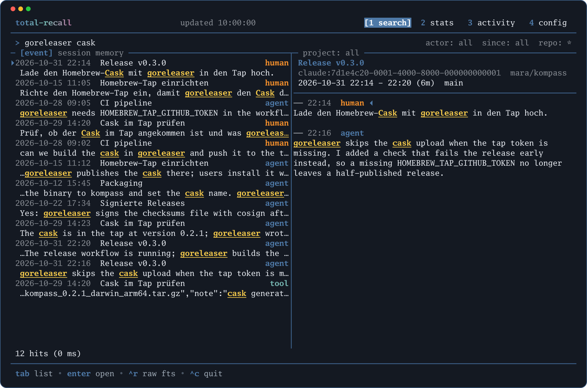

# total-recall

`total-recall` archiviert die Sessions von Coding-Agenten (zuerst Claude Code) in einer lokalen SQLite-Datenbank und macht sie durchsuchbar und auswertbar, für Menschen und für Agenten. Claude Code löscht alte Transkripte nach einigen Wochen; `total-recall` liest sie über Hooks laufend ein und hebt sie auf. Es läuft kein Hintergrunddienst, die Datenbank bleibt auf dem eigenen Rechner, Geheimnisse werden vor dem Speichern maskiert.



Dokumentation: <https://seletz.github.io/total-recall/>. Die Quellen liegen unter [docs/](docs/), nach [Diátaxis](https://diataxis.fr/) gegliedert; die Spezifikation ist [docs/explanation/design.md](docs/explanation/design.md), die Änderungen je Version stehen in [docs/reference/90-aenderungen.md](docs/reference/90-aenderungen.md).

## Was es kann

- **Einlesen über Hooks**, inkrementell und ohne Daemon; beim Session-Start wird alles nachgelesen, was fehlt.
- **Befehle:** `sessions`, `show`, `search` (Volltext über FTS5), `stats` (je Tag, Repo und Wochentag × Stunde; Zeitreihen mit `--period`/`--by`; Arbeitszeit je Tag mit `--workday`; Arbeitszeit je Projekt für Stundenzettel mit `--worktime`), `sql` (nur lesend), `backup`/`restore`, `doctor` für Format-Drift. Alle lesenden Befehle haben `--json`.
- **TUI** (`total-recall tui`): Suche mit Vorschau beim Tippen und Sprung in die Session, Statistik als Chart (Text oder Kitty Graphics), Tabelle und Heatmap, erste und letzte Aktivität je Tag mit Kernzeit, Soll und Feiertagen. Mausbedienung, Theme nach Terminalhintergrund, Tasten umbelegbar.
- **Für Agenten:** `total-recall llm --skill` gibt eine Anleitung mit Schema und Beispiel-SQL aus.

## Installation

Unterstützt werden macOS und Linux (amd64, arm64). Das Binary ist statisch gebaut und hat keine Abhängigkeiten.

**Release-Archiv.** Jedes [Release](https://github.com/seletz/total-recall/releases) trägt je Plattform ein Archiv `total-recall-<tag>-<os>-<arch>.tar.gz` mit dem Binary und den Shell-Vervollständigungen, dazu eine SBOM (CycloneDX) und die Datei `checksums-<tag>.txt` mit den SHA-256-Summen. Beispiel für macOS auf Apple Silicon:

```sh
tag=v1.0.0
curl -LO https://github.com/seletz/total-recall/releases/download/$tag/total-recall-$tag-darwin-arm64.tar.gz
curl -LO https://github.com/seletz/total-recall/releases/download/$tag/checksums-$tag.txt
shasum -a 256 --ignore-missing -c checksums-$tag.txt
tar -xzf total-recall-$tag-darwin-arm64.tar.gz
install -m 0755 total-recall ~/.local/bin/
total-recall --version
```

**Homebrew** (ab v1.0.0, Cask im Tap `seletz/homebrew-tap`):

```sh
brew install --cask seletz/tap/total-recall
```

**Aus dem Quellcode:** `mise run build` baut `./total-recall`, oder `CGO_ENABLED=0 go install github.com/seletz/total-recall/cmd/total-recall@latest`.

Alle Wege im Einzelnen, samt Prüfung von Checksummen und SBOM: [Installieren](https://seletz.github.io/total-recall/how-to/10-installieren/) und [Release-Assets](https://seletz.github.io/total-recall/reference/50-release/).

## Erste Schritte

```sh
total-recall hooks print --harness claude   # Hook-Block für ~/.claude/settings.json ausgeben
total-recall ingest --all                   # alle vorhandenen Transkripte einlesen
total-recall sessions --since 2026-10-01    # Sessions auflisten
total-recall search "flaky test"            # Volltextsuche
total-recall tui                            # Terminal-Oberfläche
```

Den Hook-Block in `~/.claude/settings.json` eintragen, danach liest jede Session sich selbst ein. Schritt für Schritt: [Erste Schritte](https://seletz.github.io/total-recall/tutorials/erste-schritte/); was jeder Hook tut: [Hooks einrichten](https://seletz.github.io/total-recall/how-to/20-hooks-einrichten/).

## Entwicklung

Voraussetzungen: Go (Version laut `go.mod`) und [mise](https://mise.jdx.dev/); `mise install` holt den Rest.

```sh
mise run build        # Binary bauen
mise run test         # go test ./... gegen das synthetische Demo-Archiv
mise run lint         # go vet und golangci-lint
mise run docs:serve   # Doku lokal mit Zensical
mise run docs:screenshots        # Screenshots der TUI neu erzeugen (nach jeder TUI-Änderung)
mise run docs:screenshots:check  # prüft, ob die eingecheckten Screenshots aktuell sind (läuft in der CI)
mise run release:snapshot        # Release-Archive, SBOMs und Checksummen lokal nach dist/ bauen
```

Branches gehen von `develop` ab, Pull Requests zurück nach `develop`; Commits im Conventional-Commit-Stil. Tests, Fixtures und Doku enthalten nur erfundene Daten, nie echte Transkripte.

## Lizenz

MIT, siehe [LICENSE](LICENSE).
